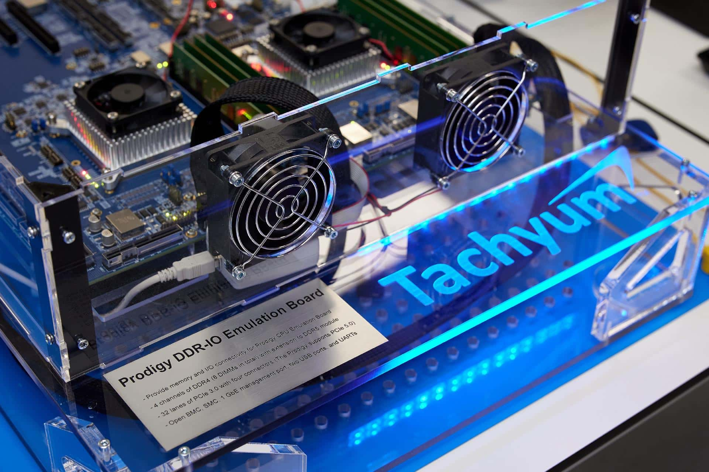

Prodigy nunca llegó a un socket. Ese es el dato que ordena toda la historia: Tachyum, la empresa eslovaca que desde 2018 prometía un procesador «universal» para centros de datos, presentó el 22 de octubre de 2026 su propio concurso de acreedores ante el Tribunal Municipal de Bratislava III. La resolución que abrió el procedimiento la publicó Forbes Eslovaquia el 29 de octubre, y Tom's Hardware añadió después el detalle societario que más pesa sobre el futuro de la tecnología: la propiedad intelectual de Prodigy no está en la filial quebrada.

## Qué consta en el expediente del concurso

La resolución judicial es breve y no deja margen a la interpretación. El tribunal registra que el propio deudor presentó el 22 de octubre la solicitud de declaración de concurso sobre su patrimonio, y que la petición cumple los requisitos de la Ley de concurso y reestructuración. Añade un principio legal relevante: cuando es el deudor quien solicita el concurso, se presume su insolvencia. No hubo, por tanto, un acreedor empujando el proceso; fue la compañía la que se puso en manos del juzgado.

A partir de ahí entra en juego el procedimiento eslovaco habitual: un administrador designado por el tribunal gestiona los activos de la empresa, que después se venden para pagar a los acreedores. Eso es lo que figura en los documentos. Lo que no figura, ni en la resolución ni en ninguna comunicación de la empresa, es un plan de continuidad para Prodigy.

## La estructura societaria que decide el futuro de Prodigy

Aquí está el matiz que separa «empresa quebrada» de «tecnología muerta». Según la actualización de Tom's Hardware, la matriz última y titular de toda la propiedad intelectual de Tachyum es Tachyum Ltd., con sede en las Islas Caimán. Esta controla a la estadounidense Tachyum Inc., que a su vez controla a la eslovaca Tachyum s.r.o., responsable de la mayor parte del desarrollo de Prodigy.

Esa cadena permite, en teoría, que la filial eslovaca sea declarada insolvente y liquidada mientras Tachyum Ltd. sigue operando, crea nuevas sociedades y continúa con el desarrollo. El problema es que la propia Tachyum Ltd. es objeto de un procedimiento de liquidación, según recoge el medio estadounidense citando a OffshoreAlert. Si esa sociedad acaba liquidada, el control de las patentes de Prodigy podría pasar a administradores judiciales, que podrían venderlas para pagar a los acreedores. La dirección actual podría intentar recomprarlas, pero competiría con otros interesados y tendría que cumplir las condiciones de la venta.

## Qué prometía Prodigy

El proyecto se presentó en 2018 con una promesa ambiciosa: un procesador que ofreciera un rendimiento muy alto en centros de datos y, al mismo tiempo, un consumo eléctrico menor. El lanzamiento estaba previsto para 2019 y nunca se produjo. Con los años el diseño fue cambiando: empezó como una CPU de 64 núcleos y terminó planteándose como una arquitectura de chiplets de hasta 1.024 núcleos, según recoge Profesional Review. Tom's Hardware resume el historial en una frase: hitos de desarrollo y producción incumplidos de forma repetida.

La placa que ilustra este artículo lo dice todo sin decirlo: es una «Prodigy DDR-IO Emulation Board», un sistema de emulación para validar memoria y E/S, no un procesador Prodigy en producción. En la imagen se lee la letra pequeña del prototipo: cuatro canales de DDR4 con ocho módulos DIMM en total, 32 líneas de PCIe 3.0 con cuatro conectores y gestión BMC. Es material de laboratorio, no un producto que alguien pudiera comprar.

## Por qué importa —y por qué no— para el mercado de CPUs

Para quien monta un equipo, la respuesta corta es que no cambia nada. Prodigy nunca tuvo socket comercial, ni placas base, ni soporte de BIOS, ni un precio. Nadie pudo planificar un montaje alrededor de él, así que su desaparición no deja ningún equipo huérfano ni obliga a cambiar de plataforma.

Para el mercado de servidores, el caso es más interesante como lección que como catálogo. Un procesador nuevo necesita algo más que una ficha con muchos núcleos: compiladores, sistema operativo, firmware, placas y clientes dispuestos a validarlo. Ese ecosistema es lo que sostiene a x86 y lo que está construyendo Arm en el segmento de centros de datos, como se ve en el trabajo de laboratorio de [Arm con su CPU AGI para servidores](/noticias/arm-agi-cpu-lab/). Una arquitectura «universal» que no llega a silicio no compite con nada.

Queda la vía de la propiedad intelectual. Que las patentes sobrevivan a la quiebra es posible; que eso se traduzca en un chip, no. Comprar un diseño y convertirlo en producto exige equipo, financiación y años de validación, y nadie ha anunciado esa operación.

## Lo que todavía no se sabe

No hay comunicado de la compañía, no hay comprador anunciado y no hay fecha para un Prodigy. La idea de que la matriz compre la propiedad intelectual de la filial eslovaca para esquivar la insolvencia circula como especulación, y así hay que leerla: no consta en el expediente. Tampoco hay confirmación de que el desarrollo vaya a continuar, más allá de la posibilidad teórica que deja abierta la estructura societaria.

Si el plan era esperar a Prodigy para armar un servidor, ese plan ya no existe. La decisión práctica sigue estando donde siempre: elegir entre x86 y Arm con plataformas que se venden hoy, con placas, BIOS y soporte de software verificables. Y para el taller, una regla que este caso recuerda: antes de ilusionarse con una arquitectura nueva, conviene comprobar que existe la placa donde va a montarse.
