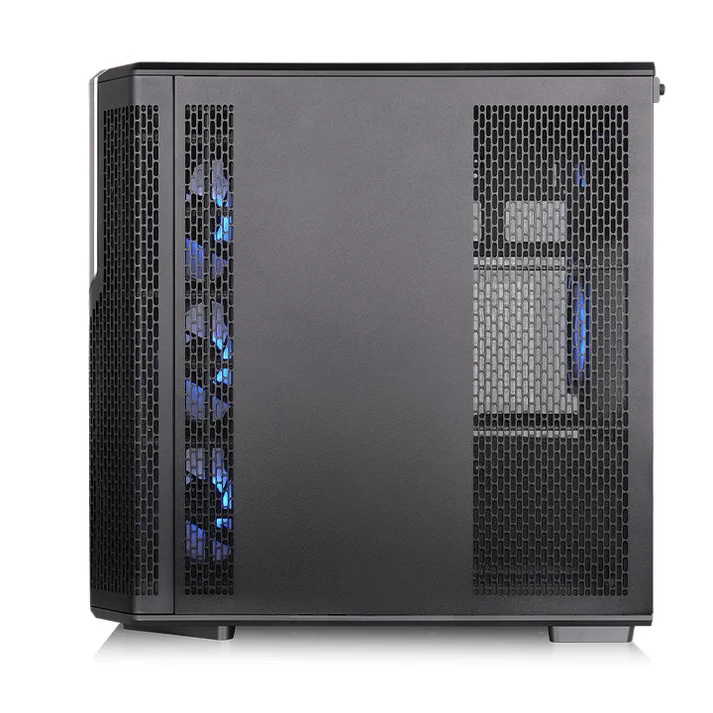
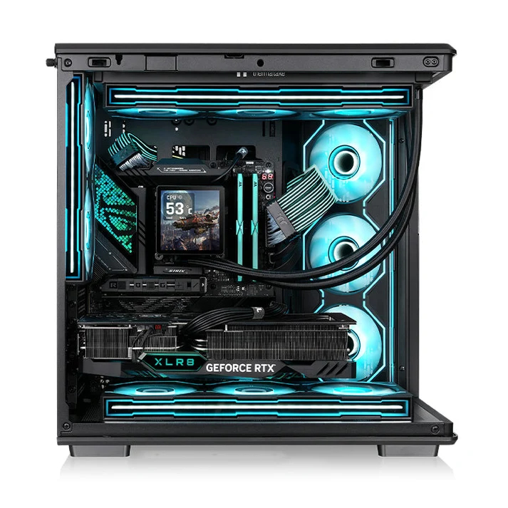

La **Thermaltake View 590 TG ARGB** admite tarjetas gráficas de hasta 435 mm, pero esa cifra baja a **350 mm si se instala una refrigeración líquida AIO en el lateral de la placa base**. Es el detalle que conviene revisar antes de montar esta semitorre de doble cámara, que combina un panel de cristal curvo con cinco ventiladores incluidos y soporte para placas con conectores traseros.

Thermaltake ha detallado el chasis en su [ficha oficial de la View 590](https://thermaltake.com/products/view-590-tg-argb-mid-tower-chassis), recogida también por [KitGuru](https://www.kitguru.net/components/cases/joao-silva/thermaltake-launches-view-590-tg-argb-chassis-with-curved-glass-panel/). La propuesta está disponible en acabados negro y blanco, aunque las fuentes consultadas no permiten confirmar precio ni fecha de disponibilidad en España.

## View 590: holguras que dependen del montaje

Las dimensiones exteriores son de 473 × 290 × 477 mm. La tabla técnica enumera compatibilidad con placas Mini-ITX, micro-ATX, ATX y SSI-CEB; para modelos con conectores ocultos, especifica formatos micro-ATX y ATX y cita las familias ASUS BTF, MSI Project Zero y Gigabyte Project Stealth. No basta, por tanto, con elegir una placa por su nombre comercial: hay que comprobar también su formato.

El disipador de CPU puede alcanzar los 165 mm de altura. La fuente de alimentación tiene un límite anunciado de 270 mm, pero la tabla de holguras lo reduce a 180 mm con un disco duro instalado. Igual que sucede con el radiador lateral y la GPU, no todas las capacidades máximas deben leerse como si fueran simultáneas.

La caja incorpora un soporte para la tarjeta gráfica. Es un añadido útil para sostener modelos pesados, pero no sustituye la comprobación de su longitud ni del espacio que ocupará la refrigeración elegida.

## Cinco ventiladores incluidos, hasta once en total

De fábrica llegan tres ventiladores Infinity ARGB Reverse PWM de 120 mm en el lateral de la placa, configurados como entrada de aire, y otros dos Infinity ARGB PWM de 120 mm en la trasera, como extracción. La disposición importa más que la iluminación: permite empezar el montaje con ambas funciones cubiertas, sin comprar primero un juego completo de ventiladores.

El chasis admite hasta once unidades de 120 mm repartidas entre techo, lateral, base y trasera. Para refrigeración líquida, Thermaltake especifica radiadores de hasta 360 mm tanto arriba como junto a la placa; el techo también contempla 280 mm. Elegir la posición superior evita la reducción de longitud de GPU que la ficha atribuye a la AIO lateral, aunque sigue siendo necesario revisar las dimensiones del conjunto.

La iluminación se puede sincronizar con software de ASUS, ASRock, Gigabyte y MSI. Estas son prestaciones declaradas por el fabricante, no resultados de una prueba térmica o acústica: los cinco ventiladores incluidos no permiten concluir por sí solos cómo se comportará un equipo completo bajo carga.

## Cristal desmontable y conexiones accesibles

El panel de cristal templado de 4 mm rodea el frontal y el lateral izquierdo. Integra una pestaña para retirarlo durante la instalación o el mantenimiento, de modo que el acceso no depende de trabajar a través de una abertura estrecha.

La separación en dos cámaras permite apartar el cableado de la zona principal. Es una línea de diseño compartida con otras cajas orientadas a mostrar el equipo, como la [AZZA ABYSS con soporte para conectores traseros](/noticias/componentes/azza-abyss/), pero la elección debe atender a las holguras de cada modelo, no solo a su superficie acristalada.

Las conexiones incluyen un USB-C 3.2 Gen 2, dos USB-A 3.0 y audio HD. Thermaltake también anuncia filtros antipolvo, un elemento que conviene mantener limpio para no obstaculizar las entradas de aire.

## Precio y disponibilidad en España, pendientes de confirmar

La [tienda oficial estadounidense](https://thermaltakeusa.com/products/view-590-tg-argb-mid-tower-chassis-ca-12c-00m1wn-01) muestra un precio de 159,99 dólares para la View 590 TG ARGB. Esa referencia no equivale a un precio español ni confirma existencias en comercios nacionales; tampoco corresponde convertirla directamente a euros como si incluyera las mismas condiciones de venta.

Para quien planee un equipo con placa de conectores traseros, la View 590 merece una comprobación de compatibilidad. Antes de comprar, las tres medidas decisivas son la longitud real de la gráfica con la AIO elegida, los 165 mm del disipador y el espacio de la fuente cuando se utilicen discos duros. El cristal es lo más visible; esas restricciones son las que deciden si el montaje encaja.
