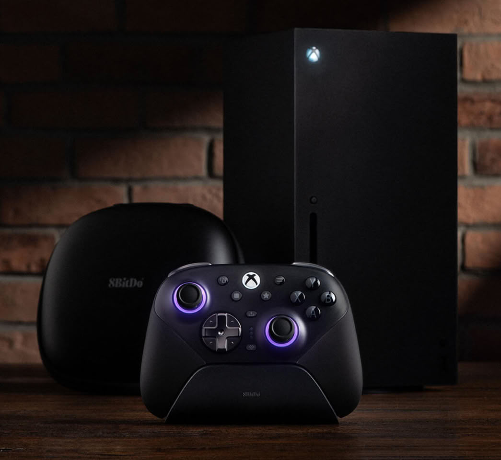
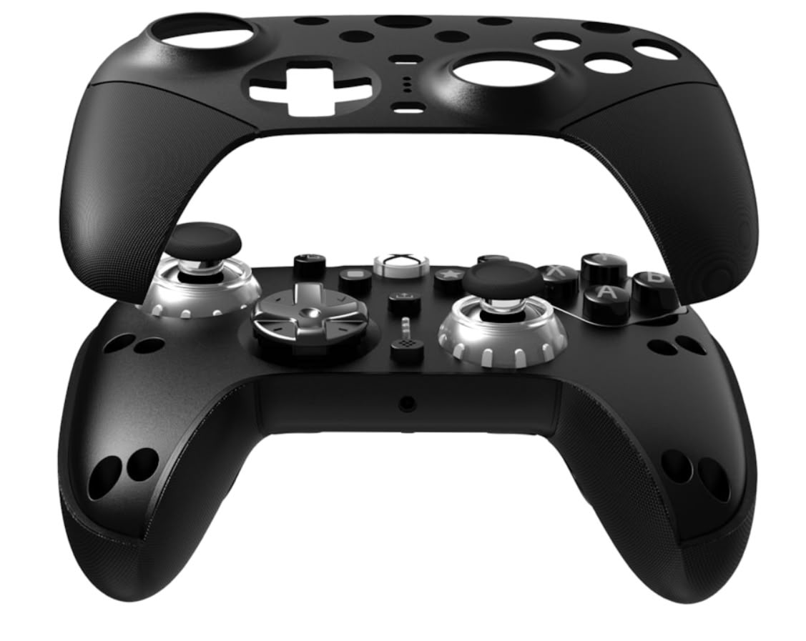
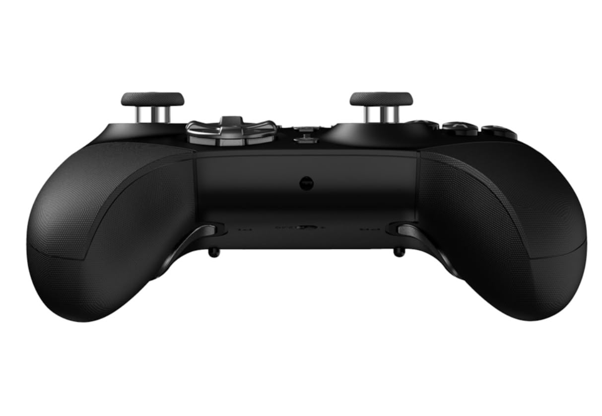
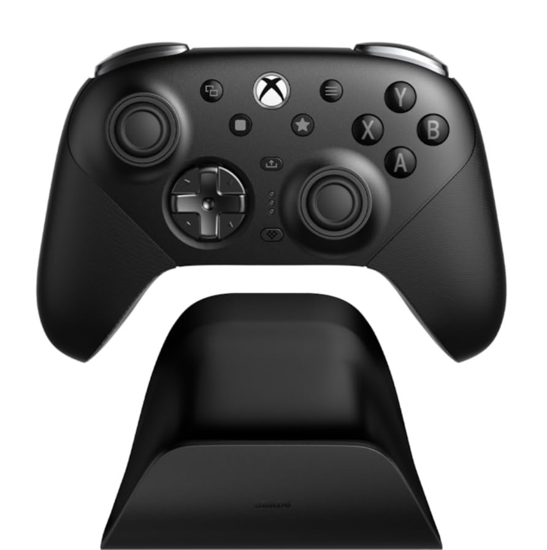
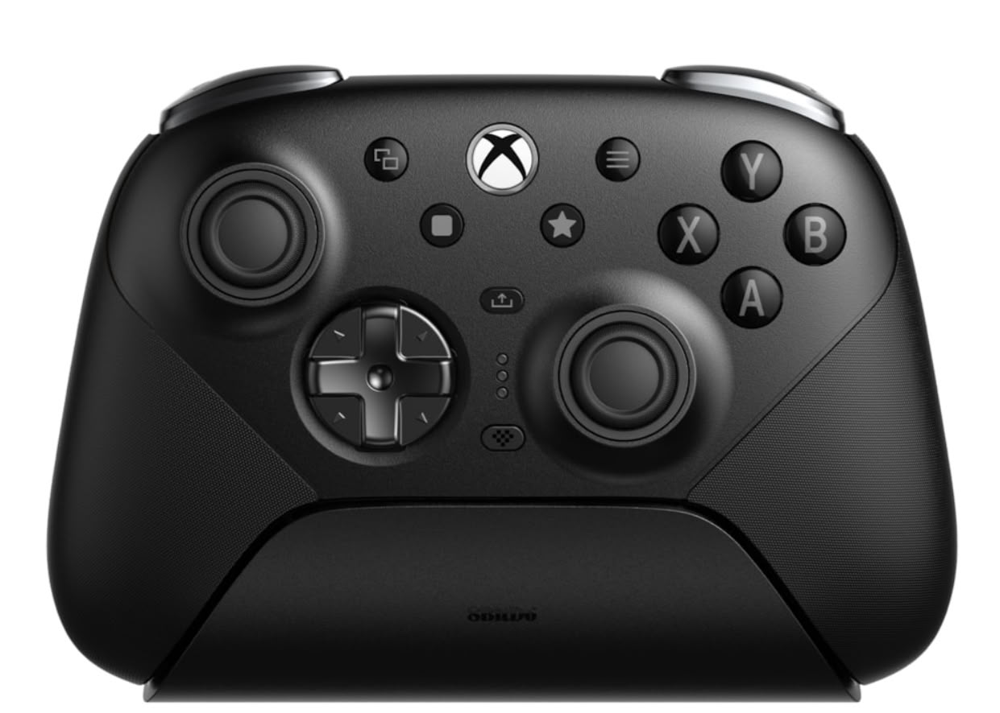

El **8BitDo Ultimate 3E** llega al mercado europeo con un precio recomendado de **139,99 euros** y una propuesta centrada en adaptar el mando al jugador: botones frontales intercambiables, distintas crucetas y varias opciones de palancas. Game Outlet Europe anuncia el inicio de los envíos en Europa y Reino Unido este 23 de octubre. Es un accesorio con licencia oficial para Xbox que también funciona en PC, aunque no ofrece las mismas funciones en ambas plataformas.

El anuncio procede del [comunicado del distribuidor publicado por Overload PR](https://www.overloadpr.com/post/8bitdo-ushers-in-the-next-generation-of-ultimate-launching-the-8bitdo-ultimate-3e-controller-for-x), que TechPowerUp reproduce como nota de prensa. La comunicación incluye Amazon España entre los puntos de venta, pero el precio recomendado no garantiza existencias ni el mismo importe final en todas las tiendas.

## Ultimate 3E: cambiar el tacto, no solo los botones

La personalización física es el principal argumento del Ultimate 3E. El módulo ABXY se puede sustituir para elegir entre una membrana de silicona y microinterruptores: dos respuestas distintas para los cuatro botones de acción. También permite alternar entre una cruceta convencional y otra circular, en lugar de imponer una única superficie para todos los juegos.

Los dos joysticks estándar vienen instalados. El paquete añade dos palancas altas, una con cuello más grueso y otra con superficie abombada. La carcasa frontal es magnética y las empuñaduras llevan textura de silicona. Son opciones de ajuste; el anuncio no sustituye una prueba de comodidad con distintos tamaños de mano.

La [ficha oficial de 8BitDo](https://www.8bitdo.com/ultimate-3e-controller-xbox/) confirma sensores TMR en los joysticks y un convertidor ADC de 12 bits. Los gatillos emplean efecto Hall y cuentan con dos niveles de tope de recorrido. Completan los controles dos botones traseros y los botones superiores adicionales L4 y R4, que permiten reasignar acciones sin depender únicamente de los botones frontales.

## Xbox y PC comparten conexión, pero no los 1.000 Hz

En Xbox Series X|S, Xbox One y Windows, el mando admite conexión inalámbrica de 2,4 GHz mediante su adaptador o conexión USB por cable. Bluetooth queda para dispositivos Apple y Android; no es el modo de conexión anunciado para jugar en Xbox. La ficha especifica Windows 10 desde la versión 1903 y Android 13 o posterior.

Hay dos límites especialmente importantes antes de comprarlo. La tasa de sondeo de **hasta 1.000 Hz**, tanto por cable como de forma inalámbrica, es exclusiva de PC. Además, 8BitDo identifica esa cifra como un resultado de laboratorio en condiciones ideales: no equivale a una medición independiente de la latencia completa durante una partida.

El control por movimiento de seis ejes también es exclusivo de PC y requiere el modo de 2,4 GHz. No está disponible en consolas Xbox. Ultimate Software X permite ajustar esa función, reasignar botones y modificar sensibilidad, recorrido de gatillos e intensidad de vibración. El mando ofrece tres perfiles personalizados y una toma de auriculares de 3,5 mm para Xbox o Windows.

## Base, accesorios y autonomía: qué incluye el precio

Los 139,99 euros anunciados incluyen la base de carga, el adaptador inalámbrico, un cable USB, el estuche de transporte y el paquete de piezas intercambiables. No se trata, por tanto, del precio de un mando básico al que haya que sumar por separado esos accesorios.

Según el fabricante, la batería recargable de 1.400 mAh permite hasta 18 horas de juego y necesita entre cuatro y cinco horas para cargarse. Son cifras declaradas, no resultados de una prueba propia. La base utiliza alineación magnética y carga inalámbrica sin puntos de contacto.

Para quien juega principalmente en Xbox, la decisión gira alrededor de los módulos intercambiables, los controles adicionales y el conjunto de accesorios, no de los 1.000 Hz ni del giroscopio. Quien alterna consola y ordenador sí puede aprovechar esas funciones adicionales en PC. En el mismo segmento ya figuran los [mandos Razer Wolverine V4 para Xbox y PC](/noticias/consolas/razer-wolverine-v4/): comparar las funciones disponibles en cada plataforma importa más que elegir únicamente por la cifra de sondeo más alta.
