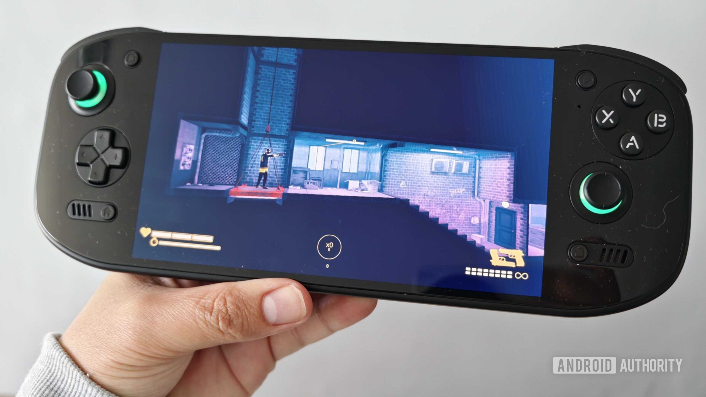

AYN ha confirmado que el Odin 3 Portal está en camino. El anuncio llega sin ficha técnica y sin fecha: apenas una imagen publicada en Instagram y en su servidor de Discord, la promesa de "flagship power" (potencia de gama alta) y un diseño que, a primera vista, calca el del Odin 2 Portal.

## Un anuncio sin especificaciones

La compañía ha mostrado el aspecto del equipo, prácticamente idéntico al de su predecesor, pero no ha detallado qué cambia frente al Odin 2 Portal ni frente al Odin 3. Tampoco hay cifras de rendimiento, de pantalla o de catálogo. De momento es la confirmación de que el modelo existe y está en marcha, sin más compromisos.

La trayectoria de la familia ayuda a interpretar el movimiento. El Odin 2 Portal mantenía el chip Snapdragon 8 Gen 2 y la batería de 8.000 mAh del Odin 2, pero subía la pantalla OLED de 6 a 7 pulgadas. Si AYN repite la fórmula, el Odin 3 Portal heredaría el procesador Dragonwing Q8 del Odin 3 —en la práctica un Snapdragon 8 Elite sin módem— y añadiría una pantalla más grande que la del modelo estándar.

## La pantalla, el rasgo que define al Odin 3 Portal

En esta familia, el apellido Portal nunca ha significado más potencia, sino más superficie de juego. El Odin 3, que Android Authority describe como la portátil Android más capaz del mercado, marca el techo de rendimiento; el Portal, en cambio, se ha distinguido por ofrecer una base similar en un formato más cómodo para sesiones largas. La incógnita no es tanto qué chip montará, sino cuánto crecerá la pantalla y a qué precio se sostiene el conjunto frente a alternativas como las [Retroid Pocket 5 y Pocket Flip 2](/noticias/retroid-pocket-upgrade-sorpresa/).

## El precio, la gran incógnita

AYN tampoco ha desvelado cuánto costará, y ese es hoy el dato más sensible del segmento. La crisis de la memoria RAM ha sacudido el mercado de las portátiles Android: el propio Odin 3 ha encadenado varias subidas y ya se vende por 369 dólares. No sería extraño, por tanto, que el Odin 3 Portal se sitúe por encima de los 400 dólares.

El listón, en cualquier caso, está alto. El Odin 2 Portal llegó en 2023 y sigue considerándose una de las mejores portátiles Android que se pueden comprar, de modo que la expectativa es que el nuevo modelo recoja el testigo donde lo dejó.

## Qué cambia para el jugador

Para quien ya juega en una portátil Android, el Odin 3 Portal no es una revolución, sino una ampliación de catálogo dentro de la misma casa: misma plataforma, más pantalla y, previsiblemente, un precio más alto. La decisión de compra seguirá dependiendo menos de la potencia bruta que de los juegos y los servicios disponibles, y de cuánto tiempo AYN sostenga ese soporte a lo largo de la generación. Con el Odin 2 Portal como referencia de longevidad, la familia tiene crédito; la duda razonable es si el salto de precio acompaña a un salto real de experiencia.
