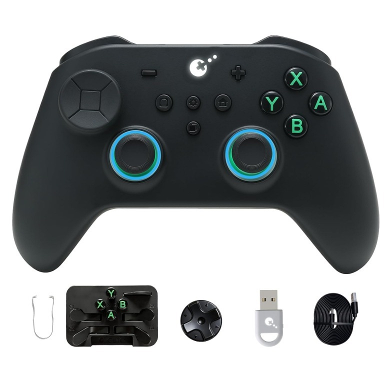

Jugar en Switch 2 con un mando independiente no obliga a pagar lo que cuesta el modelo oficial. El **GuliKit TT Pro** es la alternativa de 60 dólares que Jessica Conditt analiza en Engadget frente a los 90 dólares del Switch 2 Pro Controller. La diferencia de 30 dólares acompaña a una propuesta con sticks simétricos, accesorios de transporte y compatibilidad con varios sistemas, aunque la prueba también identifica ruido y una función importante que no consiguió activar.

La reseña, publicada el 23 de octubre, concede al mando un 8 sobre 10. Sus impresiones pertenecen a Engadget: no se trata de una prueba realizada por TechSpain24. Los importes son las referencias en dólares que utiliza ese medio, no precios confirmados para España; esta información tampoco permite fijar un precio europeo equivalente.

## Qué ofrece el GuliKit TT Pro para jugar en Switch 2

Además de Switch 2, el TT Pro funciona con la primera Switch, PC, Android e iOS, según el análisis. Sitúa ambos sticks a la misma altura, una disposición cercana a la del DualSense, en lugar de escalonarlos. Engadget describe un mando sólido y equilibrado, pero también grande: su tamaño puede encajar mejor en manos amplias que en quienes buscan un accesorio compacto.

Los sticks emplean tecnología magnética TMR y permiten ajustar su resistencia de forma continua con una herramienta incluida. También hay controles por movimiento. En los gatillos, unos selectores físicos permiten alternar entre el recorrido analógico de efecto Hall y una pulsación mediante microinterruptores. La elección importa más por el tipo de control que busca cada jugador que por acumular especificaciones.

La tecnología de los sticks no debe interpretarse como una garantía de duración ilimitada. Como contexto, el [análisis de reparaciones de Joy-Con 2 que ya recogimos](/noticias/joy-con-2-drift-teardown/) distingue entre la mejora de los sensores y el desgaste de otros elementos mecánicos del mando.

*Imagen de GuliKit publicada por Engadget. La fotografía de portada pertenece a Engadget.*

## Un estuche y accesorios para llevarlo fuera de casa

El argumento más práctico del paquete es el estuche rígido, acompañado por una caja pequeña para organizar accesorios. Incluye cuatro palancas metálicas traseras configurables, que llegan sin instalar, botones alternativos con distribución para PC, extractor, herramienta de ajuste de los sticks, una cruceta adicional, cable de carga y adaptador inalámbrico USB Hyperlink 2.

Para quien alterna entre consola y ordenador o guarda el mando en una mochila, ese conjunto evita que la compra se limite al accesorio desnudo. No obstante, cambiar físicamente los botones exige intervenir sobre el mando; no equivale a disponer de un cambio inmediato de distribución por software.

El TT Pro tampoco ofrece el modo de cuatro direcciones para la cruceta que Engadget señala en el TT Max. Este último cuesta 70 dólares en la comparación del medio, frente a los 60 del Pro. Conviene distinguir ambos modelos antes de dar por incluidas las mismas opciones de configuración.

## Ruido, autonomía y una advertencia sobre el encendido remoto

Engadget valora la respuesta háptica, pero advierte de que produce bastante ruido en sus distintos modos e intensidades. También considera al TT Pro más ruidoso que el mando oficial de Switch 2 por la vibración y el sonido de los sticks. Es una concesión relevante para jugar en silencio, aunque el ahorro resulte atractivo.

La carga utiliza USB-C y GuliKit anuncia hasta 26 horas de autonomía con la iluminación apagada, una cifra del fabricante recogida por Engadget, no una medición independiente de esa duración. El mando permite desactivar los anillos RGB, además de elegir distintos efectos.

La mayor cautela afecta a la posibilidad anunciada de despertar Switch 2 a distancia: **Conditt no logró hacerla funcionar con el TT Pro**, pese a seguir distintos tutoriales. La reseña menciona testimonios de otros usuarios, pero no determina la causa del fallo. Por tanto, no puede presentarse como una función comprobada ni darse por resuelta mediante una actualización futura.

El TT Pro merece atención si pesan el precio de referencia, los sticks simétricos y el equipo de transporte. Si despertar la consola desde el sofá es imprescindible, esa limitación de la prueba aconseja comprobar el funcionamiento y las condiciones de devolución antes de comprar. Para el lector español, falta además confirmar el precio local: sin ese dato, el ahorro de 30 dólares no puede trasladarse directamente a su cesta.
