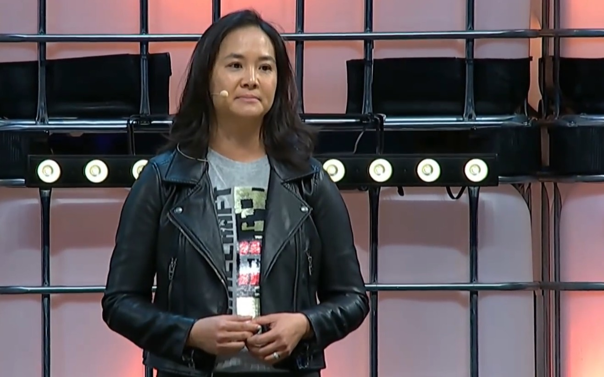

Helen Chiang, hasta hace unas semanas directora de operaciones de Xbox, publicó el 2 de noviembre un mensaje en LinkedIn en el que rechaza las acusaciones que circularon tras su salida y sostiene que su despido no se gestionó con los mismos criterios que ella espera de la compañía. El texto, titulado «Clarity is Kindness», no explica por qué dejó el puesto, pero sí deja claro que la decisión no fue suya.

La ejecutiva no discute que fuera despedida. Lo que discute es el relato que se construyó alrededor de su marcha.

## Qué dijo Chiang

En el mensaje, Chiang enumera y niega una por una las versiones que se habían difundido: que filtrara información confidencial a la prensa, que se marchara a un competidor, que hubiera incurrido en discriminación, acoso, abuso de información privilegiada, malversación u otras prácticas fraudulentas, y que se hubiera ido porque le negaran un puesto de mayor responsabilidad.

> No quiero que mi salida se reduzca a una historia inexacta sobre incompetencia, ambición por el siguiente gran puesto o un escándalo de manual.

Sobre su trayectoria, añade: «No se pasan dos décadas en un sitio sin desarrollar una lealtad profunda hacia la gente, los equipos y los negocios que has ayudado a construir». Y sobre el cierre del capítulo: «No es así como imaginé nunca que terminaría mi historia aquí. Y no es toda la historia».

El párrafo más relevante es el dedicado a la equidad y la rendición de cuentas. Chiang afirma creer en ambas cosas, pero advierte que «solo significan algo cuando se aplican de forma consistente», y añade que tiene «serias dudas» sobre cómo se aplicaron en su caso, unas dudas que, a su juicio, «merecen tomarse en serio».

## Una salida que nadie ha explicado

La cronología ayuda a entender por qué el caso ha llamado tanto la atención dentro y fuera de Microsoft. Chiang llevaba más de dos décadas en la compañía, casi todas ellas en el negocio de los videojuegos, y venía de dirigir la franquicia Minecraft como vicepresidenta corporativa. En julio de 2026 fue ascendida a un puesto de nueva creación, el de directora de operaciones de Xbox, dentro de la reorganización con la que Microsoft reordenó su división de juego, con responsabilidad sobre contenidos, hardware, plataforma y servicios.

Tres meses después estaba fuera. El anuncio interno fue breve: la consejera delegada de Xbox, Asha Sharma, comunicó que Chiang dejaba Microsoft ese mismo día y le agradeció «sus años de servicio». Pocos días más tarde, Eurogamer publicó que había sido «despedida por violaciones de políticas», una acusación que PC Gamer describe como anónima. Esa es la versión que Chiang califica de inexacta.

Microsoft no respondió a las peticiones de comentario de The Verge ni de PC Gamer. Tampoco está confirmado si Chiang piensa emprender acciones legales: el medio preguntó por ello y no obtuvo respuesta. Quedan, por tanto, dos incógnitas abiertas: el motivo real del despido y el alcance de esas «serias dudas» que la ejecutiva insinúa sin detallar.

Conviene separar lo confirmado de lo especulado. Confirmado está el ascenso de julio, la salida de octubre, el comunicado interno y la existencia del mensaje en LinkedIn. No está confirmado ningún motivo, ni por parte de la empresa ni de la ejecutiva, y ninguna de las acusaciones que ella niega ha sido respaldada públicamente con pruebas.

## Por qué importa a quien juega

El episodio no cambia el catálogo ni los precios de la consola, pero sí dice algo sobre cómo se está gestionando la Xbox de esta generación. La salida de Chiang se produjo en plena reestructuración de la división, un proceso que ha dejado despidos —como los de [Ninja Theory ante el cierre del estudio de Hellblade](/noticias/consolas/ninja-theory-cierre-hellblade/)— y ventas de equipos, y que ya analizamos al hablar de cómo [la nueva estructura refuerza el peso de Activision y Bethesda](/noticias/reestructuracion-xbox-refuerza-activision-bethesda/). Los movimientos en la cúpula son la parte visible de ese ajuste; lo que el jugador percibe es el ritmo de lanzamientos, el estado de las suscripciones y el soporte de los servicios a lo largo de la generación.

Con la dirección de operaciones vacante y sin explicación oficial, la pregunta razonable es si la reorganización mantiene el rumbo que Sharma ha defendido en los últimos meses o si habrá más cambios antes de que la división se estabilice. Por ahora solo hay una certeza: la persona que ocupaba ese puesto durante el último trimestre ya no está, y la versión oficial sigue siendo la de un comunicado de tres líneas.
