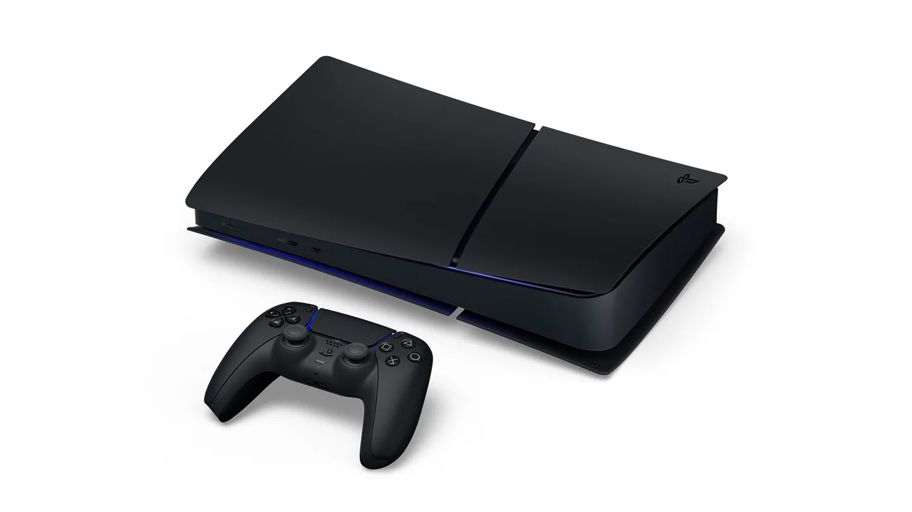

Sony ha anunciado una versión en color «Midnight Black» de su PS5 Digital Edition exclusiva de Japón. La consola se pondrá a la venta el 19 de noviembre por 55.000 yenes —unos 350 dólares— con impuestos incluidos, y las reservas se abren el 20 de octubre en las tiendas y la web de PlayStation en el país. La fecha coincide con el lanzamiento de GTA 6, un detalle que Sony aprovecha para poner el juego junto a la consola en su anuncio.

## Una PS5 Digital Edition en negro, sin cambios de hardware

No hay sorpresas bajo la carcasa. El nuevo modelo, con referencia CFI-2200B02S, es una PS5 Digital Edition estándar con SSD de 825 GB, solo que en negro. Arrastra, eso sí, las mismas limitaciones que la versión blanca que Sony vendió en Japón el año pasado: el idioma del sistema está fijado al japonés y la consola solo funciona con cuentas de PlayStation registradas en el país. Eso la deja fuera de juego para cualquier jugador que no viva allí, aunque consiga importarla.

Junto a la consola llega un lector de discos a juego, también en Midnight Black y también el 19 de noviembre, por 11.980 yenes (unos 76 dólares).

## El precio, la parte más interesante

La clave de esta edición está en la etiqueta. Cuando Sony subió los precios de PS5 en todo el mundo en abril, el modelo exclusivo de Japón se quedó en 55.000 yenes (unos 350 dólares), mientras que la Digital Edition estándar en Japón saltó a 89.980 yenes (unos 570 dólares). En Estados Unidos esa misma versión digital se vende ya por 599,99 dólares, en un mercado donde el [precio medio de las consolas ha marcado máximos históricos](/noticias/consolas/mercado-consolas-caida-xbox-ps5/). Con una diferencia así, el bloqueo regional no parece un capricho: es lo que impide que estas unidades más baratas salgan del país y compitan con el precio internacional.

## Qué cambia para el jugador

Para quien juega en España o Latinoamérica, de momento no cambia nada: Sony no ha dicho una palabra sobre un lanzamiento fuera de Japón. La compañía sí aprovechó el anuncio para repetir que los nuevos juegos de PlayStation serán solo digitales a partir de enero de 2028, un mensaje que choca con sacar un lector de discos nuevo el mismo día. Es una contradicción que ya ha recibido críticas desde dentro de la propia industria: el exejecutivo Shawn Layden [calificó el adiós al disco como «un golpe importante para la marca»](/noticias/consolas/shawn-layden-discos-playstation/).

La decisión de compra, por tanto, se queda en Japón y en un público muy concreto: quien quiera una PS5 negra más barata que la del resto del mundo y pueda asumir que su catálogo y su cuenta vivirán atados al mercado japonés a lo largo de la generación.
