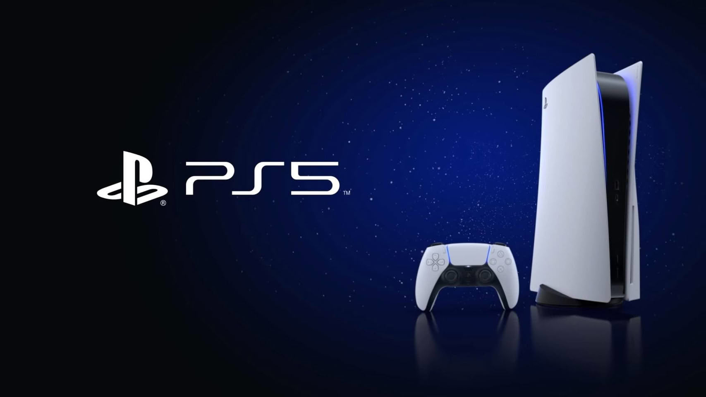

Jugar a los juegos de Xbox en una consola de Sony dejó de ser un experimento de emulación para convertirse en algo parecido a un servicio más. El desarrollador independiente RafaelNGP ha publicado **PSBox Cloud Gaming**, un cliente no oficial de Xbox Cloud Gaming que se ejecuta de forma nativa en PS5 con el homebrew habilitado, siempre que se cargue a través de un lanzador como ShadowMountPlus.

El nombre lo dice todo: en lugar de mover el catálogo de Microsoft dentro de la consola, lo que hace es traerlo por streaming. Eso simplifica mucho las cosas, porque no depende de la potencia bruta del hardware ni de la traducción de instrucciones, sino de la conexión y de la infraestructura de Microsoft.

## Qué ofrece PSBox Cloud Gaming

La aplicación se apoya en la cuenta del jugador, no en hardware adicional. El inicio de sesión se resuelve introduciendo un código en `microsoft.com/link`, y para usarla todavía hace falta una suscripción **Game Pass Ultimate**, que es la que da acceso al catálogo en la nube.

A partir de ahí, el cliente intenta que la experiencia sea lo más parecida posible a la de una consola de Xbox:

- El **DualSense** actúa como mando de Xbox, con vibración incluida, y la última compilación añade chat de voz a través del micrófono del propio mando.
- Los streams se emiten a **1080p y 60 fps** por defecto, con 720p para conexiones más lentas y un modo experimental de **1440p** donde Microsoft lo ofrece.
- La app puede usar la **GPU de la PS5 para escalar** la imagen hasta 4K, con la opción de elegir entre el escalador AMD FSR 1 y Anime4K.

Ese último punto es el más curioso del proyecto: en lugar de dejar el trabajo de imagen en manos del servidor remoto, aprovecha el silicio de la consola para afinar lo que llega por la red.

## Un proyecto que avanza rápido, pero con limitaciones

El ritmo de publicación llama la atención. La versión 0.5.0, que introdujo el escalado a 4K, llegó el 8 de octubre, y apenas dos días después apareció la 0.9.5, que sumó la posibilidad de hacer **Remote Play hacia tu propia Xbox**. Es decir: no solo se puede jugar desde la nube, también desde la consola de Microsoft que el jugador tenga en casa.

No todo es perfecto, y conviene saberlo antes de instalarlo. El vídeo se decodifica en **H.264 por CPU**, así que de momento no hay HDR, y el bitrate se queda en torno a **10 y 12 Mbps** a 1080p. Algunos probadores tempranos han reportado artefactos de macrobloques, destellos rosados y problemas con la vibración del DualSense.

## Lo que cambia para el jugador

PSBox no es para cualquiera: exige una PS5 con jailbreak y un entorno homebrew en marcha, además de la suscripción a Game Pass Ultimate. Quien cumpla esas condiciones se encuentra con una forma poco habitual de acceder al catálogo de Microsoft sin comprar una consola de Xbox, aunque apoyada en una infraestructura que no controla.

Y ahí está el riesgo de fondo. Como reconoce el propio desarrollador en las notas del proyecto, **Microsoft puede cambiar o bloquear los servicios** en los que se apoya el cliente en cualquier momento. Eso convierte a PSBox en una solución más frágil que un lanzamiento oficial, y en algo que conviene valorar como un extra, no como la vía principal a los juegos.

El proyecto llega, además, en un tramo muy movido del homebrew para PS5, después de emuladores capaces de ejecutar juegos de Nintendo Switch, de cargar discos de PS2 a través del emulador PS5SX2 y hasta de mover Halo 2 con un emulador de Xbox. PSBox añade una vía distinta, la del streaming, y deja la decisión donde siempre ha estado para este tipo de proyectos: en manos del jugador que, con el equipo ya desbloqueado y la suscripción activa, quiera exprimir el catálogo de la competencia en su propia consola.
