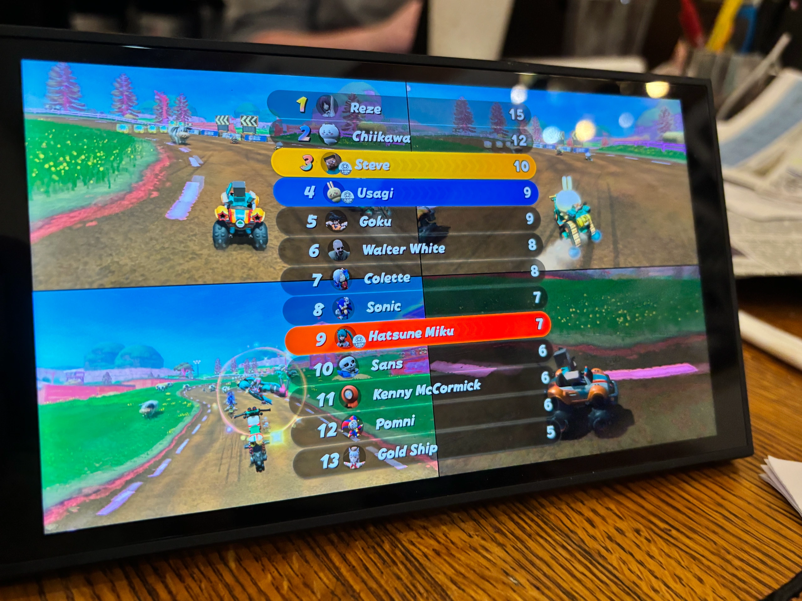
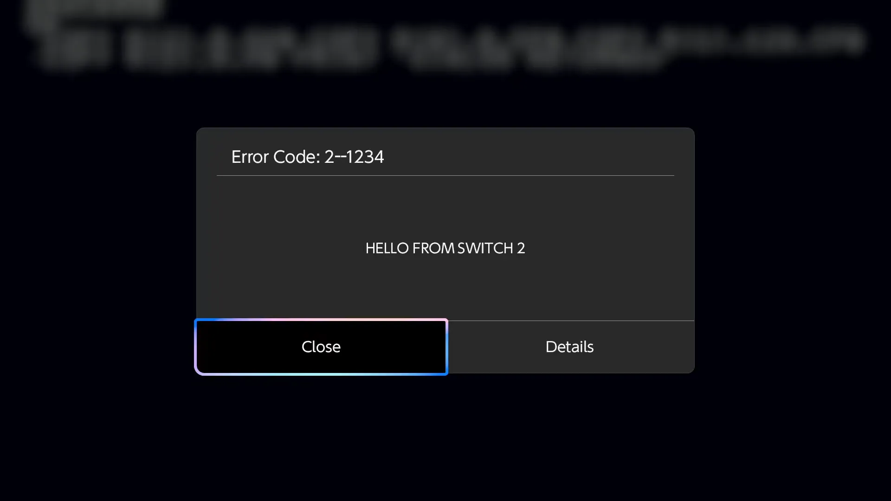

Mario Kart World con personajes ajenos al catálogo de Nintendo es la demostración más visible de **ns2jb, el jailbreak por software para Switch 2 presentado por el investigador pepsipu**. Su explicación técnica, publicada el **18 de octubre**, describe ejecución de código nativo en determinados procesos del sistema y señala compatibilidad con el firmware **23.0.1**. Es un avance para el homebrew y las modificaciones de juegos, pero no significa que la consola esté completamente abierta ni que disponga ya de un firmware personalizado.

El anuncio recibió cobertura de [Nintendo Everything el 22 de octubre](https://nintendoeverything.com/nintendo-switch-2-has-been-jailbroken-for-the-first-time/). Conviene separar esas fechas: la investigación no se publicó hoy, y la noticia de un medio que recoge la demostración **no equivale a una reproducción independiente del exploit**. Este artículo explica las capacidades que documenta su autor; no hemos probado el procedimiento en una consola.

## Qué permite ns2jb en Switch 2

Según pepsipu, ns2jb permite ejecutar código nativo arbitrario con los permisos de cualquier módulo ordinario del sistema y del módulo integrado **fs**, encargado del sistema de archivos. No se trata solo de mostrar un mensaje dentro de una aplicación: ese alcance permite trabajar con servicios que intervienen en el funcionamiento de la consola.

El investigador enumera usos como ejecutar **homebrew**, es decir, software no oficial creado por la comunidad; estudiar y modificar juegos de Switch 2; y extraer copias de las partidas guardadas. También describe acceso a buena parte de los periféricos mediante sus registros de memoria. Son capacidades técnicas, no un anuncio de aplicaciones terminadas ni de compatibilidad universal con herramientas existentes.

La prueba que mejor entiende un jugador es el mod de Mario Kart World. Las imágenes y los vídeos publicados muestran personajes personalizados en el exclusivo de Nintendo. Esa demostración ilustra la modificación de un juego concreto: no acredita por sí sola que todos los títulos puedan modificarse de la misma forma.

*Imagen de la demostración publicada por pepsipu; no corresponde a contenido oficial de Nintendo.*

## La entrada está en un juego de la primera Switch

La investigación aprovecha **SmileBASIC 4, un título de la Switch original**, como punto de entrada en la nueva consola mediante la retrocompatibilidad. El autor relata cómo pasó de ejecutar código en esa aplicación a obtener mayores capacidades en servicios del sistema. Por tanto, que el destino sea Switch 2 no implica que el primer fallo esté en un juego nativo de esa generación.

La versión de firmware indicada en el artículo original es 23.0.1, descrita como la más reciente **cuando se publicó el 18 de octubre**. Esa referencia no debe convertirse en una promesa de funcionamiento en versiones posteriores ni en cualquier configuración de la consola.

Tampoco debe confundirse con el [fallo de seguridad de la Switch original relacionado con el envío de capturas al teléfono](/noticias/switch-23-firmware-exploit/), que cubrimos anteriormente. Compartir familia de consolas no convierte dos vías de acceso distintas en la misma vulnerabilidad.

## No es permanente ni equivale a un CFW completo

El propio investigador define ns2jb como **tethered**: el acceso no se conserva después de reiniciar y hay que volver a activar el procedimiento. Que sea exclusivamente por software significa que esta vía no depende de un modchip; no significa que se mantenga desde el arranque o que funcione sin condiciones.

Además, pepsipu reconoce que, entre los módulos integrados, solo ha conseguido comprometer fs. Su conclusión presenta el trabajo como una posible ayuda para que la comunidad avance hacia un **CFW, o firmware personalizado**, no como un CFW ya disponible. La ejecución en esos procesos no demuestra control total del núcleo del sistema ni de la cadena de arranque.

Por la misma razón, **la demostración no prueba que se haya habilitado la piratería**. Modificar Mario Kart World o respaldar una partida no es lo mismo que disponer de un método general para ejecutar copias no autorizadas. El alcance documentado debe describirse por lo que permite, no por capacidades que todavía no acredita.

## Codex ayudó, pero no hackeó la consola por sí solo

Otro matiz importante está en el papel de la inteligencia artificial. Pepsipu utilizó Codex durante la investigación, pero aclara expresamente que el objetivo automatizado inicial de conseguir ejecución de código no tuvo éxito. El jailbreak requirió **unas dos semanas de trabajo sustancial**, según su explicación.

El autor sí atribuye a Codex la elaboración del mod de Mario Kart World en un día, una demostración lúdica distinta del desarrollo de la cadena de explotación. Mezclar ambos trabajos produciría un titular llamativo, pero incorrecto.

Para quien solo quiere disfrutar del catálogo de Switch 2, lo publicado sigue siendo investigación con límites, no una nueva función oficial ni una razón sólida para decidir una compra. Su valor inmediato está en las posibilidades de estudio, homebrew y modificación; el soporte futuro y la evolución hacia herramientas más accesibles siguen pendientes.
