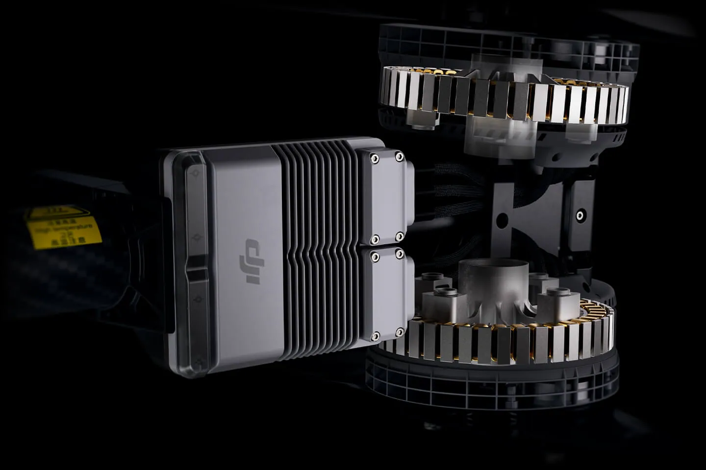

China exigirá autorización para exportar **determinados motores sin escobillas, reguladores electrónicos de velocidad y palas de hélice para drones a partir del 18 de noviembre de 2026**. La obligación depende de características técnicas concretas: no alcanza automáticamente a cualquier repuesto ni equivale a una prohibición general de exportación.

El cambio figura en el **anuncio 49/2026**, fechado el 19 de octubre y firmado por el Ministerio de Comercio, la Administración General de Aduanas y el Departamento de Desarrollo de Equipamiento de la Comisión Militar Central. [Xinhua reproduce el texto oficial completo](https://www.news.cn/fortune/20261019/0b8361ce5c114f8f989211e9b7566fc5/c.html), que recoge el apartado 9A901 para estos componentes y actualiza otros controles sobre aeronaves, software y tecnología.

## Qué motores de drones quedan sujetos a licencia en China

El apartado 9A901.a se refiere a motores sin escobillas diseñados específicamente para accionar hélices de aeronaves no tripuladas. Para quedar incluidos deben reunir **las cuatro condiciones simultáneamente**:

| Característica nominal | Umbral del anuncio |
| --- | --- |
| Tensión | Igual o superior a 48 V |
| Potencia | Igual o superior a 3 kW |
| Densidad de potencia | Igual o superior a 3 kW/kg |
| Velocidad de giro | Igual o inferior a 3.000 rpm |

La distinción importa al revisar una ficha técnica: superar 48 V, por sí solo, no basta. Tampoco basta con una potencia máxima anunciada si no se conoce el valor nominal que exige la norma.

Los reguladores electrónicos de velocidad, conocidos como **ESC**, tienen su propio apartado, 9A901.b. Deben estar diseñados específicamente para los motores controlados por 9A901.a y reunir a la vez una tensión nominal de al menos 48 V y una potencia nominal de al menos 3 kW. No es un requisito indiscriminado para todos los ESC vendidos desde China.

*Imágenes: DJI, publicadas por [DroneXL](https://dronexl.co/2026/10/19/china-drone-export-controls-motors-props-november-18/). El Agras T100 ilustra el tipo de componentes; su aparición no acredita que un modelo concreto cumpla todos los umbrales del anuncio.*

## Las palas de carbono tienen tres criterios alternativos

El apartado 9A901.c cubre palas fabricadas con **material compuesto de fibra de carbono** que puedan utilizarse en drones y cumplan cualquiera de estas condiciones:

- En una hélice de paso fijo cuya pala atraviese el centro de rotación, la distancia desde ese centro hasta la punta debe ser de **al menos 762 mm**.
- Si la estructura de la pala de paso fijo no atraviesa el centro de rotación, la longitud desde la cara del extremo de la raíz hasta la punta debe ser de **al menos 648 mm**.
- La raíz de la pala dispone de una estructura que permite **variar el paso**. Para esta alternativa, el texto no fija una longitud mínima.

No son tres exigencias acumulativas, como ocurre con los motores. También cambia el punto desde el que se mide: centro de rotación o raíz. Por eso, el diámetro comercial de una hélice no sustituye sin más a las dimensiones que pide el anuncio. La condición de material compuesto de fibra de carbono se mantiene en las tres alternativas.

## Autorización de exportación, no veto general

Los exportadores de los artículos comprendidos deben solicitar permiso a la autoridad comercial competente. Además, tienen que declarar sus características ante aduanas. El anuncio exige también detallar los parámetros de productos próximos a los umbrales que no estén incluidos y señalar expresamente esa circunstancia; si aduanas cuestiona la veracidad de la declaración, la mercancía no se despacha mientras se resuelve la duda.

En una [explicación oficial publicada también por Xinhua el 19 de octubre](https://www.news.cn/fortune/20261019/06e8685081394fdd92f5530302c044a7/c.html), el Ministerio de Comercio afirma que aprobará las solicitudes que cumplan las disposiciones aplicables. Justifica la revisión por el carácter de doble uso civil y militar de estos artículos. Esa es la posición del ministerio, no una garantía de autorización para cualquier operación.

La revisión va más allá de los repuestos. Por ejemplo, el apartado 9A012.a contempla aeronaves controlables fuera de la línea de visión natural del operador: unas con autonomía de tres horas o más, y otras con autonomía desde 30 minutos hasta menos de tres horas que además puedan despegar y mantener un vuelo estable y controlado con ráfagas de al menos 46,3 km/h. Para este último grupo, el texto prevé una vía de registro antes de cada exportación para obtener un justificante. **Esa facilidad no debe trasladarse automáticamente a los componentes 9A901.**

## Qué puede cambiar para compradores y montadores

Para una empresa que importe propulsión desde China, la comprobación útil es contrastar la documentación técnica de cada referencia con su apartado correspondiente y confirmar con el proveedor qué trámite necesita. Una denominación como «motor para dron» no permite determinar por sí sola si está sujeto a licencia.

Tampoco hay base para afirmar que todos los montajes FPV quedan afectados, ni que todos están exentos. Un [toothpick FPV de 1S y 3 pulgadas](/noticias/drones/montar-dron-fpv-1s-3-pulgadas/) pertenece a una escala distinta de la propulsión descrita, pero la clasificación debe apoyarse en las características de las piezas, no en la etiqueta FPV. No cumplir 9A901 tampoco demuestra que un producto esté libre de cualquier otro control aplicable.

El anuncio fija una fecha y unas condiciones legales; **no cuantifica retrasos, subidas de precio o escasez en España**. Hasta conocer la clasificación de cada componente y cómo tramitan las operaciones los exportadores, atribuirle esas consecuencias sería anticiparse a la evidencia.
