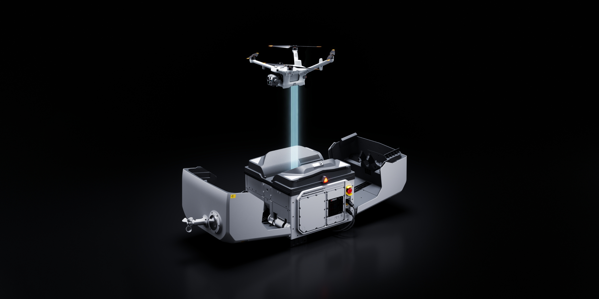

El Dock 4 de DJI recambia la batería del dron de forma automática en 25 segundos y lo tiene de nuevo en el aire en menos de 45 desde el aterrizaje. Es la primera estación drone-in-a-box de la marca con recambio de baterías, y el dato importa más de lo que parece: hasta ahora, una misión que exigía varios despegues obligaba a esperar alrededor de 30 minutos de recarga entre vuelo y vuelo. La compañía lo presentó el 14 de octubre enfocándolo en respuesta a emergencias, inspección de infraestructura y seguridad nocturna.

## Qué recambia el Dock 4 y cuánto aguenta la batería

El Dock 4 carga a la vez dos packs de 925 gramos y 260 Wh, homologados para 400 ciclos, y tarda unos 27 minutos en llevar cada uno del 15 % al 95 %. Ese tiempo deja de ser un problema operativo precisamente porque el dock no espera a que la batería vuelva al dron: la cambia. Con al menos dos packs en el dock, el sistema sigue recambiando aunque se caiga la red eléctrica, aunque la energía de respaldo —unos 4,5 horas por pack, en secuencia— solo alimenta el dock, no recarga las baterías.

La estación pesa 66 kg en vacío, conserva los mismos agujeros de montaje de 400 × 400 mm que el Dock 3 y solo funciona con el nuevo dron Matrice 5TD, además de requerir la estación de tierra DJI O4. La aeronave aguanta casi una hora de vuelo recto (de 100 % a 0 % a 15 m/s y sin carga), alcanza 21 m/s en las tareas «FlyTo» y monta tres cámaras de 50 MP: gran angular, teleobjetivo medio de 70 mm equivalente y telefoto de 252 mm (11×). Añade térmica nativa de 1280 × 1024 —2560 × 2048 en el modo UHR de DJI—, visión nocturna a color sin foco auxiliar y telémetro láser de hasta 3.000 m.

## Sensores, cargas útiles y vuelo sin operador en el sitio

El Matrice 5TD combina LiDAR rotatorio, radar mmWave hacia delante, arriba y abajo, y visión en seis direcciones; DJI asegura que detecta cables eléctricos incluso de noche. A bordo lleva IA que reconoce 17 tipos de objetos —coches, barcos o animales, entre otros— y con DJI FlightHub 2 el operador puede buscar en el vídeo por texto o imagen y recibir alertas por SMS, correo o plataforma. La carga útil llega a 450 g repartidos entre tres soportes para altavoz, foco y paracaídas, y el dock y el dron están calificados de −40 a 50 °C (IP56 el dock, IP55 el dron), con vuelo en vientos de hasta 12 m/s.

Respecto al modelo anterior, el salto de sensores es claro: el Dock 3 iba con el Matrice 4TD, de térmica 640 × 512, telefoto de 168 mm y telémetro de 1.800 m, y resistente solo hasta −20 °C. El avance real, sin embargo, está en la operativa del dock, no en la ficha del dron: es lo que convierte una estación drone-in-a-box en un servicio de primer respondedor aéreo que no depende de que alguien cargue baterías a mano entre misión y misión. En reparto autónomo sin operador en el punto de entrega, [Matternet persigue una lógica parecida con su plataforma M3](/noticias/drones/matternet-m3-plataforma-reparto-drones/).

## Precio, disponibilidad y la ausencia de certificación FCC

Los socios de DJI en China ya toman pedidos de un kit con Dock 4, Matrice 5TD y estación O4 por 167.999 yuanes —unos 25.000 dólares— solo de hardware, y la venta global pasa por los distribuidores oficiales de DJI Enterprise. Ahí está el pero: la ficha del propio DJI no incluye ninguna cifra de certificación FCC, y el Dock 4 no está autorizado ni a la venta en Estados Unidos. La razón no es técnica. En diciembre de 2025 la FCC incluyó todos los drones de fabricación extranjera y sus componentes críticos en la Covered List, y un modelo nuevo no puede obtener autorización ni venderse en EE. UU. sin que el Departamento de Guerra o el de Seguridad Nacional dictamine que no supone un riesgo. DJI demandó a la comisión a principios de año.

Hay un frente abierto adicional: una propuesta de la FCC publicada en agosto podría retirar del mercado drones extranjeros ya autorizados que lleven LiDAR o sensores térmicos, e incluso estaciones de aterrizaje ya certificadas. El expediente no tenía orden final a 17 de octubre, y la propuesta daría a los vendedores 180 días desde su publicación en el Federal Register para dejar de importar y comercializar el equipo afectado. Para un operador europeo, el Dock 4 es una herramienta de respuesta rápida con una ficha verificable; para el mercado estadounidense, de momento, es un producto con fecha de anuncio pero sin camino regulatorio.
