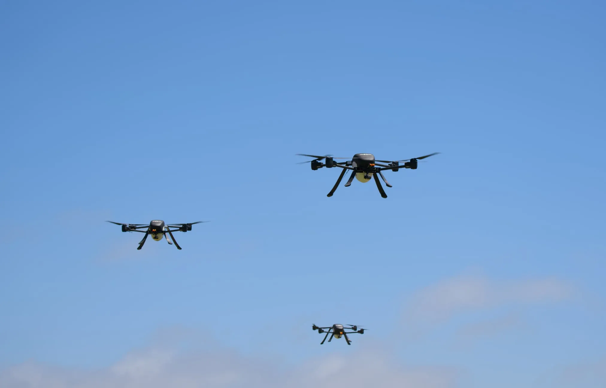

El Distrito de Protección contra Incendios del Condado de San Bernardino (SBCoFD) ha firmado con Seneca el despliegue de un equipo de cinco drones autónomos de extinción, una base móvil de operaciones aéreas remolcable y el software de autonomía de la compañía. Será el primer departamento de bomberos de California en entrenar y operar el sistema, según el comunicado que la empresa publicó el 28 de octubre. Cada salida descarga más de 500 galones de espuma terminada y, siempre según el fabricante, alcanza un conato nuevo en 5 o 10 minutos como máximo.

El condado es el más extenso de los Estados Unidos continentales: algo más de 2 millones de residentes repartidos en unos 52.000 kilómetros cuadrados, con barrios densos, cañones, desierto alto y montaña dentro del mismo distrito. Muchos de esos incendios empiezan en terrenos a los que una cuadrilla no llega a tiempo y en horas en las que los medios aéreos tripulados no vuelan.

## Cinco drones y un solo piloto

La pieza que cambia la operación no es el dron, sino quién lo vuela. Las cinco aeronaves navegan y se coordinan con inteligencia artificial a bordo, de modo que un único piloto del distrito supervisa el equipo completo en lugar de manejar cada aparato con los mandos. Seneca describe el sistema como copters eléctricos que se lanzan desde una tableta, se transportan en un vehículo utilitario o se quedan estacionados en un punto de riesgo alto, sin helipuerto, mecánicos ni estación de repostaje.

A eso se suma una base de operaciones móvil que se remolca hasta la zona, y varias capas de separación de tráfico —evasión autónoma de obstáculos, alertas ADS-B y Remote ID— para no cruzarse con otros aparatos en el espacio aéreo del incendio. La operación nocturna se apoya en los sensores de a bordo, que es justo la franja en la que buena parte de la aviación tripulada de extinción queda en tierra.

## Lo que llevan de verdad en el depósito

Los 500 galones del titular miden espuma terminada, no líquido a granel. La espuma clase A se genera aireada a presión muy alta, de modo que ocupa mucho más volumen que el agua de la que sale: los 500 galones no equivalen a los casi 1.900 kilos que pesaría ese mismo volumen de agua. En la ficha de producto, Seneca cifra el conjunto completo —sistemas de cuatro a seis drones— en 500 a 1.000 libras de agente extintor por viaje, es decir, entre 227 y 454 kilos. Es la cifra que se puede comparar con la carga de un medio aéreo convencional, y explica el modelo: muchas descargas pequeñas y repetidas en lugar de un único lanzamiento grande.

De ahí salen los tres usos que el comunicado pone por delante. El primero es el ataque inicial sobre un conato en terreno inaccesible. El segundo, tender perímetros de espuma o retardante alrededor de estructuras y vegetación cuando los recursos están repartidos en varios frentes. El tercero es el remate: enfriar puntos calientes en la fase de liquidación sin exponer a las cuadrillas a materiales tóxicos.

El sensor es la otra mitad del problema, y ahí el sector lleva meses moviéndose. En octubre contamos cómo los [drones contra incendios ganan visión 3D con LiDAR para volar entre el humo](/noticias/drones/drones-incendios-lidar-ouster/), una capacidad que este tipo de operación necesita para no depender de la visibilidad del operador.

## Los números que el anuncio no da

El comunicado no publica peso al despegue, autonomía de vuelo, límite de viento, número de recargas por hora ni precio del contrato. Tampoco concreta la formulación de la espuma ni si está libre de compuestos fluorados, una pregunta recurrente entre bomberos y en la normativa europea sobre espumógenos. Son los datos que separan una demostración de una herramienta de guardia: sin autonomía declarada no se sabe cuántos viajes caben en una hora, y sin límite de viento no se sabe qué días de la temporada la flota se queda en el suelo.

Los plazos sí están: la formación del personal empezará antes de la entrega, prevista para el primer y segundo trimestre de 2027, y el sistema debe estar integrado en la operación antes del pico de la temporada de 2027. Es decir, nada de esto está volando hoy. El objetivo que el jefe del distrito, Dan Munsey, pone encima de la mesa es detener el 90 % de los incendios antes de que pasen de 10 pies cuadrados, menos de un metro cuadrado, y el distrito lleva más de un año trabajando con Seneca en el diseño.

## El cuello de botella es el certificado

Estados Unidos limita la operación de drones civiles pequeños a 55 libras —unos 25 kilos— bajo la Parte 107. Una aeronave que descarga cientos de litros de espumógeno queda muy lejos de ese umbral y se mueve en el terreno de la certificación de aplicaciones aéreas y de las autorizaciones para volar más allá de la línea de visión del piloto. El comunicado no detalla por qué trámite va el sistema de San Bernardino ni qué exenciones tiene concedidas.

El marco europeo no es más blando. El reglamento de la EASA obliga a certificar la aeronave por encima de los 25 kilos y a obtener una autorización operacional para este tipo de misión, con análisis de riesgo incluido. Para un servicio de emergencia español, la barrera no es el precio del dron: es el expediente. Y ahí la comparación con el mercado estadounidense, donde el distrito ya opera una división propia de robótica y sistemas aéreos no tripulados, sigue siendo la distancia que separa un anuncio de una flota en servicio.

¿Merece la pena? Como capacidad de ataque inicial, el argumento se sostiene: llegar en minutos a un conato de un metro cuadrado cuesta menos que combatir un incendio de diez hectáreas. Lo que falta por ver es la letra pequeña —autonomía, viento, coste por salida y certificados—, y esa letra no está en el anuncio.
