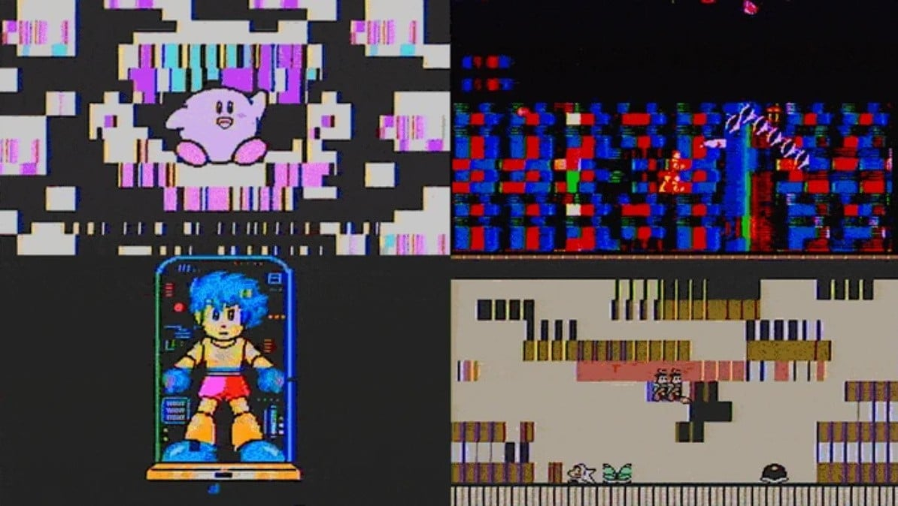

Glitch Boy utiliza la emulación de NES y Game Boy para algo distinto de reproducir los juegos con la mayor fidelidad posible: alterar su funcionamiento y convertir sus imágenes y sonidos en material audiovisual. Melted Electronics ofrece este instrumento por **189 euros**, tanto en versión independiente como en módulo Eurorack. La cobertura reciente de [Time Extension](https://www.timeextension.com/news/2026/11/glitch-boy-new-emulator-and-chiptune-synth-allows-users-to-corrupt-nes-games-in-real-time), publicada el 1 de noviembre, vuelve a poner el foco en el dispositivo; no acredita un lanzamiento realizado hoy.

## Qué hace Glitch Boy con los emuladores

Según la [ficha del fabricante](https://meltedelectronics.com/products/glitch-boy/), el equipo parte de emuladores de NES y Game Boy modificados deliberadamente para provocar fallos. Los controles permiten intervenir durante la ejecución, mientras que la entrada de audio y MIDI sirven para sincronizar las alteraciones con música. El destino que propone Melted Electronics son los directos visuales, los videoclips y el videoarte, no una competición por ejecutar más sistemas sin errores.

Time Extension explica el funcionamiento sobre NES: el mando Glitch A afecta a la CPU emulada y puede cambiar tanto la imagen como el sonido; Glitch B interviene sobre el procesador gráfico. La distinción importante es que, según esa descripción, las distorsiones proceden de modificar la emulación, no simplemente de colocar un filtro sobre un vídeo terminado. No hemos probado el aparato ni medido la estabilidad de esas intervenciones.

*Imágenes: Melted Electronics; montaje de distorsiones difundido por Time Extension.*

## NES, Game Boy y música mediante MIDI

La página oficial identifica NES y Game Boy en su descripción y añade expresamente **compatibilidad con Game Boy Color**. Eso amplía lo que recoge la noticia centrada en NES, pero no equivale a una garantía de funcionamiento de todos los juegos de esos catálogos. La ficha consultada no aporta una lista exhaustiva de títulos verificados, por lo que no permite prometer compatibilidad completa.

Los juegos se cargan desde microSD. Las especificaciones indican tarjetas de hasta 32 GB, no incluidas, y salida de vídeo compuesto PAL o NTSC hacia una pantalla externa. No se documenta un lector de cartuchos: no debe confundirse con proyectos como la [FPGA SP que ejecuta cartuchos originales de Game Boy Advance](/noticias/emuladores/taki-udon-fpga-sp-gba/), cuyo planteamiento es diferente.

La otra función es musical. MIDI permite tocar los sonidos de la consola emulada y utilizar el aparato como instrumento chiptune. El fabricante también detalla una entrada de línea mono, conexión MIDI TRS de tipo A y dos entradas CV de 0 a 5 V. Son conexiones relevantes para integrarlo con otros equipos, no una prueba de que cualquier configuración musical vaya a funcionar sin adaptación. La ficha ofrece además actualizaciones de firmware desde el navegador mediante USB.

## Dos formatos al mismo precio y un plazo de expedición

La variante independiente funciona con alimentación USB y no necesita un bastidor modular. La edición Eurorack está pensada para montarse en un sistema de ese formato. Ambas figuran a 189 euros en la tienda oficial; quien solo quiera experimentar sin disponer de un sistema modular debe tener presente esa diferencia antes de elegir.

Melted Electronics anuncia que el pedido **sale aproximadamente dos semanas después de realizarlo**. Es un plazo orientativo de preparación y expedición, no una garantía de recepción en España en catorce días. Tampoco debe interpretarse ese precio de ficha como confirmación del coste final de transporte para cualquier destino.

El interés está en usar la emulación como herramienta creativa, aceptando alteraciones donde un emulador convencional intentaría evitarlas. Para trabajar con juegos, conviene limitarse a archivos propios o contenidos cuya licencia permita su uso; comprar el dispositivo no concede derechos sobre catálogos comerciales ni sobre la difusión de sus imágenes y música. Lo confirmado es su propuesta audiovisual y los sistemas anunciados por el fabricante, no una consola portátil con cartuchos ni una compatibilidad universal.
