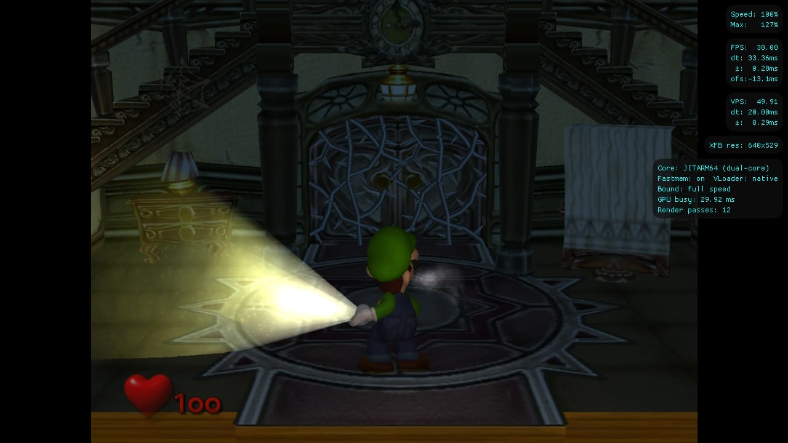
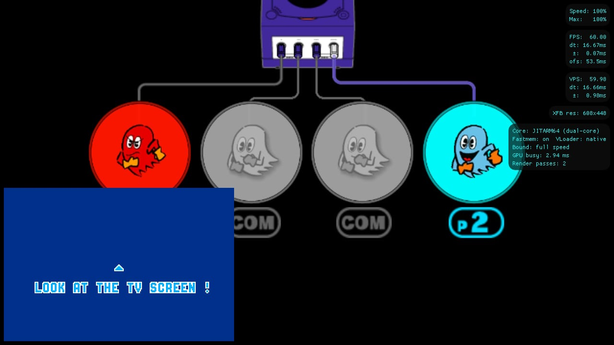

**Nezumiiruka 1.0.0 ya tiene su primera publicación fuera de la fase preliminar.** PalindromicBreadLoaf lanzó el 19 de octubre esta adaptación de Dolphin para emular GameCube y Wii en Nintendo Switch. Su objetivo es acercar GameCube a la velocidad original con las frecuencias habituales del modo portátil, aunque el propio desarrollador reconoce que buena parte de los juegos todavía queda por debajo.

La entrega está basada en **Dolphin 2609-75** y es idéntica a la versión candidata 1.0.0-rc2. El cambio a la numeración estable no introduce una nueva tanda de optimizaciones frente a esa RC2 ni significa que todos los juegos funcionen sin errores. Además, el proyecto es independiente: su documentación aclara que no está afiliado al equipo de Dolphin.

## Nezumiiruka apuesta por Deko3D antes que por Vulkan

La adaptación incluye un backend Deko3D escrito específicamente para aprovechar el hardware de Switch. Es la opción recomendada por el autor y la que utiliza la descarga estándar, `nezumiiruka.nro`. También hay una compilación alternativa con Vulkan mediante nxvk, pero el desarrollador la considera más lenta y con mayor sobrecarga.

En su [anuncio original en GBAtemp](https://gbatemp.net/threads/nezumiiruka-a-new-port-of-dolphin-to-the-nintendo-switch.685580/), explica que Vulkan queda como alternativa para los juegos que presenten problemas con Deko3D, no como la primera elección para ganar rendimiento. La distribución se realiza como aplicación homebrew en formato NRO para Nintendo Switch, no como una aplicación de la eShop.

## GameCube tiene casos a velocidad completa; Wii exige más

El autor cita **Luigi’s Mansion y Super Smash Bros. Melee** como ejemplos que pueden alcanzar la velocidad original con las frecuencias de serie del modo portátil. En el mismo anuncio sitúa la mayoría de los juegos más cerca del 85–90 % de velocidad de emulación. Son valoraciones del desarrollador, no resultados de una prueba independiente de TechSpain24 ni una garantía para todo el catálogo.

La [documentación de la versión](https://github.com/PalindromicBreadLoaf/nezumiiruka/blob/v1.0.0/Readme.md) ofrece una referencia más conservadora: muchos títulos tridimensionales rondan el 80 % y están limitados por la CPU. Ambas descripciones apuntan al mismo problema práctico: disponer de margen gráfico para aumentar la resolución no asegura que la lógica del juego avance a su ritmo original.

*Captura publicada por el desarrollador, que la presenta como Luigi’s Mansion a resolución interna 2× y frecuencias de serie. Una imagen fija no permite verificar la fluidez.*

Para Wii, el responsable habla de títulos jugables con un overclock elevado, de **1.785 MHz o más** en su anuncio. Esa condición no equivale a compatibilidad general ni convierte la subida de frecuencias en una recomendación universal. En una respuesta posterior del mismo hilo también advierte de que Metroid Prime y Metroid Prime 2 funcionan mal y no asegura que puedan alcanzar la velocidad completa.

## Controles, logros y generación de fotogramas opcional

Nezumiiruka incorpora perfiles de control predefinidos y personalizables, un menú durante la partida, un perfilador para ayudar a diagnosticar problemas y un actualizador integrado. El anuncio enumera además soporte para RetroAchievements, almacenamiento USB y conexión con Game Boy Advance. Para Wii, la documentación contempla utilizar la pantalla táctil como entrada del puntero.

*Ejemplo de Pac-Man Vs. con la función de conexión de Game Boy Advance, compartido por PalindromicBreadLoaf.*

También existe generación de fotogramas mediante Lossless Scaling y lsfg-nx. Es una función opcional: requiere una copia propia de `Lossless.dll`, obtenida con la compra de Lossless Scaling, y actualmente solo está implementada en Deko3D. El autor advierte de su elevado consumo de recursos y de la necesidad de aumentar las frecuencias de la GPU para obtener buenos resultados. No debe confundirse la inserción de imágenes intermedias con ejecutar la emulación a su velocidad original.

## Sin Netplay y con límites al trasladar datos desde PC

El recompilador JitArm64 adaptado para Switch trae una contrapartida: **los estados de guardado y las cachés de shaders no son intercambiables con Dolphin en PC**. La documentación también avisa de que los estados pueden dejar de funcionar entre versiones de Nezumiiruka; no conviene tratarlos como un formato de conservación permanente.

El juego en red es otra ausencia relevante. El desarrollador descarta Netplay entre Switch y PC por las desincronizaciones, y señala que las partidas entre consolas Switch todavía no están implementadas. Aunque el [Dolphin principal ha ampliado NetPlay a Android](/noticias/dolphin-progress-report-2609/), esa función no se traslada automáticamente a esta adaptación.

Las [notas de la versión 1.0.0](https://github.com/PalindromicBreadLoaf/nezumiiruka/releases/tag/v1.0.0) añaden una cautela sobre los periféricos: el autor no ha podido probar personalmente el adaptador de mandos de GameCube para Wii U ni determinadas funciones de Skylanders y Disney Infinity por no disponer del material necesario. El estado actual combina juegos concretos que, según su responsable, ya alcanzan la velocidad completa con otros limitados por la CPU y funciones pendientes de verificar. Ese es el alcance de esta primera versión estable, no la promesa de ejecutar toda GameCube y Wii sin concesiones.
