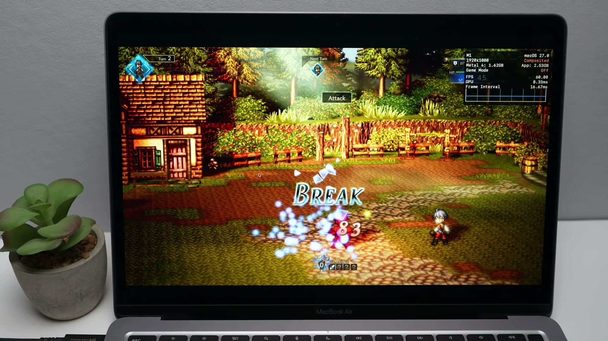

nxnative ya puede ejecutar juegos de Switch como aplicaciones nativas de macOS. El
youtuber Andrew Tsai ha publicado una demostración en la que Monster Hunter Rise corre
en un MacBook Air M1 de 8 GB, y la superposición de Metal que activa el propio proyecto
marca 60,00 FPS con 14,37 ms de GPU. Detrás está
[`seedds/nxnative`](https://github.com/seedds/nxnative), un proyecto con licencia MIT
que ronda las 5.500 estrellas en GitHub y que arrancó como copia de las partes
genéricas de `d2r-mobile`, el trabajo previo del mismo enfoque para Diablo II:
Resurrected.


El titular del vídeo promete que «cualquier juego de Switch» puede funcionar así. El
repositorio es bastante más prudente: mantiene una lista de títulos probados y, para
todo lo demás, el script hace lo que puede. Esa distancia entre el reclamo y el estado
actual es la parte interesante de la historia.

## Qué hace nxnative en lugar de emular

La diferencia técnica es real y explica el rendimiento. Un emulador de Switch
interpreta o recompila las instrucciones de la consola y reproduce su GPU en tiempo
real; aquí no. nxnative reescribe los módulos de código del juego y deja que el código
ARM64 original se ejecute directamente sobre el chip de Apple. Lo que sí sigue ahí es
un host que suplanta al kernel de Horizon y a los servicios del sistema: hilos y
sincronización, memoria, sistema de ficheros con guardado transaccional, entrada,
audio, teclado en pantalla y ciclo de vida de la aplicación. Es una capa de
compatibilidad considerable, solo que no emula la CPU.

Los gráficos van por el mismo camino. La API NVN de Switch se reconstruye sobre Metal,
y los shaders se extraen de los contenedores de Nintendo y de los objetos de Unity para
traducirlos antes de ejecutar: el traductor de shaders de Ryujinx convierte el código
Maxwell en SPIR-V y después SPIRV-Cross lo pasa a Metal Shading Language, que se compila
por adelantado. Los juegos que dibujan con Vulkan o con OpenGL tienen sus propias capas
intermedias.

El resultado práctico es que ningún fotograma se pierde traduciendo instrucciones de
CPU, que es justo el cuello de botella de la emulación en un portátil. Por eso un M1
básico puede sostener 60 FPS en títulos que en la consola van a 30.



## Qué hace falta para probarlo

El requisito de hardware no es negociable: **un Mac con Apple Silicon**. El host de
macOS ejecuta el código arm64 del juego, así que un Mac Intel se queda fuera. En iPhone
la exigencia es aún más concreta: iOS 26 y un A17 Pro o posterior.

A partir de ahí, el camino es el de siempre en este tipo de proyectos: Xcode y Homebrew
instalados, las dependencias de compilación (`xcodegen`, `zstd`, `spirv-cross`,
`glslang`, el SDK de .NET y un puñado de paquetes de Python) y, sobre todo, **material
propio**. Hace falta una carpeta con los NSP del juego —la base, y la actualización y el
DLC si se tienen— y el archivo `prod.keys` de la propia consola. El repositorio no
incluye ni un solo archivo de juego y así lo advierte su autor.

Con eso, una sola orden genera la aplicación:

```
python3 scripts/build_ipa_from_nsp.py ~/Games/MarioWonder -k ~/keys/prod.keys --platform mac-app
```

El script extrae, reescribe, traduce los shaders y empaqueta un `.app` que se abre desde
el Finder, sin depender de la carpeta de compilación. La primera compilación tarda entre
30 y 60 minutos; las siguientes rondan los 10. Conviene reservar alrededor del doble del
tamaño de los NSP más 10 GB libres. Los guardados van a
`~/Library/Application Support/nxnative/<title ID>/` y los registros, a
`~/Library/Logs/nxnative/`.

Hay dos detalles que la demostración no enseña. El primero es que la app se firma de
forma ad hoc y **no está notarizada**: si llega descargada, Gatekeeper la bloquea hasta
que se autoriza desde Ajustes del Sistema › Privacidad y seguridad. El segundo es que
las primeras veces que aparece una escena nueva hay tirones cortos, porque Metal compila
sus pipelines en ese momento y el proyecto solo los recuerda para la siguiente partida.

## Qué no debes esperar

**No todos los juegos funcionan.** La galería del proyecto reúne más de setenta títulos
con notas por juego, y cada uno tiene su perfil con las compilaciones reconocidas y sus
parches. Un juego sin perfil recibe un análisis automático y un intento de empaquetado
«lo mejor posible» que, en palabras del propio repositorio, puede no arrancar.

**Los 60 FPS son una demostración del autor, no una prueba independiente.** Tsai los
muestra en su equipo y con su partida; nadie ha replicado todavía esas cifras de forma
sistemática. Además dependen de la versión: la tabla del proyecto anota 60 FPS en
Monster Hunter Rise con la actualización 16.0.2, y avisa de que los ajustes hechos para
una versión concreta no se aplican a otra distinta.

**No hay online ni amiibo.** El proyecto lista como limitaciones conocidas la ausencia
de soporte de amiibo y de funciones online; Super Smash Bros. Ultimate aparece
directamente como «offline». El multijugador local sí está: en macOS cada mando
conectado ocupa un jugador propio, hasta ocho, con el teclado como jugador uno. Tampoco
hay que fiarse de la galería como si fuera toda de Mac: mezcla pruebas hechas en Mac y
en iPhone, y cada ficha aclara en qué plataforma se probó.

Quedan además huecos de renderizado reconocidos: el render condicional se dibuja siempre,
los shaders de geometría no se traducen y, en Mac, los menús y los diálogos de Mario
salen en blanco (en iPhone no). Es el estado actual de un proyecto que va muy rápido y
que conviene leer como lo que es: un avance serio con una lista de compatibilidad
todavía corta, no una forma de jugar a cualquier cosa que tengas en la estantería. Quien
quiera seguir el detalle juego por juego lo tiene en la vertical de
[emuladores](/noticias/emuladores/).
