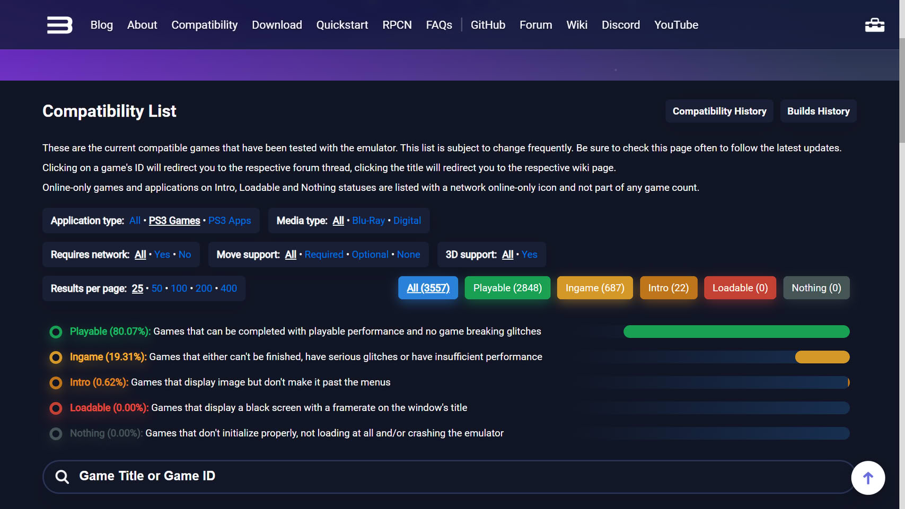
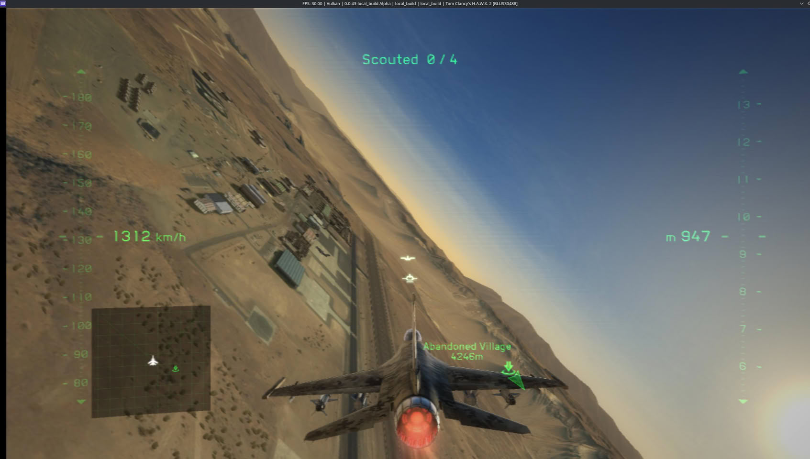

RPCS3 ya no tiene ningún juego atascado en la categoría **Loadable**. El equipo del
emulador de PlayStation 3 lo ha anunciado en X y la lista de compatibilidad lo refleja:
el último título que quedaba en esa franja, **Tom Clancy's H.A.W.X. 2**, ha subido a
**Ingame** gracias a una corrección de precisión del SPU firmada por el colaborador
Yahfz. De los 3557 juegos contabilizados, 2848 aparecen como Playable, 687 como Ingame,
22 como Intro y ninguno en Loadable ni en Nothing.

## Qué mide la categoría «Loadable» en RPCS3

La lista de RPCS3 clasifica cada juego según hasta dónde llega al ejecutarse, y «Loadable»
era el escalón más bajo antes del fallo total: títulos que cargan y después solo muestran
una **pantalla negra con el contador de fotogramas en la barra de título**. Es decir, el
emulador arranca el juego, pero la imagen nunca llega a dibujarse.

| Categoría | Qué exige |
| --- | --- |
| Playable | Se puede completar con rendimiento jugable y sin fallos que rompan el juego |
| Ingame | Arranca y se deja jugar, pero no se puede terminar, tiene fallos serios o le falta rendimiento |
| Intro | Muestra imagen, pero no pasa de los menús |
| Loadable | Pantalla negra con el contador de fotogramas en la barra de título |
| Nothing | No inicializa: no carga o directamente cierra el emulador |

Vaciar «Loadable» significa que **ningún juego se queda ya en el paso previo a mostrar
imagen**, y nada más que eso. Ingame no es jugabilidad garantizada: el propio proyecto
define la categoría como los juegos que no se pueden terminar, arrastran fallos graves o
no alcanzan rendimiento suficiente. H.A.W.X. 2 ha salido de la pantalla negra, no de la
lista de tareas pendientes.

El matiz está en la letra pequeña de la propia lista: el recuento deja fuera los juegos
exclusivamente online que caen en Intro, Loadable o Nothing, que la web marca aparte y no
suma al total. Un puñado de ellos —Final Fantasy XIV: A Realm Reborn, Dragon's Dogma
Online o Angel Love Online, entre otros— sigue figurando en Loadable, pero su estado no
entra en la cifra que el equipo ha dejado a cero.

## El arreglo estaba en el cargador de hilos SPU

La corrección es de las que se explican con el depurador delante. RPCS3 reproduce ahora
**el cargador de hilos SPU y los argumentos que el núcleo LV2 de PS3 deja en la Local
Store** al comienzo de cada grupo de SPU, antes de que se cargue la imagen de código. Con
ese estado reconstruido tal y como lo dejaba la consola, el cargador deja de corromperse
y el juego avanza hasta la partida.

El detalle importa porque la arquitectura de PS3 no se emula «por aproximación»: los SPU
del Cell trabajan con una memoria local pequeña y un protocolo de carga muy concreto, y
una diferencia en los argumentos iniciales basta para que el programa lea basura donde
esperaba código. Por eso los avances de compatibilidad llegan en forma de arreglos de
precisión y no de parches de rendimiento.

## Quedan 22 títulos en Intro y un 19 % en Ingame

El bloque grande ya no es el de la pantalla negra, sino el de **Ingame**: 687 juegos, un
19,31 % del total, que arrancan y se dejan jugar con reservas. La lista corta es la de
**Intro**, con 22 títulos que no pasan de los menús; según el recuento, la mayoría son
juegos multijugador o títulos que exigen el controlador PlayStation Move, con excepciones
como Need for Speed: The Run.

Tampoco es la primera vez que la categoría se queda a cero: el equipo ya lo anunció hacia
el cambio de 2023 y la lista volvió a llenarse después. Una regresión en cualquier
subsistema puede devolver títulos a la pantalla negra, así que el hito conviene leerlo
como **una foto del estado actual**, no como una meta cerrada. El otro dato que ayuda a
situar el avance es la progresión: en julio el 0,06 % de la biblioteca seguía en Loadable
y Playable rondaba el 75 %, según el recuento que publicó TechPowerUp entonces, frente al
80,07 % de ahora.

## Qué cambia para quien emula PS3 hoy

Para el que juega, el titular práctico es otro: **cada vez quedan menos juegos que ni
siquiera se ven**. Antes de descargar una copia conviene mirar la ficha concreta en la
lista de compatibilidad, porque la etiqueta global del emulador no dice nada sobre el
título que te interesa, y «Ingame» puede significar desde una partida estable hasta un
menú que se cae al cargar el primer nivel. RPCS3 publica builds para Windows, Linux y
macOS; en Android el camino pasa por [ports como ARMSX3](/noticias/ps3-android-movil-emulador/),
que parten de este mismo trabajo. Y si el rendimiento se queda corto en una GeForce, no
está de más revisar el [rodeo al bug de los drivers de NVIDIA](/noticias/rpcs3-nvidia-driver-performance/)
que el equipo documentó en septiembre.

Queda trabajo, y bastante: 687 juegos en Ingame y 22 que no pasan de los menús. Lo que
cambia hoy es que la lista ya no tiene un cajón de títulos que cargan a ciegas.
