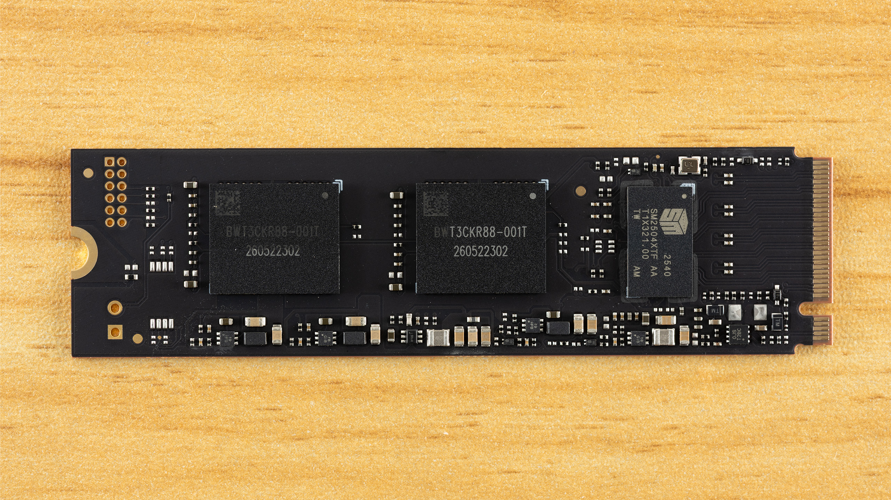
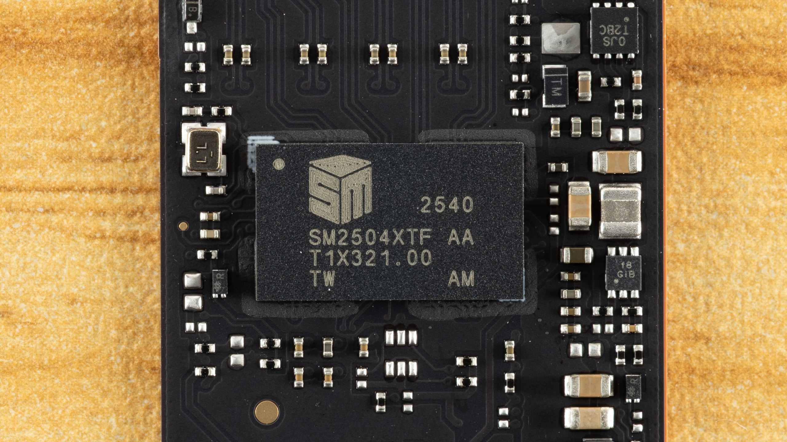

El **Biwin M560 de 2 TB** obtiene una valoración especialmente favorable por su respuesta y eficiencia en el [análisis publicado por Tom’s Hardware el 1 de noviembre](https://www.tomshardware.com/pc-components/ssds/biwin-m560-2tb-ssd-review). El matiz importante aparece al escribir grandes cantidades de datos: el medio encuentra una caída notable cuando se agota la caché. Es una diferencia relevante para quien busca una unidad principal para aplicaciones y juegos frente a quien necesita transferencias largas y continuas. **Esta información recoge las pruebas de Tom’s Hardware; no es un análisis realizado en el laboratorio de TechSpain24.**

## Biwin M560: PCIe 5.0 sin DRAM dedicada

La ficha técnica recogida por Tom’s Hardware describe un SSD **M.2 2280 de una sola cara**, con interfaz PCIe 5.0 x4 y protocolo NVMe 2.0. La unidad combina el controlador Silicon Motion SM2504XT con memoria Kioxia BiCS8 TLC de 218 capas. No incorpora DRAM dedicada y recurre a HMB, un mecanismo que utiliza parte de la memoria del sistema anfitrión.

Para la versión de 2 TB, el medio recoge especificaciones de hasta **11.000 MB/s de lectura y 10.000 MB/s de escritura secuencial**, además de una resistencia declarada de 1.500 TBW y cinco años de garantía. Son valores de ficha, no velocidades garantizadas para cualquier archivo o equipo. La gama que examina la publicación se limita a 1 y 2 TB; la ausencia de una opción de 4 TB figura entre sus reservas.

*Fotografía del desmontaje publicada por Tom’s Hardware.*

## La respuesta en aplicaciones pesa más que el máximo secuencial

En los [resultados de rendimiento de Tom’s Hardware](https://www.tomshardware.com/pc-components/ssds/biwin-m560-2tb-ssd-review/2), el M560 termina primero entre las unidades comparadas en PCMark 10 Storage y segundo en 3DMark Storage, por detrás de la muestra de ingeniería SM2504XT. El medio también destaca su latencia de lectura aleatoria de 4 KB a profundidad de cola uno: lidera ese apartado dentro del grupo comparado. No significa que sea el SSD más rápido de todo el mercado ni que vaya a acelerar todos los juegos por igual.

El contexto de esas mediciones importa. Tom’s Hardware declara una plataforma con **Core i9-12900K, placa Asus ROG Maximus Z790 Hero, 32 GB de DDR5-5600 CL28 y Windows 11 Pro**. Su metodología general utiliza cada SSD como dispositivo secundario, con el 50 % ocupado y varias tareas de fondo desactivadas para reducir variaciones. También especifica refrigeración activa salvo indicación contraria. No equivale a medirlo como disco de arranque dentro de cualquier portátil.

La comparación tampoco es favorable en todos los apartados. En DiskBench, donde el medio utiliza un conjunto de 50 GB con 31.227 archivos, su valoración resulta menos entusiasta: los modelos con controlador Phison E31T y memoria BiCS8 salen mejor parados. Es una advertencia contra reducir la compra a un único resultado sintético.

*Detalle del controlador fotografiado por Tom’s Hardware.*

## La caché cambia el resultado de las escrituras largas

El ensayo sostenido de Tom’s Hardware emplea Iometer durante 15 minutos y distingue **tres estados de escritura**, no una sola velocidad constante. Con la unidad vacía, el medio mide algo más de 10,3 GB/s durante más de 59 segundos, con una caché pSLC de aproximadamente 611 GB. Esa reserva es dinámica: se reduce a medida que se ocupa el SSD. No debe confundirse este escenario inicial vacío con el estado de ocupación de su metodología general.

Después aparece la escritura directa a TLC, por encima de 4,1 GB/s según el análisis. Sin embargo, Tom’s Hardware advierte de que ese dato tampoco describe por sí solo una transferencia prolongada: cuando el SSD necesita trasladar datos de la caché a la TLC para liberar espacio, la velocidad cae a algo más de **1,6 GB/s**. Esa reorganización compite con las nuevas escrituras.

Por eso, el veredicto del medio favorece su uso como unidad principal polivalente, pero no lo considera ideal para cargas sostenidas de escritura. Una caché grande permite absorber ráfagas extensas; no elimina la penalización posterior ni garantiza el mismo comportamiento con el disco casi lleno.

## Eficiencia y compatibilidad: qué comprobar antes de comprar

Tom’s Hardware califica su eficiencia como excelente, aunque ligeramente inferior a la de los modelos E31T con BiCS8 en ese indicador. En su prueba térmica, descrita sin disipador, los dos sensores alcanzan **61 y 76 °C**, con una temperatura ambiente cercana a 22 °C. El medio sitúa el sensor más caliente aproximadamente diez grados por debajo del umbral de limitación térmica, pero advierte de que los sensores no siempre son precisos. Esas temperaturas no son una promesa para cualquier chasis o clima.

Para instalarlo, conviene comprobar el soporte M.2 2280 NVMe, las líneas de la ranura y el espacio disponible. En una plataforma PCIe 4.0 no se aprovechará el ancho de banda de PCIe 5.0. El reparto de conectores también importa en sobremesa, como ilustra nuestra cobertura de las [ranuras M.2 de la Gigabyte B850 AORUS ELITE X3D](/noticias/gigabyte-b850-aorus-elite-x3d/).

La conclusión de Tom’s Hardware es favorable para quien prioriza respuesta y eficiencia en una unidad principal de 2 TB, no para quien busca la mayor capacidad o escrituras continuas sin cambios de ritmo. **No hay un precio ni existencias en España verificados para esta pieza**: las referencias comerciales estadounidenses del análisis no permiten establecer cuánto costará aquí ni si está disponible en una tienda española.
