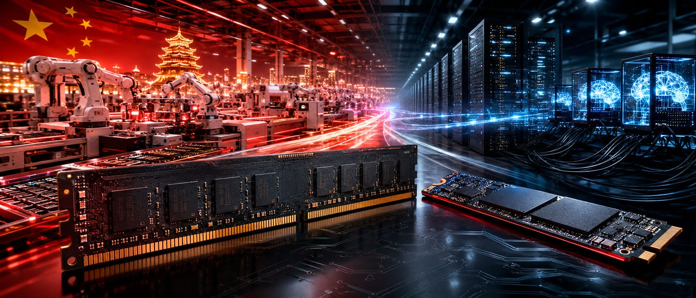

Durante el tercer trimestre de 2026, el procesador, la memoria RAM y el SSD concentraban aproximadamente el 68 % del coste de los componentes de un portátil convencional con un precio recomendado de 900 euros o dólares. El dato conviene leerlo con precisión, porque cambia todo lo que viene después: ese porcentaje corresponde al coste de los materiales del equipo, no a su precio de venta. Dicho de otro modo, casi siete de cada diez euros que cuesta fabricar la máquina se van en tres piezas.

## Subidas encadenadas en el silicio

El porcentaje no sale de un repunte puntual, sino de una suma de incrementos que se acumulan desde hace meses. Los procesadores de AMD e Intel ya han aplicado al menos dos subidas de precio en lo que va de año, y todo apunta a que la tendencia se mantenga en 2027. Qualcomm, aunque no lo haya anunciado oficialmente, también habría encarecido sus chips para ordenadores y móviles. El origen de estas subidas está en TSMC, que ha elevado el precio que cobra a estas compañías por fabricar sus procesadores y tarjetas gráficas.

A esa factura hay que añadirle la de la memoria DRAM y la del almacenamiento NAND. En `memorias` conviene fijarse en este punto: ambos son los componentes que más se mueven al alza y lo hacen trimestre a trimestre. Las previsiones apuntan a que seguirán subiendo durante todo 2027 y buena parte de 2028, así que el problema no es de una sola generación de portátiles, sino de las dos o tres siguientes.

## Tres salidas y ninguna cómoda

Con ese escenario, el fabricante solo tiene tres caminos. El primero es subir el precio final, con el efecto inmediato de que baja el volumen de ventas. El segundo ya se está viendo en las tiendas: recortar especificaciones. Se ha vuelto habitual encontrar equipos con 8, 16 o 24 GB de RAM y configuraciones de SSD de 256 o 512 GB. El tercero, el más raro, es que la marca asuma el sobrecoste reduciendo su margen de beneficio.

Ninguno resulta atractivo y los tres tienen el mismo destino: o encarecer el producto, o hacerlo menos competitivo, o ganar menos con él. El analista de mercado TrendForce considera poco probable que las marcas puedan mantener a la vez precio, prestaciones y rentabilidad durante 2027. Según esa misma estimación, la producción mundial de portátiles fuera de China caería del 24 % en 2025 al 21 % en 2026, y podría quedar por debajo del 20 % en 2027, ya que la industria volvería a priorizar su infraestructura en China para contener costes.

## La IA sigue apretando la DRAM y la NAND

La memoria RAM está bajo una presión que no depende del mercado de PC. Los servidores de inteligencia artificial absorben prácticamente toda la capacidad de fabricación avanzada, así que el suministro de memoria para ordenadores personales podría crecer de forma limitada. En el lado de la NAND Flash, la que usan los SSD, las restricciones podrían aliviarse durante la segunda mitad de 2027 gracias a nueva capacidad de producción.

Conviene tener claro que el fenómeno no se limita a los portátiles: afecta igual a sobremesa, convertibles y Mini-PC. Y ya ha alcanzado a otros componentes como las placas de circuito impreso (PCB), los condensadores y los chips de gestión energética.

## Qué cambia para el comprador

La lectura práctica es que los equipos de precio asequible tienen los meses contados, y que el momento de comprar deja de ser una cuestión de oportunidad para convertirse en una de calendario. Para quien no quiera pasar por caja ahora, alargar la vida del portátil actual es una vía razonable: un formateo acompañado de un cambio de compuesto térmico y una limpieza devuelven al equipo un comportamiento muy cercano al original, y opciones como Windows 11 LTSC o el salto a Linux reducen el impacto en rendimiento sin tocar el hardware.

Cuando llegue el momento de renovar, el criterio conviene que sea la compatibilidad por delante del número de escaparate. En un equipo nuevo, la decisión real está en la plataforma que soporta la memoria y el almacenamiento —qué generación de DDR admite la placa, cuántos canales, si el SSD es PCIe de qué versión— más que en el porcentaje del folleto. Con los precios en la deriva actual, acertar en esa base evita tener que cambiar de máquina antes de tiempo.
