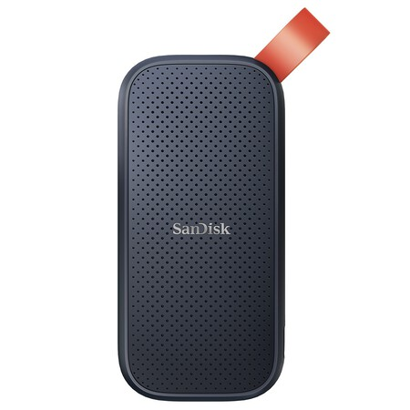

El **SanDisk Portable SSD de 1 TB** está disponible por 139 euros en El Corte Inglés y MediaMarkt, y por 142 euros en FNAC. Es un disco externo con interfaz USB-C 3.2 Gen 2 y una velocidad de lectura declarada de hasta 800 MB/s. La cifra no es un récord, pero sí un precio que llama la atención en un momento en el que el almacenamiento ha dejado de bajar.

## Qué es exactamente este SanDisk Portable SSD

Se trata de la variante portátil de SanDisk, no del modelo Extreme. Monta 1 TB de capacidad en un cuerpo compacto de unos 40 gramos, con un pequeño asa en una de las esquinas que ayuda a sujetarlo. La conexión es USB-C con USB 3.2 Gen 2, y el fabricante declara hasta 800 MB/s en lectura.

No requiere instalación ni software adicional: se conecta al equipo y aparece como una unidad más. Esa simplicidad es relevante para quien lo va a usar entre varios dispositivos —un portátil, una consola o un móvil con USB-C— sin instalar nada en cada uno de ellos.

## Por qué este precio va a contracorriente

El contexto importa más que la cifra. El precio habitual de este mismo modelo rondaba los 80 euros hace algo más de un año, y desde hace meses es común verlo por cerca del doble de esa cantidad. Con la memoria y el almacenamiento al alza, las rebajas en este segmento se han vuelto escasas, así que encontrar 1 TB por 139 euros devuelve el producto a un terreno razonable.

Dicho de otro modo: no es el chollo que era hace algo más de un año, pero sí es una de las pocas ocasiones recientes de comprar 1 TB externo a un precio que se acerca al que tenía antes de la subida. Ya contamos que la subida de precios de las [tarjetas de expansión para Xbox](/noticias/xbox-expansion-cards-ssd-prices-2026/) anticipaba un 2026 caro en almacenamiento; la tendencia se ha confirmado también en los SSD portátiles.

## Para quién tiene sentido

- Quien necesita **mover archivos grandes** entre equipos —vídeos, fotos, copias de seguridad— y no quiere depender de la nube ni de un disco mecánico lento.
- Quien busca **1 TB en el bolsillo** con un peso que no se nota y sin cables propietarios: USB-C estándar.
- Quien trabaja con un portátil de pocos gigabytes y prefiere ampliar por fuera antes que abrirlo.

## Para quién no

- Quien vaya a **editar vídeo directamente desde el disco** o a mover proyectos grandes de forma constante: 800 MB/s de lectura no compiten con un NVMe interno, y la velocidad de escritura sostenida no aparece entre los datos que acompañan a la oferta.
- Quien necesite **resistencia real al agua y al polvo**. La versión Extreme de SanDisk cuenta con certificación IP65; este modelo no, y solo aguanta impactos ligeros.
- Quien prefiera **más capacidad**: aquí el límite es 1 TB.

## La limitación que conviene tener clara

La interfaz USB 3.2 Gen 2 fija un techo de 10 Gbps, y los 800 MB/s declarados corresponden a lectura secuencial en condiciones óptimas. En la práctica, la velocidad dependerá del puerto del equipo: si se conecta a un USB 3.0 antiguo o a un hub de baja calidad, el rendimiento cae. Tampoco es un disco pensado para golpes ni para llevar suelto en una mochila sin funda.

Aun así, para copias de seguridad, traslado de archivos y almacenamiento frío, el equilibrio entre precio, capacidad y tamaño es difícil de discutir a 139 euros.
