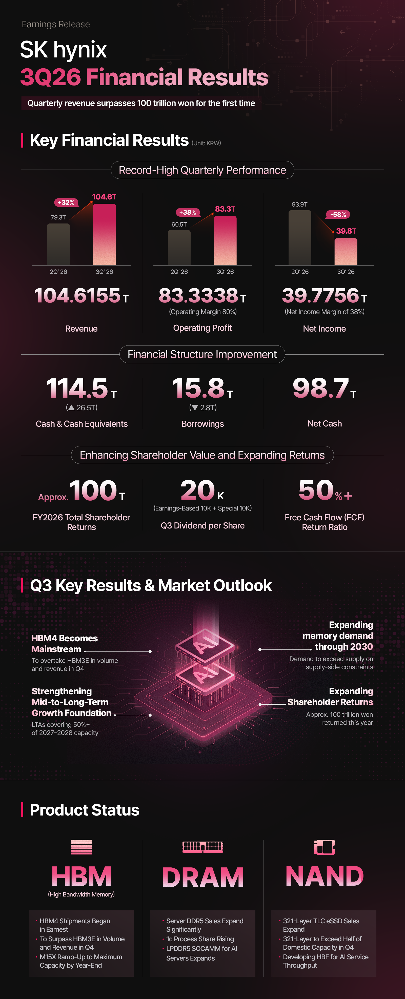

La escasez de memoria no se resolverá el año que viene. Esa es, al menos, la lectura que dejó SK Hynix en la presentación de sus resultados del tercer trimestre de 2026, publicada el 28 de octubre: la compañía espera que la estructura en la que la demanda supera a la oferta se mantenga **hasta 2030**. Conviene subrayar dos cosas antes de seguir. La primera es que se trata de una previsión, no de un compromiso de precios ni de una fecha cerrada. La segunda es que quien la formula es uno de los tres grandes fabricantes de DRAM y NAND del mundo, es decir, una parte interesada en que el mercado siga tenso.

## Qué dijo SK Hynix sobre la escasez de memoria

El documento no habla de precios, sino de equilibrio entre oferta y demanda. La compañía sostiene que la oferta no está siguiendo el ritmo del mercado por dos motivos concretos: la dificultad técnica de los procesos de fabricación más avanzados y el largo plazo que exige levantar una fábrica nueva. De ahí su conclusión: la demanda seguirá por delante de la oferta hasta 2030.

El calendario de la demanda también queda descrito. A corto plazo, la presión viene de la IA empresarial y de la IA personal; a medio y largo plazo, de la llamada IA física, con la conducción autónoma y la robótica como vectores. No es un mercado que la compañía espere que se enfríe pronto.

Los números del trimestre explican por qué nadie tiene prisa por corregir el rumbo. SK Hynix registró unos ingresos de 104,6 billones de wones, la primera vez que supera los 100 billones en un trimestre, con un beneficio operativo de 83,3 billones y un margen operativo del 80 %. Las ventas de HBM4 arrancaron y la compañía espera que ese producto supere al HBM3E en volumen e ingresos durante el cuarto trimestre.

## Por qué la oferta no reacciona tan rápido

La parte que más afecta a quien compra hardware está en el detalle de capacidad. SK Hynix ha firmado acuerdos a largo plazo con 14 clientes principales, entre ellos los grandes proveedores de servicios cloud, y ya tiene comprometido **más del 50 % de su capacidad de producción de 2027 y 2028**. Son contratos que suelen firmarse a cinco años y que incluyen un mecanismo de precios dentro de un rango acordado.

Ese dato, leído en clave de consumo, significa que buena parte de las obleas de los dos próximos años ya tiene destinatario antes de que el mercado libre pida una sola memoria. Y el destino es servidor: DDR5 de servidor, HBM4, módulos SOCAMM de LPDDR5 para servidores de IA y eSSD de 321 capas, que en el cuarto trimestre pasarán a representar más de la mitad de la capacidad NAND doméstica de la compañía. La producción de gama alta se inclina hacia donde está el margen.

A eso se suma la inversión. La compañía prevé un aumento significativo del gasto el año que viene, con la primera fase de Yongin entrando en operación a plena escala, pero mantiene la puerta abierta a ajustar el calendario según la demanda y la rentabilidad. Es decir: más capacidad, sí, pero no necesariamente al ritmo que el mercado de consumo desearía.

## El contrapunto: Acer y los plazos del almacenamiento

La previsión de SK Hynix choca de frente con la que dio en septiembre el consejero delegado de Acer, Jason Chen, que calificó de «imposible» que la escasez durara hasta 2030 y situó el inicio de las bajadas a mediados de 2027, cuando entre en juego capacidad adicional. Aquel análisis llegaba matizado: procedía de una traducción y podía referirse sobre todo al mercado chino. Puedes releer el [análisis de las declaraciones de Jason Chen](/noticias/acer-ceo-ram-crisis/) para comparar ambos calendarios.

Entre ambos extremos, el análisis de Engadget sobre almacenamiento aporta un matiz útil: los HDD y los SSD han quedado algo más protegidos que la RAM, pero tampoco son inmunes. La previsión que maneja ese medio sitúa 2027 como una primera ola de alivio, con descensos sutiles que muchos compradores ni notarán, y retrasa una bajada realmente apreciable a 2029 o 2030. Los mínimos anteriores a la pandemia, añade, probablemente no vuelvan.

Puestos a ordenar las tres versiones, hay un punto en el que coinciden: ninguna promete una vuelta a los precios de hace dos años, y todas mueven la corrección relevante hacia el final de la década. La discrepancia real no es si habrá bajadas, sino cuánto se notarán y cuándo empezarán a notarse.

## Qué cambia si vas a comprar RAM, SSD o un PC

Para quien tiene que ampliar memoria, la consecuencia práctica es que el momento de comprar no va a mejorar por esperar unos meses. Si el equipo se queda corto ahora, el kit DDR5 hay que comprarlo con el mercado como está, y con dos precauciones que ahorran disgustos: verificar que el perfil EXPO o XMP del módulo está validado para la placa y el procesador concretos, y no mezclar kits distintos para rascar capacidad, porque es la vía más rápida a un sistema que no arranca con el perfil activado.

En almacenamiento el margen es algo mayor. Si el SSD que falla es el del sistema, no hay debate: se sustituye ya. Si es una unidad secundaria para biblioteca de juegos o archivo, la horquilla que describe Engadget deja 2027 como una ventana razonable para esperar, sin apostar por un desplome.

Y para quien valora un PC completo, la memoria es solo una parte de la factura, pero es la que más se ha movido: los precios de los equipos de marca y de los montajes a medida absorben ese coste con retraso, así que la subida llega a las tiendas después de aparecer en el componente suelto. Comparar configuraciones equivalentes sigue siendo más rentable que esperar un cambio de ciclo que, según el propio fabricante dominante, no está previsto antes de 2030.
