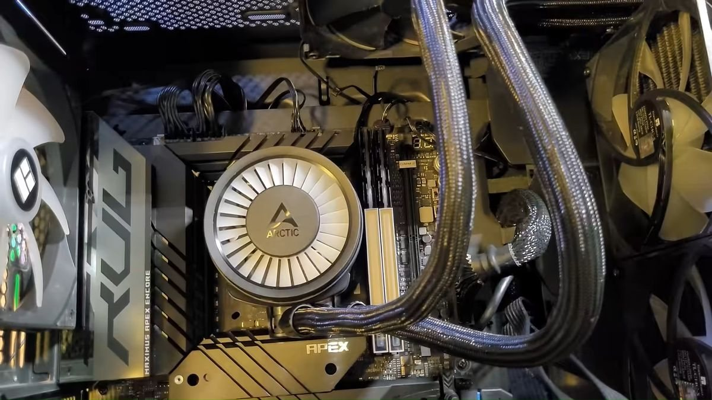

**Blighted Agent ha convertido chips de memoria de portátil en un kit de sobremesa que, según Tom’s Hardware, alcanzó DDR5-7800 CL38.** La publicación de Mark Tyson describe el traslado de componentes de dos SO-DIMM SK hynix de 16 GB DDR5-5600 a nuevas placas de memoria de escritorio. Se trata de retrabajo electrónico especializado, no de insertar un adaptador entre formatos.

## De SO-DIMM a DDR5 de sobremesa mediante trabajo BGA

La fuente consultada para esta noticia es [el informe de Tom’s Hardware](https://www.tomshardware.com/pc-components/ddr5/electronics-hobbyist-converts-usd120-ddr5-sodimm-kit-into-usd1000-desktop-kit-to-fight-ram-crisis-ics-from-sk-hynix-ddr5-5600-16gb-modules-used-to-create-ddr5-7800-desktop-sticks), que remite al [vídeo original de Blighted Agent](https://www.youtube.com/watch?v=bpT5CdOBNDU). No hemos inspeccionado el vídeo completo ni comprobado el montaje de forma independiente.

Según ese relato, el proyecto requiere retirar los circuitos integrados, preparar de nuevo sus conexiones BGA y soldarlos en otras placas. Esa operación necesita herramientas, control del calor y experiencia: un fallo de soldadura o un chip dañado puede impedir que arranque el conjunto. Esta información no constituye una guía para reproducirlo.

## DDR5-7800 CL38 en una plataforma concreta

Tom’s Hardware recoge un ajuste de **DDR5-7800 CL38 a 1,40 V en una ASUS ROG Maximus Z790 Apex Encore** y una prueba de estrés de 90 minutos comunicada por el creador. Son resultados atribuidos al proyecto, no una validación propia de estabilidad.

Ni esa frecuencia ni esa duración de prueba permiten garantizar funcionamiento en cualquier placa o con cualquier controlador de memoria. La compatibilidad sigue dependiendo de la plataforma y de los ajustes. La identificación de los chips como posibles A-die también aparece como una apreciación del creador recogida por el medio, no como una identificación confirmada aquí.

## El coste de materiales no es el coste total

El informe cifra los dos módulos donantes usados en 120 dólares y los materiales del proyecto en unos 175 dólares al añadir placas y disipadores. **La cuenta no incluye equipo especializado ni mano de obra.** La comparación con un supuesto kit de 1.000 dólares no demuestra un ahorro reproducible ni un valor de mercado verificado.

El interés está en reutilizar chips mediante un cambio físico de soporte y después ajustar su funcionamiento. Es un caso distinto de los [módulos DDR5-6400 industriales de Transcend](/noticias/transcend-ddr5-6400-industrial/): una modificación individual no ofrece las mismas condiciones de validación y soporte que un producto comercial especificado para una plataforma.

*Imágenes: Blighted Agent, a través de Tom’s Hardware y de la miniatura pública de su vídeo. No implican una inspección independiente del proceso.*
