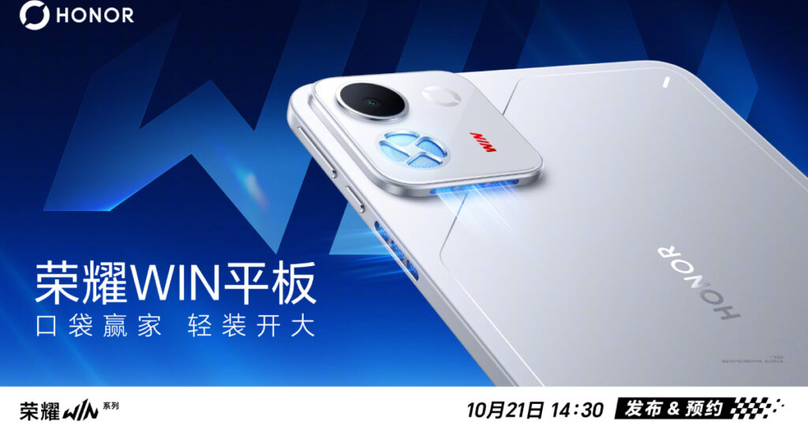

Honor ya tiene fecha para su próxima ofensiva gaming: el **21 de octubre**. Ese día, durante el evento Honor Win Gaming Universe Carnival, la compañía presentará la serie **Honor Win 2** y la **Honor Win Pad**, su primera tablet de la familia Win. Lo que todavía no hay es precio, ni ficha técnica cerrada, ni una sola palabra sobre si alguno de los dos saldrá de China.

Eso es lo que más importa a quien mira desde España: por ahora todo apunta a un lanzamiento doméstico.

## El Win 2, segunda vuelta de la marca Win

No es la primera vez que Honor recurre al apellido Win. La firma estrenó los **Honor Win y Win RT en China en diciembre de 2025**, con una pantalla de 185 Hz, una batería de 10.000 mAh y un ventilador de refrigeración integrado. La serie Win 2 recoge el testigo de esa primera generación.

Honor ya ha mostrado cómo serán los nuevos teléfonos: un módulo de cámara horizontal en la parte trasera con dos sensores, junto a un ventilador y un bloque LED con iluminación RGB. La trasera añade además un patrón que imita nubes. La compañía no ha desvelado todavía las especificaciones de la serie.

Los Win 2 se pondrán a la venta **el mismo día de la presentación**, según Honor, que los vende como «el dispositivo gaming de gama alta del año».

## La Win Pad, refrigeración activa en una tablet

La otra novedad del evento es la **Honor Win Pad**, la primera tablet de la línea Win en montar un ventilador integrado. Es decir, refrigeración activa en un formato en el que lo habitual es confiar solo en la disipación pasiva.

Los filtros apuntan a que la tablet llevará un **Snapdragon 8 Elite Gen 5**, una pantalla OLED de **8,4 pulgadas** y **240 Hz** de refresco. Honor no ha confirmado ninguno de esos datos, así que conviene tratarlos como rumores hasta el 21 de octubre. Las reservas de la Win Pad arrancarán durante el propio evento.

## Lo que queda por confirmar

A Honor le falta cerrar la letra pequeña de ambos equipos: procesadores, capacidades de batería, precios y configuraciones. Tampoco ha dicho si la serie Win 2 o la Win Pad llegarán a mercados fuera de China, donde la familia Win se ha movido hasta ahora.

## Veredicto de compra

Sin precio y sin fecha de llegada a España, todavía no hay nada que decidir. Quien busque un móvil gaming tendrá que esperar al 21 de octubre y, sobre todo, a que Honor confirme si estos equipos cruzan la frontera. Si la Win Pad mantiene la refrigeración activa y sale a un precio contenido, será una propuesta interesante; si se queda en China, será una pieza más para leer con envidia, no para comprar.
