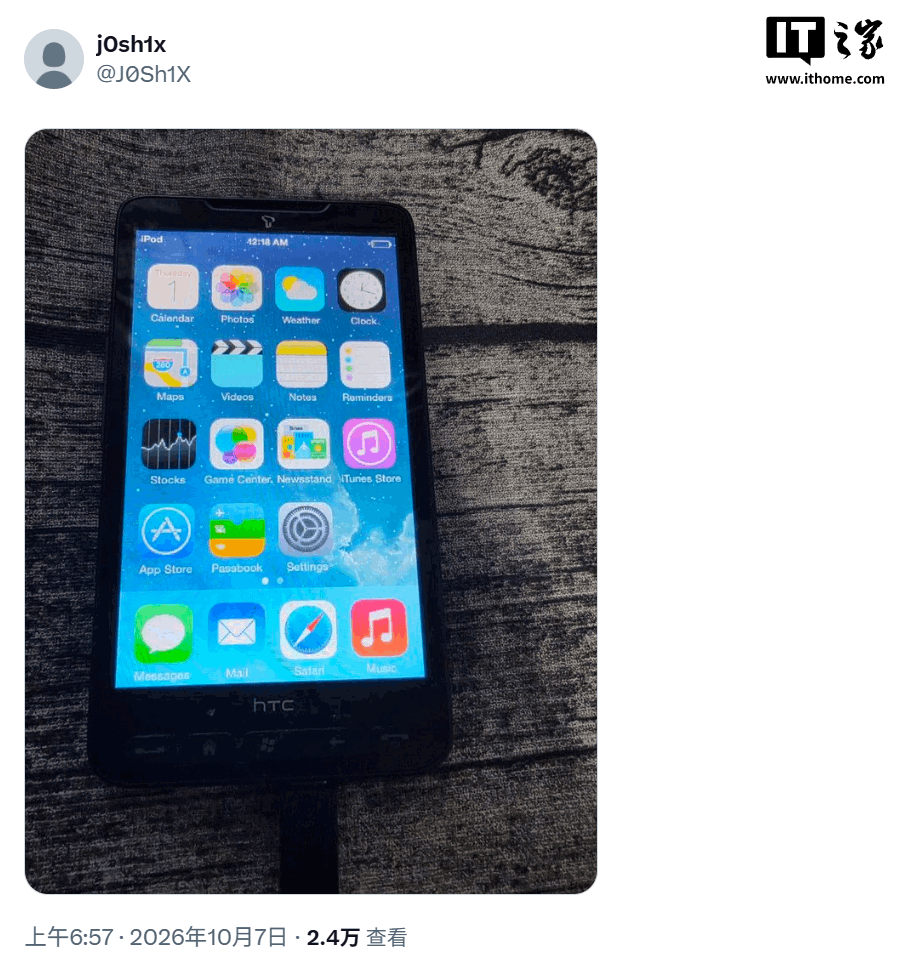
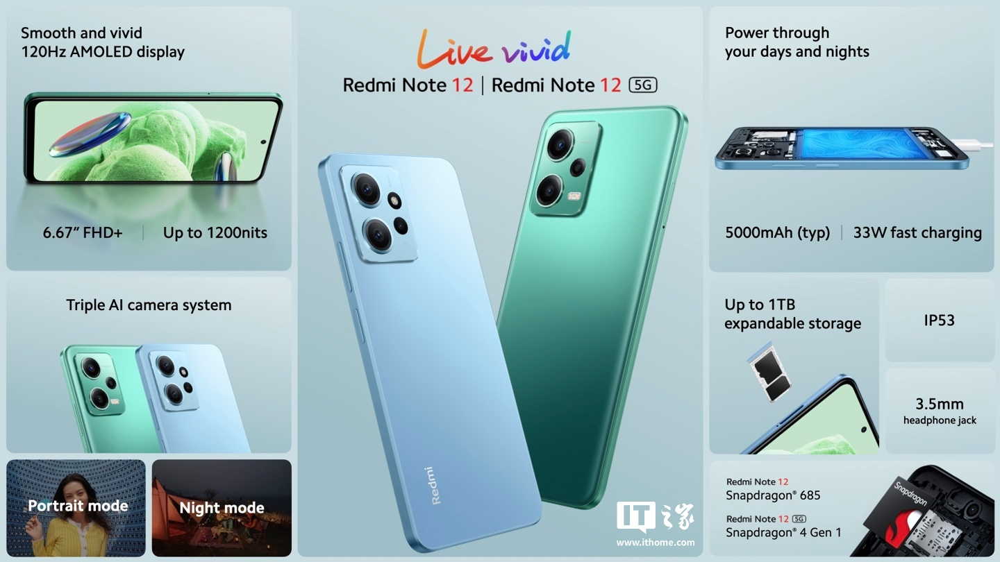

Un aficionado que se presenta como Makr ha conseguido que un **Xiaomi Redmi Note 12 4G**
arranque **iOS 16** de verdad y ha publicado el código del port en GitHub, con el nombre
`ios-topaz`. No es un tema, ni un lanzador, ni un emulador: por debajo corre el núcleo XNU
de Apple, el híbrido que usa su sistema Darwin, y encima el software de un iPhone X sin
modificar. La historia la recogió ITHome el 19 de octubre a partir de la demostración del
propio autor.

En la grabación, el apartado «Acerca del móvil» informa de la versión iOS 16.7.16 y de un
modelo «iPhone X». El repositorio ya está abierto, con instrucciones de compilación y una
tabla que reparte con honestidad entre lo que funciona y lo que todavía no.

## Qué hace exactamente ios-topaz en el Redmi Note 12

`ios-topaz` es una bifurcación de `ios-sweet`, el proyecto que llevó el XNU de código
abierto de Apple (la versión `xnu-8796`) a un Redmi Note 10 Pro. Lo nuevo aquí es el
destino: el Redmi Note 12 4G, con códigos internos `topaz` y `tapas` y el Qualcomm SM6225
«khaje», es decir, el Snapdragon 685.

Sobre ese kernel, el proyecto ejecuta el sistema de un iPhone X con iOS 16.7.16 (compilación
20H392) **sin tocarlo**: `launchd`, los demonios del sistema, `backboardd` y `SpringBoard`
son los originales. El teléfono se identifica además como un `iPhone10,3`, así que la
interfaz asume el iPhone X, con gestos y sin botón de inicio.

El arranque conserva el bootloader original de Xiaomi: la única orden que se da es
`fastboot boot`, que carga una pieza intermedia en la RAM sin escribir en las particiones de
arranque. La raíz de iOS vive como volumen HFS+ con journaling dentro de la partición
`userdata`. Según el README del proyecto, actualizado el 18 de octubre, el teléfono tarda
unos tres minutos en llegar a la pantalla de bloqueo usando los cuatro núcleos Cortex-A73.

## Lo que no funciona todavía en el port de iOS 16

Aquí el proyecto deja de parecer una demostración curiosa y se convierte en ingeniería real,
con una lista de pendientes larga:

- **Sin GPU.** El renderizado se hace entero en la CPU y la tasa de fotogramas es baja: no
  hay controlador gráfico.
- **Cuatro núcleos de ocho.** XNU usa páginas de 16 KB y los núcleos Silver (clase
  Cortex-A53) no soportan esa granularidad de traducción, así que quedan aparcados. Un XNU
  de 4 KB figura en la hoja de ruta.
- **Sin conectividad ni sensores.** No hay Wi-Fi, Bluetooth, red móvil, audio, cámara, GPS
  ni SEP: `bluetoothd` y `fairplayd.H2` entran en bucle porque el hardware no está.
- **Sin reloj de tiempo real**, de modo que la fecha arranca el 31 de diciembre.
- **Seguridad desactivada**, con AMFI y sandbox permisivos y sin protección de datos.
- **Táctil y botones en discusión.** El README los lista entre lo que no funciona: el
  controlador FocalTech FT5452 está escrito pero sin confirmar en el aparato, y las teclas de
  encendido y volumen no están portadas. ITHome, en cambio, da por operativos el táctil y el
  volumen en su demostración. Hasta que el repositorio lo confirme, conviene contar con que
  la pantalla aún puede no responder.

Y el detalle que duele a cualquiera que lo pruebe: la instalación **borra los datos de
Android** al escribir en `userdata`. Las particiones de arranque no se tocan, pero para
llegar hace falta un bootloader desbloqueado, un PC con Linux y `fastboot`, y una cuenta de
GitHub para compilar el kernel, una tarea que el proyecto estima en unos ocho minutos en los
runners de macOS de GitHub.

## No es la primera vez: los ports de iOS llevan semanas en marcha

El Redmi Note 12 no es el primer teléfono con Android que ejecuta iOS. Hace doce días, el 7
de octubre, el desarrollador j0sh1x mostró un HTC HD2 —un modelo de 2010— con la pantalla de
inicio de iOS 7 y publicó el código del kernel XNU y del soporte de hardware. En su caso, el
táctil ya funcionaba. La base común de los dos trabajos es la misma: el XNU que Apple
publica abiertamente.

## Qué cambia para quien solo quiere un móvil que funcione

Para quien esté a punto de comprar, la respuesta corta es: nada. El Redmi Note 12 llegó en
marzo de 2023 junto al Redmi Note 12 5G, el Note 12 Pro y el Note 12 Pro+; la versión de 4G
monta pantalla de 6,67 pulgadas FHD+ a 120 Hz, Snapdragon 685, batería de 5.000 mAh y una
cámara principal de 50 megapíxeles. Todo eso sigue funcionando con Android, y el port de
iOS 16 no añade ni una función, ni una actualización, ni un solo año de soporte.

Lo que sí aporta el proyecto es otra cosa: una demostración, con documentación pública, de
que el núcleo de Apple puede arrancar en hardware ajeno sin modificar el sistema operativo
del iPhone. En el sentido inverso, Xiaomi ya ha dado pasos para que su ecosistema conviva con
el de Apple: [sus móviles con HyperOS 4 admiten el Apple Watch](/noticias/xiaomi-apple-watch-hyperos/).

**Veredicto:** como ingeniería pura, es fascinante y, además, está abierta. Como sistema
para el día a día, ni hablemos. El Redmi Note 12 4G sigue siendo lo que era antes de este
port: un gama media con Android, al que la hazaña no le cambia nada.
