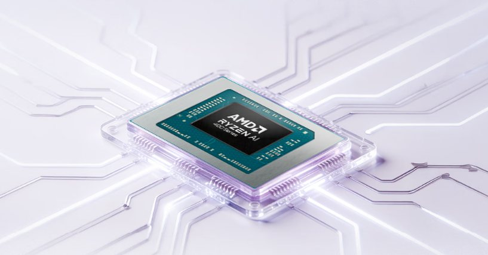
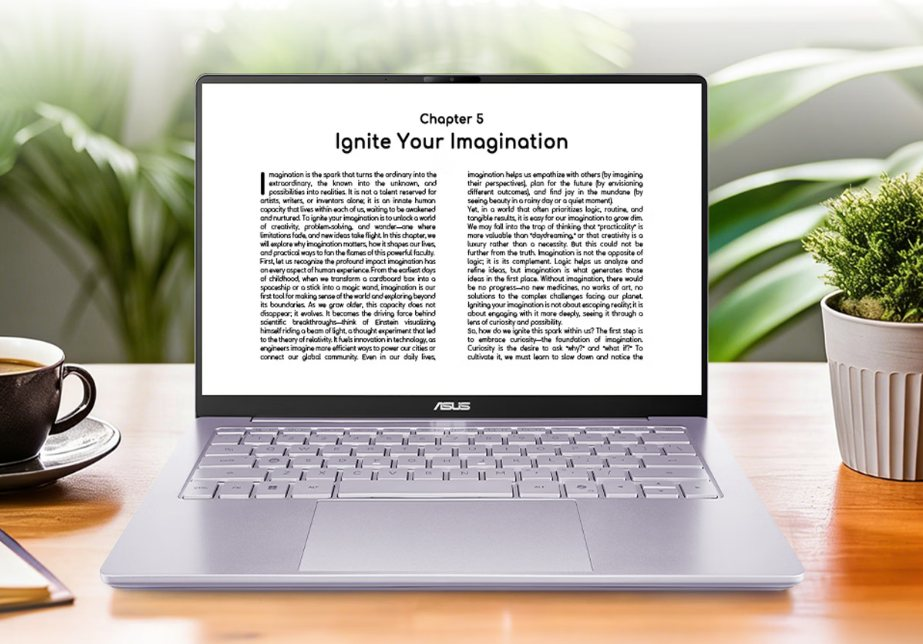

**El ASUS adol 14 Air 2026 suma en China una configuración de 16 GB de RAM y SSD de 1 TB, según informa MyDrivers.** El medio sitúa su precio de lanzamiento desde 5.949 yuanes con subvenciones incluidas. La noticia es la ampliación de configuraciones de este portátil ligero, no la presentación de un chasis completamente nuevo ni su llegada al mercado español.

## ASUS adol 14 Air 2026: OLED de 14 pulgadas y menos de un kilo, según el informe

MyDrivers describe una pantalla OLED de 14 pulgadas, resolución 2.8K y refresco de 120 Hz. También atribuye al equipo un peso de 990 gramos y un grosor de 14,9 mm. Son características recogidas por esa publicación, no mediciones realizadas por TechSpain24.

Para quien transporta el ordenador a diario, el peso es una referencia más útil que una promesa de potencia sin condiciones. Aun así, no explica por sí solo la comodidad del teclado, el ruido bajo carga ni el comportamiento térmico, aspectos que necesitan una prueba del equipo.

La combinación de movilidad y OLED también aparece en otros equipos de la marca, como el [ASUS ZenBook 14 con Snapdragon X](/noticias/asus-zenbook-14-snapdragon-review/). No es, sin embargo, el mismo modelo ni la misma configuración.

## La novedad está en la combinación de memoria y almacenamiento

La configuración descrita combina **16 GB de RAM con 1 TB de SSD**, una opción adicional dentro del adol 14 Air 2026. El informe también menciona configuraciones de 32 GB, pero no permite tratar todos sus precios y condiciones como si correspondieran al modelo de entrada.

El importe de 5.949 yuanes corresponde a una oferta con ayudas del mercado chino. No es un precio de venta en España ni una base suficiente para convertir la cifra a euros y presentarla como coste de importación: las condiciones comerciales no son equivalentes.

## Qué queda por confirmar fuera de China

La información consultada no establece fecha de venta española, distribución europea ni precio local. Tampoco hemos podido verificar la nueva configuración en una ficha primaria legible de ASUS, por lo que el alcance de esta noticia se limita al informe de MyDrivers.

No se trasladan aquí las cifras de autonomía del material promocional como resultados en uso real. Para quien busca un portátil ligero con OLED, la configuración es una novedad a seguir; para decidir una compra en España, todavía faltan disponibilidad, condiciones de garantía y una evaluación independiente.

*Imágenes: material publicado por MyDrivers en la noticia citada.*
