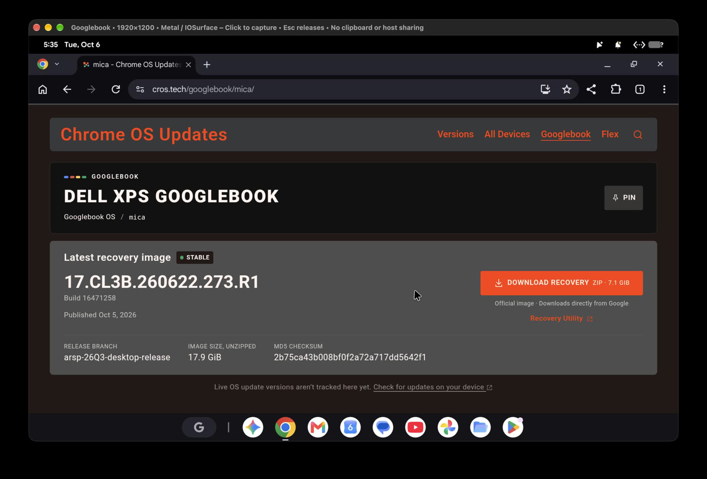

Los Googlebook llevan apenas unas semanas en el mercado y su sistema ya funciona en un equipo para el que Google no lo diseñó: un Mac con chip de Apple. El desarrollador Skylar Taylor-Barrick ha publicado `gbos-vm`, un proyecto de código abierto que arranca Googlebook OS dentro de una máquina virtual con aceleración por GPU en Macs con Apple Silicon, y con Chrome funcionando.

El caso es interesante para quien sigue la consolidación del portátil Android, pero conviene mirarlo con la tapa abierta y las horas pasando: no es un sistema pensado para el Mac, sino una manera de asomarse a él sin comprar nada. Como experimento, cumple; como equipo de trabajo diario, todavía no.

## Cómo se levanta el sistema

El script de instalación descarga la imagen de recuperación oficial que Google publica para el Dell XPS Googlebook, una build ARM64 basada en Android 17. Después sustituye la partición *vendor*, que es específica del hardware de Dell, por componentes de dispositivo virtual del proyecto Cuttlefish de Google, y arranca todo bajo QEMU.

La clave de que funcione sin emulación es que el Dell es uno de los Googlebook con Snapdragon X: su imagen está compilada para Arm, así que corre sobre el hipervisor del Mac directamente. Eso deja fuera a los Mac con Intel. Como Googlebook OS renderiza a través de Vulkan y los Mac usan Metal, el proyecto redirige esas llamadas mediante MoltenVK.

Antes de intentarlo hay que cumplir una lista que no es precisamente ligera: el README pide 16 GB de RAM, 60 GB de almacenamiento libre, las herramientas de línea de comandos de Xcode y el SDK de Android con NDK, además de unos 9 GB de descargas. El primer arranque tarda alrededor de 45 segundos en un MacBook M5, que es la única máquina que el desarrollador lista como probada.

## Los bordes que quedan por limar

El propio autor lo describe como un entorno para desarrollo, no como un sustituto del sistema del Mac, y los problemas que enumera justifican esa advertencia. El Bluetooth se cae al arrancar, un demonio de TPM entra en bucle de fallos, la pantalla queda limitada a 60 FPS y en uno de los arranques el audio sonó en silencio.

Hay además una limitación de fondo: la partición *vendor* reconstruida usa KeyMint y Gatekeeper por software y no tiene arranque verificado, de modo que las claves no quedan protegidas por un elemento seguro. Es la diferencia entre un banco de pruebas y un equipo en el que apoyarse para trabajar.

## Qué significa para el lector

Para quien sopesa comprar un Googlebook, `gbos-vm` es una forma gratuita de probar el sistema antes de decidirse, siempre que tenga un Mac con chip de Apple y la paciencia de montar el entorno. Para quien busca un portátil para el día a día, el camino sigue siendo el hardware nativo: la autonomía real, la térmica sostenida y el soporte del fabricante no se pueden evaluar desde una máquina virtual.

Lo que de verdad cuenta aquí es la señal: un sistema operativo recién nacido ya se mueve fuera de su hardware original en cuestión de semanas. Eso habla de una base Android con menos ataduras de las que cabría esperar, aunque todavía esté lejos de la estabilidad que se le pide a un portátil de trabajo.
