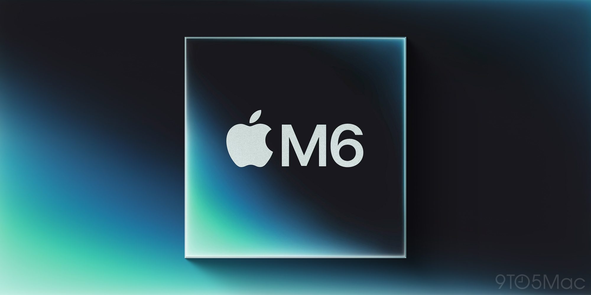
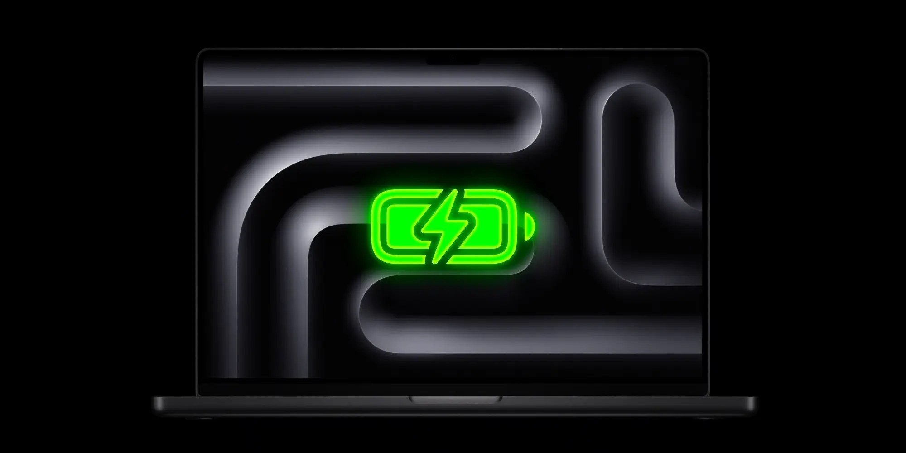

Apple tiene previsto lanzar un nuevo MacBook Pro con chip **M6** a lo largo de este mes, con una pantalla de 14 pulgadas y el diseño industrial que ya conocemos, según apunta 9to5Mac. El cambio interesante no está en la carcasa, sino dentro: el M6 introduce tres mejoras que afectan a cómo se comportará el equipo lejos del laboratorio de pruebas.

Conviene recordar que el M6 ya está en el nuevo **Mac mini**, un equipo que no depende de una batería. Su salto al portátil es justo el escenario donde esas mejoras se pueden valorar en uso real.

## Un doble Neural Engine de 16 núcleos

El M6 incorpora un **Dual 16-core Neural Engine**, frente al Neural Engine de 16 núcleos estándar del M5 y generaciones anteriores. Apple asegura que el cambio ofrece hasta el doble de cómputo máximo respecto a las generaciones previas y que algunos frameworks del sistema pueden aprovechar ambos motores a la vez para acelerar la ejecución de modelos.

Para quien trabaja con IA local —y con las funciones de IA de macOS 27, que según la firma afectarán a más usuarios—, ese doble motor es el avance con más recorrido del chip. El matiz importante: en uso sostenido, lo que marcará la experiencia no será el pico anunciado, sino cuánto aguanta ese ritmo sin que la térmica lo recorte.

## 12 núcleos de CPU y GPU, con tres tipos de núcleo

El M6 base sube a **12 núcleos de CPU y 12 de GPU**, frente a los 10 de cada tipo en el M5. Pero el detalle más relevante está en la CPU: por primera vez un chip base de Apple combina tres tipos de núcleo en la misma pieza.

- **Super cores**: pensados para cargas de un solo hilo.
- **Performance cores**: consumen menos y se suman a los super cores en cargas multihilo exigentes.
- **Efficiency cores**: se ocupan de las tareas de fondo del día a día.

Hasta ahora, esa mezcla de super cores y performance cores en un mismo chip era exclusiva del M5 Pro, el M5 Max y el M5 Ultra. Que llegue al M6 de gama estándar acerca capacidades que antes se reservaban a las versiones altas.

## 2 nm: la eficiencia que debería notarse en la autonomía

El M6 es el primer chip de Apple fabricado en un proceso de **2 nm**, y la compañía describe el resultado como «un gran salto en rendimiento y eficiencia energética». Es la mejora que más puede notarse con la tapa abierta y las horas pasando, porque la eficiencia es exactamente lo que decide cuánto dura una sesión de trabajo.

Ese salto todavía no se ha podido medir en un equipo con batería, ya que el único producto con M6 hasta la fecha es el Mac mini. En el MacBook Pro ya se espera una autonomía más larga, aunque como siempre depende de una decisión del fabricante: Apple podría mantener el consumo y agrandar la batería, o recortar la capacidad física y quedarse en una duración parecida. Hasta que haya unidades para probar, esta parte conviene tratarla como una promesa razonable, no como una cifra.

## Para quién será, y para quién no

Si tu flujo de trabajo depende de la IA en local, de compilar o de sesiones largas sin enchufe, el M6 con doble Neural Engine y eficiencia en 2 nm es la generación que justifica esperar. Quien acaba de comprar un M5 o vive cómodo con su M4 no tiene motivo para correr: son mejoras de plataforma, no un cambio que redefina el producto.

El punto a vigilar cuando lleguen las primeras unidades es la autonomía medida y la térmica bajo carga sostenida. Ahí es donde se verá si el salto de eficiencia se traduce en horas reales o se queda en la diapositiva.
