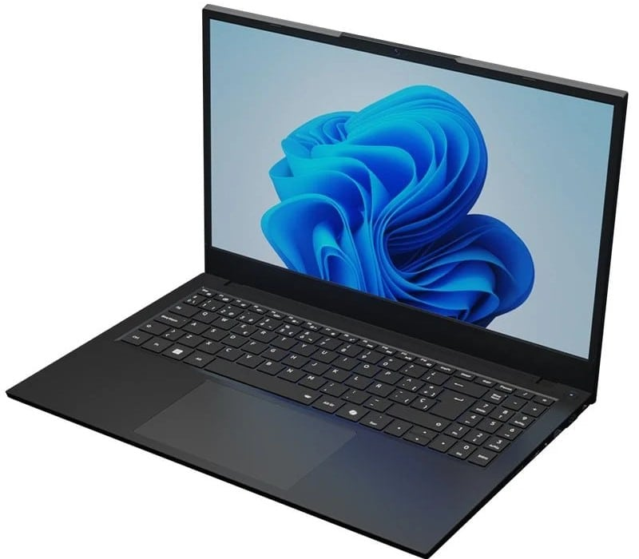

El Alurin Flex Advance IA de 15,6 pulgadas se ha dejado 750 euros por el camino en PcComponentes y ha quedado en 509 euros. Su precio de referencia (PVP) es de 1.259,99 euros, así que la rebaja no es un ajuste cosmético: hablamos de más de la mitad del importe original en un equipo que mantiene un procesador Intel Core Ultra 7 155H, 16 GB de memoria DDR5 y un SSD de 1 TB.

La clave está en la combinación. Un Core Ultra 7 de la familia Meteor Lake con 16 núcleos y 22 hilos, gráficos Intel Arc integrados y una NPU dedicada no es lo que uno espera encontrar por debajo de 600 euros. Menos aún con un terabyte de almacenamiento y Windows 11 Home preinstalado.

## Qué configuración trae el Alurin Flex Advance IA

| Componente | Configuración |
| --- | --- |
| Procesador | Intel Core Ultra 7 155H (16 núcleos, 22 hilos, hasta 4,8 GHz) |
| Gráficos | Intel Arc integrada y NPU dedicada |
| Memoria | 16 GB DDR5 |
| Almacenamiento | SSD M.2 NVMe de 1 TB |
| Pantalla | IPS de 15,6 pulgadas, Full HD (1920 × 1080) |
| Conectividad | Wi-Fi 6, Bluetooth 5.2, USB-C multifunción, USB-A y HDMI |
| Sistema | Windows 11 Home |
| Autonomía anunciada | Hasta 8 horas |

## Por qué esta rebaja pesa más de lo habitual

El contexto importa tanto como el descuento. La oferta llega en plena escalada de precios de la memoria, un movimiento que ya ha [cambiado la configuración base de los equipos de oficina](/noticias/office-pc-16gb-ram-price-crisis/) y que encarece cualquier portátil con DDR5.
En el mismo segmento han aparecido otros equipos que apuestan por [16 GB y 1 TB de almacenamiento](/noticias/portatiles/asus-adol-14-air-2026-suma-una-version-de-16-gb-y-1-tb-en-china/), señal de que la combinación se está convirtiendo en el nuevo punto de partida. Cuando el componente que más sube es precisamente el que este modelo incluye, un precio cerrado por debajo de 600 euros gana interés: la rebaja no compite solo contra el PVP del fabricante, compite contra lo que costará un equipo equivalente dentro de unos meses.

Ese es el motivo por el que 16 GB de DDR5 a este precio merecen atención. No es una cifra espectacular en términos absolutos, pero sí es la cantidad que hoy se considera el mínimo razonable para trabajar con varias pestañas, ofimática y alguna herramienta de edición a la vez. Y viene acompañada de un SSD de 1 TB, que elimina la discusión sobre ampliar almacenamiento a corto plazo.

## Para quién sirve

El perfil más claro es el de estudiante o profesional que necesita un portátil de trabajo y estudio con margen para los próximos años. El Core Ultra 7 155H mueve con soltura ofimática, navegación con muchas pestañas, videollamadas y edición ligera de foto y vídeo. La NPU dedicada añade un extra para quien quiera ejecutar modelos de inteligencia artificial en local sin depender de la nube, aunque conviene ser realista: hablamos de aceleración para tareas pequeñas, no de un equipo de entrenamiento.

También encaja en edición ligera. Los gráficos Intel Arc integrados son suficientes para retoque fotográfico, montaje de vídeo en Full HD y tareas creativas que no exijan una GPU dedicada. Y para quien simplemente busca un portátil de 15,6 pulgadas con pantalla grande, teclado cómodo y Windows 11 listo para usar, el precio actual lo pone en una liga distinta.

## Para quién no

No es un portátil para jugar. Los Intel Arc integrados rinden para tareas de vídeo y algún título ligero, pero no para juegos exigentes a resolución nativa. Tampoco es la elección de quien necesite una pantalla de alta tasa de refresco o un panel OLED: aquí hay un IPS Full HD convencional.

Y hay un punto que conviene verificar antes de comprar. La información publicada no detalla si la memoria va soldada a la placa o si puede ampliarse, ni si hay una ranura libre. Para quien planee subir a 32 GB en el futuro, ese dato es decisivo y debería confirmarse en la ficha del vendedor.

## Lo que no convence

Las carencias son las esperables en este tramo de precio, y conviene tenerlas claras antes de decidir. La autonomía anunciada es de hasta 8 horas, una cifra discreta para un 15,6 pulgadas y que en uso real, con brillo alto y carga de trabajo sostenida, probablemente quede por debajo. La conectividad es Wi-Fi 6 y Bluetooth 5.2, sin Wi-Fi 6E ni Wi-Fi 7, opciones que ya aparecen en otros equipos del segmento.

La pantalla cumple sin brillar: IPS, Full HD y sin tasa de refresco alta. Para ofimática y estudio es correcta; para edición de color exigente o para quien venga de un panel OLED, se notará la diferencia. Tampoco hay GPU dedicada, y el rendimiento sostenido del Core Ultra 7 dependerá del sistema de refrigeración y del perfil de energía que aplique el fabricante, algo que solo se comprueba con el equipo en la mano.

Dicho esto, la ecuación sigue siendo difícil de discutir: 509 euros por un Core Ultra 7 155H con 16 GB DDR5, 1 TB de SSD y Windows 11 Home. Quien busque un portátil funcional para los próximos años y no necesite pantalla premium, GPU dedicada ni autonomía de récord, encontrará aquí una de las ofertas más agresivas de la temporada. Quien priorice movilidad extrema, color profesional o gaming debería mirar otro modelo y asumir un presupuesto bastante mayor.
