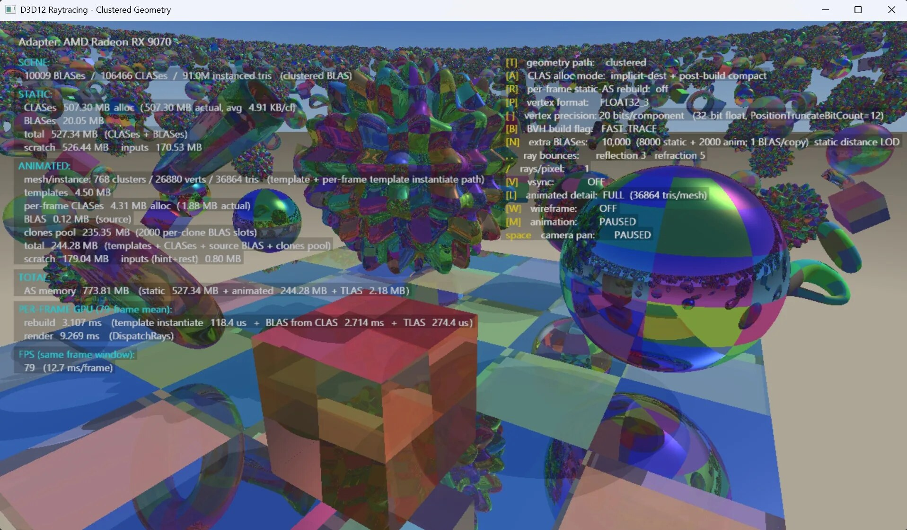
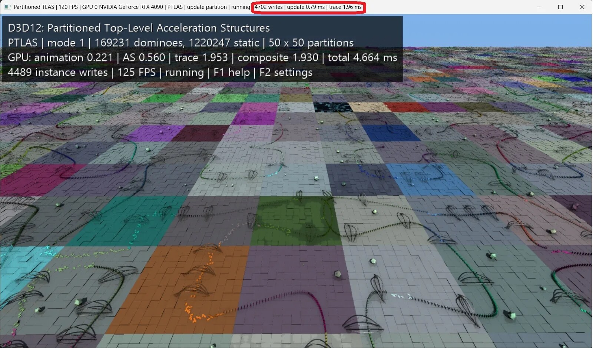

Microsoft publicó el 28 de octubre una vista previa de dos funciones nuevas para DirectX Raytracing (DXR): **Clustered Geometry** y **Partitioned TLAS**. La compañía las describe en su blog para desarrolladores como «la actualización más significativa de DXR desde su debut en 2018», y el dato que respalda la afirmación es de memoria: en una demostración propia sobre una Radeon RX 9070, el conjunto de estructuras de aceleración pasó de 7.519 MiB a 774 MiB, un 89,7 % menos. Conviene leer esa cifra con la letra pequeña delante, porque el titular completo necesita dos matices: es memoria de estructuras de ray tracing, no VRAM total, y sale de un entorno de pruebas, no de un juego terminado.

## Qué cambia en DirectX: Clustered Geometry y Partitioned TLAS

El ray tracing no lanza rayos contra la malla original del juego. Lo hace contra una estructura de aceleración (BLAS por objeto, TLAS para la escena completa) que se reconstruye cuando la geometría cambia. Con animación, streaming de niveles de detalle o terreno generado por procedimientos, esa reconstrucción se repite frame a frame y su coste crece con el tamaño del mundo.

Clustered Geometry ataca el problema por abajo. Divide la geometría en **CLAS** (*Cluster Level Acceleration Structure*), bloques de como máximo 256 triángulos y 256 vértices, y ensambla la BLAS del objeto a partir de referencias a esos bloques. Como el trabajo se repite entre fotogramas, se puede reutilizar en lugar de reconstruir, y según Microsoft eso hace viable trazar contra la geometría de detalle completo en vez de contra representaciones simplificadas: las sombras y los reflejos trazados coinciden con lo que se ve en pantalla. La API no admite *refits*, así que para mallas deformables hay **plantillas de clúster** que precalculan el trabajo independiente de la posición y solo reciben las posiciones nuevas.

Partitioned TLAS hace lo mismo por arriba. Divide la escena en particiones espaciales con registros de instancia persistentes, de modo que reconstruir cuesta en proporción a lo que cambió y no al tamaño de la escena. Las instancias que se mueven constantemente pueden ir a una **partición global**, donde cada una se gestiona por separado para no arrastrar a todo su grupo.

## El desglose de la prueba: dónde está el 90 %

Microsoft publicó la tabla completa de su ejemplo `D3D12RaytracingClusteredGeometry` en una RX 9070, comparando la reconstrucción tradicional de BLAS con el modo de geometría agrupada. Estos son los números, tal como aparecen en el blog de Microsoft:

| Métrica | BLAS tradicional | Clustered Geometry | Diferencia |
| --- | --- | --- | --- |
| Fotogramas por segundo | 1,2 | 79 | ~66× más |
| Preparación de estructuras por frame | 788 ms | 3,11 ms | ~254× menos tiempo |
| Trazado de rayos por frame | 72,6 ms | 9,27 ms | ~7,8× menos tiempo |
| Memoria estática de estructuras | 723 MiB | 527 MiB | 27,0 % menos |
| Memoria animada de estructuras | 6.794 MiB | 244 MiB | 96,4 % menos |
| Memoria total, TLAS incluida | 7.519 MiB | 774 MiB | **89,7 % menos** |
| Scratch de construcción (animado) | 8,25 MiB | 179 MiB | Más exigente |

Dos lecturas importan más que el 89,7 %. La primera: el ahorro no viene del caso estático, que baja un 27 %, sino del animado, que es donde la reconstrucción tradicional se dispara. Un juego con poca geometría animada verá una fracción de esa ganancia. La segunda: la memoria temporal que necesita la construcción **sube**, de 8,25 MiB a 179 MiB en el caso animado, porque agrupar y ensamblar tiene su propio coste logístico. Microsoft lo advierte en mayúsculas en la propia entrada: no hay que asumir que los juegos verán mejoras de esta magnitud, aquello es solo un banco de pruebas. También señala el caso inverso, en el que trazar rayos sale algo más caro pero la preparación de escena por frame compensa de sobra.

## Qué hardware lo soporta y cuándo llega

Ninguna de las dos funciones exige capacidades nuevas: funcionan sobre el soporte de ray tracing que la GPU ya tiene. Lo que hace falta es que cada fabricante implemente y valide el driver, y ahí el reparto es desigual:

- **NVIDIA**: todas las GPU RTX.
- **AMD**: Radeon RX 9000.
- **Intel**: Arc B-Series y las familias Core Ultra 200V y Series 3.
- **Qualcomm**: Snapdragon X2, con soporte de driver previsto para el primer o segundo trimestre de 2027.

El soporte en GPU de ray tracing más antiguas está por determinar, y Microsoft avisa de que el trabajo de implementación puede destapar problemas de rendimiento que lo hagan inviable. Para probarlo hoy hace falta el Agility SDK 1.722.0-preview, el compilador de shaders con Shader Model 6.10 en su versión preliminar, un driver compatible y el modo desarrollador de Windows activado. No hay fecha para la versión final.

## Qué significa para tu VRAM

La memoria de estructuras de aceleración es solo una parte de lo que ocupa una tarjeta gráfica en un juego con ray tracing, así que un 89,7 % menos ahí no se traduce en un 89,7 % menos de VRAM ocupada. Pero en escenas con mucha geometría animada es la partida que más crece, y por eso es la que más condiciona a las tarjetas con menos memoria.

El interés real está en que el ahorro no llega por comprar hardware: llega por actualizar drivers y por que los estudios adopten la API, y ese segundo paso es el lento. *Gears of War: E-Day* ya usa geometría agrupada a través de la API propia de NVIDIA, RTX Mega Geometry; estandarizarlo en DirectX extiende el mismo camino de integración a AMD e Intel y, sobre todo, deja de atar la técnica a una marca. En un año en el que la memoria y las GPU no bajan de precio, sacar más partido a lo que ya está instalado es el argumento más sólido del anuncio.

La comparación directa es [la técnica «Tetrahedral Cages» de AMD](/noticias/amd-tetrahedral-cages/), que también ataca la memoria del ray tracing reutilizando estructuras estáticas: aquella es una solución de un fabricante, y esta es una API común que necesita que cada driver la valide. Para el lector con una tarjeta de gama media, la pregunta que queda abierta no es cuánta memoria ahorra, sino cuándo habrá juegos que la usen y cuánto tarden en llegar a los drivers que ya tiene instalados. Quien quiera seguir el rastro del mismo paquete de herramientas puede leer también cómo [Advanced Shader Delivery recorta la compilación de shaders](/noticias/tarjetas-graficas/microsoft-advanced-shader-delivery-compilacion/) en el Agility SDK de Microsoft.
