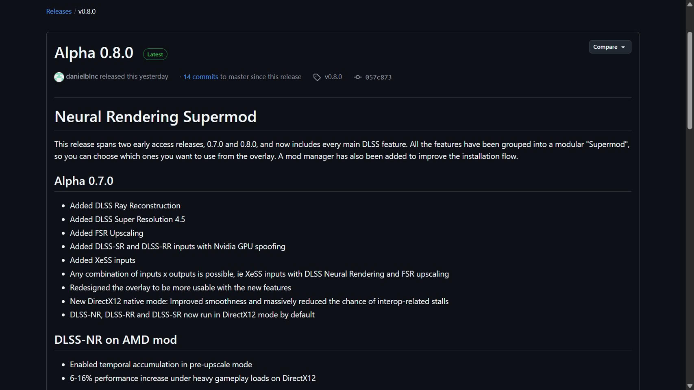

La Alpha 0.8.0 del mod DLSS-NR on AMD, publicada el 17 de octubre por el desarrollador Daniel Blanco, reúne casi todo el catálogo de funciones de DLSS sobre GPUs Radeon. La versión suma Super Resolution 4.5, Ray Reconstruction y Frame Generation —con multi-frame generation de hasta 4x— a un proyecto que en septiembre solo había logrado arrancar el DLSS 5 Neural Rendering en tarjetas AMD.

## Casi todo el stack de DLSS, sin capa de traducción

Según el desarrollador, el mod no funciona como una capa de traducción: reimplementa los runtimes de DLSS desde cero con kernels HIP propios. El usuario aporta sus propias DLL de NVIDIA; el software se encarga del resto. El reparto por arquitecturas es el siguiente: RDNA 4 y RDNA 3 reciben el juego completo de funciones, mientras que RDNA 2 sigue en fase experimental y limitado a Neural Rendering.

La lista de la Alpha 0.8.0 incluye DLSS Super Resolution 4.5 (modelos M y L), Ray Reconstruction (modelo F) y Frame Generation con hasta 4x multi-frame generation en los juegos que exponen las entradas de DLSS FG. Además, el mod empaqueta FSR 4.1.1, de modo que el escalado ya no depende del driver instalado. La instalación la gestiona el nuevo gestor NeuralHub, que detecta los juegos y centraliza los archivos en lugar de repartirlos en cada carpeta.

## El objetivo declarado: la RTX 5070 Ti

El desarrollador afirma que DLSS 5 Neural Rendering rinde en torno a 90-100 FPS a 1080p en una RX 9070 XT, con la ambición de igualar a una RTX 5070 Ti. Son cifras del propio autor del mod, no mediciones independientes.

Con Ray Reconstruction los primeros resultados son dispares. Un usuario de Reddit relató que no hubo pérdida de rendimiento en Cyberpunk 2077 con trazado de rutas a 1440p sobre una RX 9070 XT; otros, en cambio, observaron caídas de hasta el 25 %. El mod se ejecuta únicamente en juegos de DirectX 12 bajo Windows 11, y el software anti-cheat lo bloquea: la recomendación es ceñirse a títulos para un jugador.

## Qué cambia para el usuario de Radeon

Para el día a día, la vía oficial sigue siendo FSR: la propia RX 9070 XT ya cuenta con FSR 4 por driver, y esta misma Alpha 0.8.0 empaqueta FSR 4.1.1 dentro del mod. Lo que el proyecto demuestra es distinto: que el renderizado neuronal de DLSS no está ligado al silicio de NVIDIA, en la misma línea que otras aproximaciones open source que ya han llevado el DLSS 5 a [Vulkan y al navegador](/noticias/dlss-5-reimplementacion-vulkan-open-source/) o los experimentos de renderizado neuronal en las [RX 9000 con OptiScaler](/noticias/amd-renderizado-neuronal-rx-9000/). El alpha es experimental, sin soporte de NVIDIA ni de AMD, y su valor hoy está en lo que anticipa, no en lo que sustituye.
