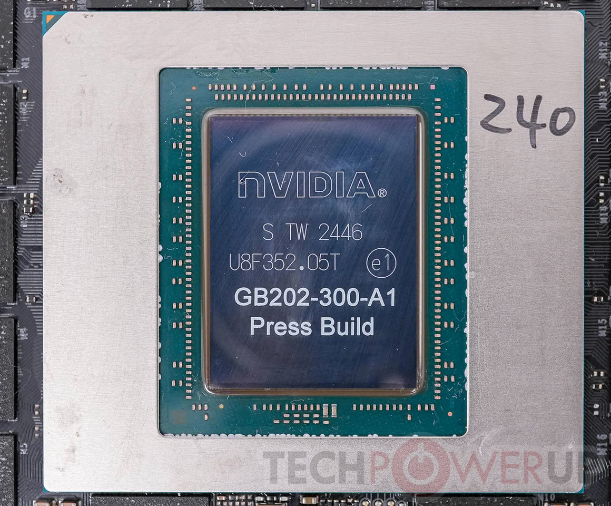

NVIDIA ha salido a desmentir los rumores de que la **RTX 5090** estaba al final de su ciclo de vida. Jeff Fisher, vicepresidente sénior del negocio de computación personal de la compañía, afirmó el 16 de octubre en Taipéi, tras la fiesta de lanzamiento de los equipos con la arquitectura RTX Spark, que la tarjeta no se ha descontinuado y que seguirá enviándose. Las declaraciones, recogidas por la taiwanesa 4Gamers y por la agencia Central News Agency (CNA) y documentadas por TechPowerUp, llegan después de una semana de especulaciones sobre el cese de la producción de la tarjeta insignia de NVIDIA.

## Lo que dijo Jeff Fisher a los medios taiwaneses

Fisher fue cuestionado sobre el fin de vida de la RTX 5090 en los márgenes del acto de Taipéi. En la respuesta que recoge 4Gamers, el vicepresidente sénior reconoce el problema de fondo y a la vez desmiente el corte:

> La cadena de suministro (la capacidad) está efectivamente algo limitada, pero NVIDIA se está esforzando al máximo para llevar los productos al mercado. Aunque existen otras variantes del chip de la RTX 5090, esta no se ha descontinuado. NVIDIA seguirá enviándola, y eso es muy importante.

A la agencia CNA añadió otro argumento: la tensión del suministro no afecta solo a NVIDIA, sino a la industria tecnológica en su conjunto, y sin el negocio de GeForce la compañía no estaría donde está hoy. 4Gamers recoge además su vínculo entre ambos negocios: sin GeForce no habría CUDA, y sin CUDA no existiría el mercado de IA tal como lo conocemos.

## Lo que la desmentida deja sin resolver

La declaración confirma dos cosas —no hay descontinuación y la compañía sigue enviando la tarjeta—, pero deja otras en el aire. Fisher no aclaró si los ensambladores vuelven a recibir ojivas GB202, que era el meollo de las filtraciones de la semana pasada, ni concretó a qué se refiere con «otras variantes» del chip. GB202 es el silicio que también alimenta las estaciones de trabajo RTX PRO 6000 y RTX PRO 5500, de modo que la frase admite más de una lectura.

Tampoco hay explicación sobre los hechos que alimentaron el rumor: la RTX 5090 desapareció del marketplace oficial de NVIDIA y del catálogo de Micro Center, y antes se había informado de que la compañía había dejado de asignar silicio GB202 a la tarjeta. El desmentido neutraliza el titular de fin de producción, no la evidencia de disponibilidad que ya estaba a la vista.

## Por qué la RTX 5090 sigue lejos de los 1.999 dólares

Aquí está el dato que importa al comprador. El precio recomendado de la RTX 5090 en EE. UU. es de 1.999 dólares, pero la tarjeta sigue siendo muy difícil de encontrar cerca de ese precio: según TechPowerUp, hay anuncios por encima de los 8.000 dólares en Amazon y Newegg. Reconocer que la capacidad está limitada equivale, en la práctica, a admitir que esa brecha no se va a cerrar de un día para otro.

Ya contamos cómo [el inventario de primera mano se esfumó en Estados Unidos](/noticias/rtx-5090-us-shortage-price-surge/) y cómo los revendedores llegaron a pedir hasta 9.500 dólares por una unidad. Desde entonces el mercado no se ha normalizado, y con NVIDIA declarando que el cuello de botella es real, lo razonable es esperar que la escasez acompañe a la tarjeta durante un tiempo más.

## Qué cambia para el comprador

El desmentido elimina, de momento, la hipótesis de un corte inminente de la RTX 5090: NVIDIA asegura que el modelo sigue en su línea de envíos. Lo que no cambia es el acceso: seguir enviándose no significa llegar a las estanterías, y menos a precio de catálogo.

Para quien tenga que comprar ahora y no quiera absorber un sobreprecio tan pronunciado, la referencia de la gama alta sigue siendo la [RX 9070 XT](/noticias/xda-one-gpu-worth-buying-right-now/), la alternativa que venimos señalando como la opción de precio por fotograma más sensata frente a una RTX 5090 que ya casi no se puede comprar.
