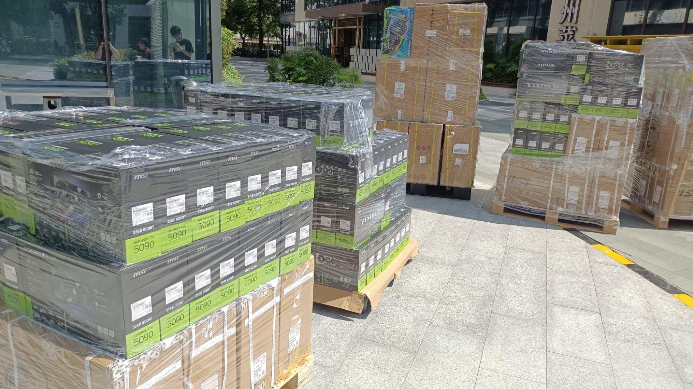

Dos palés de **RTX 5090** valorados en unos 470.000 dólares —2.500.000 reales brasileños— no aparecieron tras llegar al aeropuerto internacional de Guarulhos, en São Paulo. La distribuidora brasileña de electrónica y TI Oderço, con 38 años de actividad, publicó su reclamación en Instagram después de no obtener respuesta oficial a sus consultas, y el caso lo recoge Tom's Hardware.

## Lo que Oderço cuenta y lo que no

Según su publicación, Oderço esperaba recibir en Guarulhos dos palés de GPU Zotac RTX 5090. El envío llegó al aeropuerto y, según la empresa, desapareció después. La distribuidora afirma que es la primera vez en sus 38 años de historia que se enfrenta a una situación así.

Los datos que aporta la propia Oderço son escasos: no indica la fecha de llegada del envío ni publica números de seguimiento. Lo que sí sostiene es el otro lado de la moneda —que no ha recibido respuesta oficial a ninguna de sus consultas sobre la mercancía—, y esa ausencia de explicaciones es lo que la llevó a salir a redes sociales a pedir cuentas. La publicación está en portugués; Tom's Hardware la traduce automáticamente.

## Cuántas RTX 5090 caben en dos palés

Las cifras que maneja la distribuidora son las únicas disponibles, y conviene distinguirlas. Los 2.500.000 de reales que cita Oderço corresponden a su **coste de adquisición**, no al precio de venta al público, de modo que el valor de reventa de ese lote sería considerablemente mayor.

Para dimensionarlo, Tom's Hardware toma como referencia la Zotac RTX 5090 Solid OC, listada por 33.999,99 reales en el minorista brasileño Promotech, y una Zotac Gaming GeForce RTX 5090 que ronda los 8.000 dólares en Amazon (EE. UU.). Con esos datos, el medio cifra el envío en **al menos 63 tarjetas** y avisa de que la cifra real probablemente sea más alta: los 2.500.000 de reales son el precio que Oderço pagó por la mercancía, no la que obtendría vendiéndola.

La propia empresa no ha precisado cuántas unidades faltan, así que ese recuento sigue siendo una estimación de Tom's Hardware, no un dato confirmado por el expeditorio.

## Por qué una pérdida así pesa más en la RTX 5090 actual

Una RTX 5090 no es hoy una compra cualquiera. La tarjeta se esfumó del comercio online estadounidense a mediados de septiembre y los revendedores llegaron a pedir hasta 9.500 dólares por unidad, un episodio que ya contamos [al analizar la desaparición de la RTX 5090 del comercio online en EE. UU.](/noticias/rtx-5090-us-shortage-price-surge/). Sobre esa escasez se montó el rumor de que NVIDIA había detenido la producción para dedicar la capacidad a las tarjetas profesionales de IA: la compañía lo ha desmentido y admite que [el suministro está ajustado](/noticias/tarjetas-graficas/nvidia-desmiente-rtx-5090/), mientras la referencia sigue marcada como «not carried» en el catálogo online de Micro Center.

En ese contexto, la suerte de estos dos palés no es un detalle logístico. Esas unidades estaban destinadas a un mercado donde la oferta ya no cubre la demanda, y su desaparición retira mercancía de la cadena en lugar de sumarla.

El robo de envíos de hardware de alto valor tampoco es una novedad: en California un grupo embistió a los escoltas de seguridad para secuestrar un envío de hardware de IA, y en otro caso se llevaron dos trailers con el logotipo de NVIDIA para descubrir que cargaban arena. A escala de un particular, el frente distinto pero vecino es el de las estafas con la propia tarjeta, como la [RTX 5090 de segunda mano que llegó sin GPU ni PCB](/noticias/tarjetas-graficas/estafa-rtx-5090-sin-gpu-ni-pcb/).

## Qué cambia para el comprador

Para quien busque una RTX 5090, el episodio no altera el panorama de fondo: la tarjeta sigue difícil de encontrar y más cara de lo que su precio de catálogo sugiere. Lo que sí deja claro es que, en un suministro tan tenso, la desaparición de un envío completo no es un error administrativo: quita unidades de un mercado que ya no las tiene de sobra.

Mientras Oderço no reciba explicaciones, el caso queda abierto y sin cifra oficial de unidades extraviadas. Y mientras la escasez se mantenga, la pregunta práctica del comprador sigue siendo la de siempre: absorber el sobreprecio de la insignia de NVIDIA o evaluar la [alternativa de gama alta con mejor precio por fotograma](/noticias/xda-one-gpu-worth-buying-right-now/).
