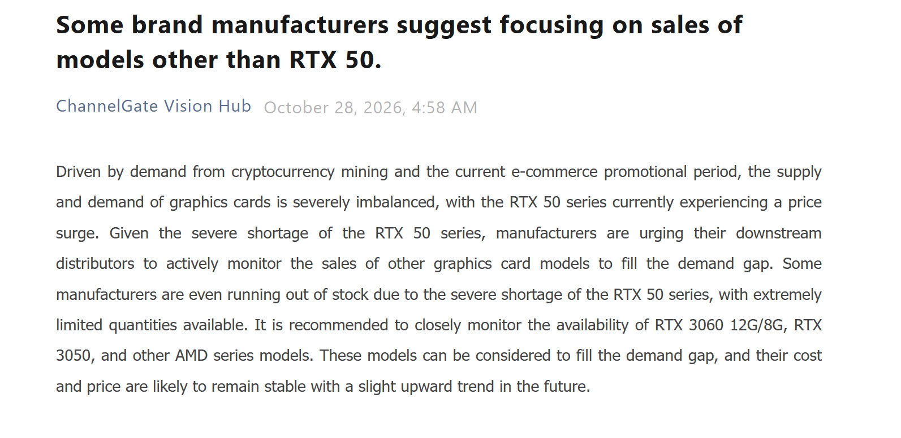

Los fabricantes de tarjetas gráficas de Asia, con China como epicentro, han empezado a recomendar a sus distribuidores que vuelvan a mirar hacia generaciones anteriores. El informe de ChannelGate que recogen TechPowerUp, Wccftech y El Chapuzas Informático sitúa en el centro de esa recomendación a la **GeForce RTX 3060 en sus variantes de 12 GB y 8 GB, la RTX 3050 y varios modelos Radeon de AMD** de gamas previas. El motivo es simple: el inventario de GeForce RTX 50 se ha quedado corto y no hay con qué cubrir la demanda en el tramo de entrada.

## Qué dice el informe y de dónde sale

El documento original está fechado el 28 de octubre y su argumento no apunta a una decisión de producto de NVIDIA, sino a un problema de disponibilidad. Según esa lectura, la demanda de minería de criptomonedas y la campaña promocional del comercio electrónico chino han desequilibrado la oferta y la demanda de tarjetas, y el resultado es que algunos ensambladores se han quedado sin unidades de RTX 50 que servir. Ante ese hueco, la instrucción a la cadena de distribución es vigilar y empujar modelos antiguos, con la advertencia de que su coste debería mantenerse estable con una ligera tendencia al alza en los próximos meses.

Conviene separar dos cosas que el titular mezcla con facilidad. Una es la disponibilidad: hay modelos de la generación actual que no llegan. La otra es el precio, y ahí las RTX 50 llevan meses sin parecerse a su tarifa de referencia, algo que ya se vio en el [desmentido de NVIDIA sobre la RTX 5090](/noticias/tarjetas-graficas/nvidia-desmiente-rtx-5090/), donde la compañía admitió suministro ajustado sin dar cifras de recuperación.

## La RTX 3060 no es una reliquia: es la GPU más usada de Steam

El detalle que da peso a la recomendación es la encuesta de hardware de Steam de octubre de 2026, en la que la RTX 3060 recupera el primer puesto. No es una coincidencia: la tarjeta se mantuvo en producción intermitente durante el año. La versión de 8 GB volvió a fabricarse en el primer trimestre de 2026 y la de 12 GB se reactivó después, con ASUS, MSI, GALAX y Colorful recibiendo nuevos chips según El Chapuzas Informático. NVIDIA ya había reintroducido en junio la variante de 12 GB con **3.584 núcleos CUDA, 12 GB de GDDR6, bus de 192 bits y el nodo de 8 nm DUV de Samsung**, la misma receta de Ampere de 2021.

En términos de rendimiento por vatio y precio por fotograma, la RTX 3060 de 12 GB sigue defendiéndose en 1080p y llega a 1440p con ajustes moderados, siempre que no se le pida ray tracing intensivo ni se dependa de generación de fotogramas, que Ampere no tiene. Su ventaja real hoy no es la velocidad: es que 12 GB de VRAM evitan los cuellos de botella que ya aparecen en varios lanzamientos con 8 GB, y eso la mantiene comprable cinco años después. Que la RTX 5070 liderase la encuesta de Steam en [septiembre](/noticias/tarjetas-graficas/rtx-5070-gpu-mas-popular-steam/) y haya cedido el puesto un mes después describe bien el momento del mercado.

## Qué implica si quiere comprar una GPU ahora

La disponibilidad puede mejorar, pero no abaratar. El propio informe apunta a precios estables o al alza, y el contexto lo respalda: la GDDR6 ha subido hasta un 10 % y los PCB se han encarecido de forma abrupta en el último trimestre, según el análisis de El Chapuzas Informático. Ese medio cifra el resultado en una RTX 3060 que se vende en 2026 al doble o al triple de su precio original, y añade que AMD prepara su tercera subida en cuatro meses. Con ese panorama, la decisión práctica para el lector es menos emocionante de lo que parece:

- **Si el presupuesto manda y el objetivo es 1080p**, una RTX 3060 de 12 GB sigue siendo una compra racional, pero solo a un precio que no la acerque a una RTX 5060. Por encima de esa frontera, la generación nueva gana en eficiencia y en soporte de tecnologías actuales.
- **Si aparece una RTX 3050**, conviene mirar la VRAM antes que el nombre del modelo: 8 GB ya se quedan cortos en varios juegos actuales.
- **Si puede esperar**, la escasez documentada no es un buen momento para comprar por urgencia. Esperar un trimestre con inventario normal suele salir mejor que pagar la prima de la escasez.

La paradoja del trimestre es que la tarjeta que vuelve a las tiendas es la que el mercado ya tenía. El silicio de 8 nm de Samsung sigue disponible y el coste que de verdad pesa en esta gama no es el de la GPU, sino el de la memoria GDDR6 que la acompaña, como señala el análisis de El Chapuzas Informático. Recuperar Ampere es barato para el fabricante; para el comprador, la pregunta sigue siendo la misma de siempre: cuántos fotogramas por euro, y a qué resolución.
