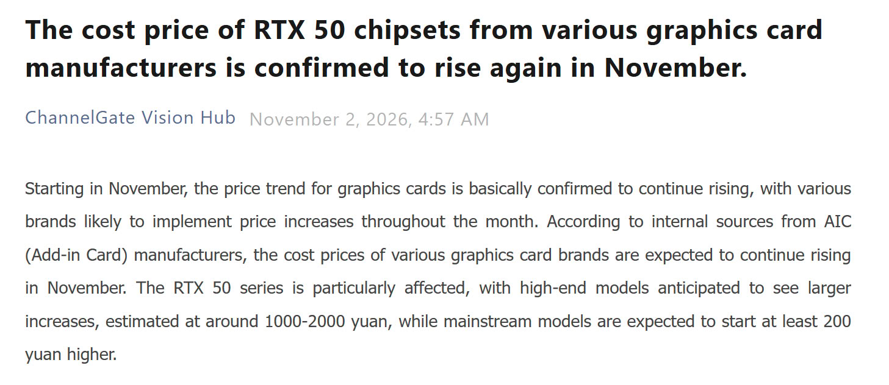
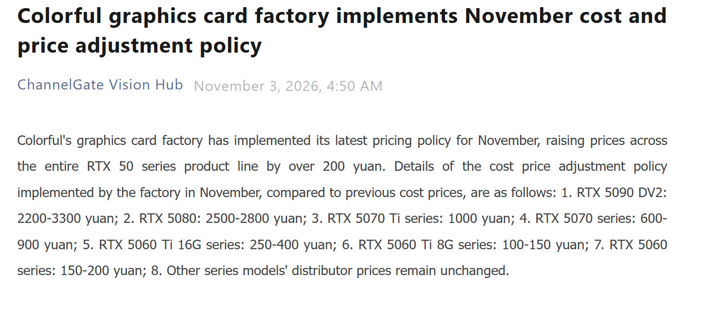
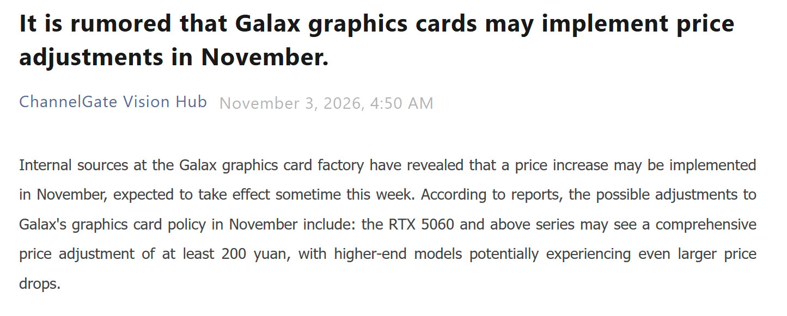

La RTX 50 vuelve a encarecerse, y esta vez el aviso llega con cifras por modelo. ChannelGate, el medio chino que sigue los precios de fábrica del canal de tarjetas gráficas, publicó el 2 de noviembre que los fabricantes AIC han confirmado una subida de coste para toda la familia RTX 50 durante este mes. La lista va de los 3.300 yuanes (unos 500 dólares) de la RTX 5090 DV2 a los 150 yuanes (unos 22 dólares) de la RTX 5060.

El dato tiene una letra pequeña que conviene leer antes de alarmarse con la cifra más alta: son precios de coste para distribuidores, no precios de venta al público. Colorful ya ha aplicado su tarifa de noviembre —lo que la convierte en la parte confirmada de la información— y GALAX estudia un ajuste similar para esta misma semana, según las fuentes internas que cita ChannelGate.

## Qué modelos de la RTX 50 suben y cuánto

Las cifras en yuanes son idénticas en las dos versiones que han circulado de la tabla, la de TechPowerUp y la de Wccftech, y coinciden con el aviso de fábrica de Colorful.

| Modelo | Subida de coste en China | Equivalente aproximado |
| --- | --- | --- |
| RTX 5090 DV2 | 2.200–3.300 yuanes | 329–494 dólares |
| RTX 5080 | 2.500–2.800 yuanes | 374–419 dólares |
| RTX 5070 Ti | 1.000 yuanes | 150 dólares |
| RTX 5070 | 600–900 yuanes | 90–135 dólares |
| RTX 5060 Ti 16 GB | 250–400 yuanes | 37–60 dólares |
| RTX 5060 Ti 8 GB | 100–150 yuanes | 15–22 dólares |
| RTX 5060 | 150–200 yuanes | 22–30 dólares |

La columna en dólares es una conversión aproximada y no coincide en todas las fuentes: son los 329–494 dólares que calcula TechPowerUp y los 374–419 de la RTX 5080, mientras que Wccftech redondea a 330–550 y 380–450. El importe original, el que publicó ChannelGate, está en yuanes, y ahí no hay discrepancia entre medios. Por eso el titular de «hasta 500 dólares» debe leerse como orden de magnitud, no como una cifra que vaya a aparecer en una etiqueta.

## La memoria decide qué modelo se encarece más

El reparto de la subida no es uniforme y sigue el patrón que ya se vio en las alzas anteriores del año: cuanto más pesa la VRAM en la tarjeta, más sube. La RTX 5060 Ti de 16 GB se lleva entre 250 y 400 yuanes, mientras que la misma tarjeta en su versión de 8 GB se queda en 100–150. Es el doble de memoria y, en esta tabla, entre dos y casi tres veces más de subida.

El motivo que citan las fuentes es el mismo que arrastra el mercado desde principios de año: la demanda de memoria de la industria de la IA tensiona el suministro de DRAM, y a eso se suma el encarecimiento de materias primas como el cobre que van en la placa y el sistema de refrigeración. NVIDIA no aparece en el origen del anuncio: lo que se mueve es el coste que trasladan los ensambladores, no un cambio de precio recomendado.

Para dimensionar la subida conviene mirar lo que ya ha subido la gama. Según el análisis de TechSpot que recoge Profesional Review, la RTX 5090 se vende en Estados Unidos por encima de los 9.000 dólares, un 370 % más que su precio recomendado, y la media global se sitúa un 262 % por encima. La RTX 5080 está un 120 % sobre su MSRP en Estados Unidos, la RTX 5070 Ti un 67 % y la RTX 5070 un 64 %; la RTX 5060 Ti de 16 GB, la más castigada por el precio de la memoria, ha subido un 84 % y ronda los 800 dólares. Wccftech añade que en Newegg hay listados de RTX 5090 por encima de los 10.000 dólares y de RTX 5080 por encima de los 2.000, más del doble de su precio de lanzamiento.

La subida inmediata es de NVIDIA. AMD tiene previsto por su cuenta otro incremento para noviembre, según los informes que recoge TechPowerUp, y el resto de la industria —Radeon RX 9000 y Arc incluidas— arrastra el mismo problema de suministro.

## Qué significa si vas a comprar una GPU en España

Ninguna de las fuentes consultadas publica precios en euros. La subida se anuncia en yuanes sobre el coste de fábrica, y la tarifa que llega a una tienda española la fija cada distribuidor con el IVA del 21 % añadido, así que la conversión directa no sirve para calcular lo que costará aquí. Lo que sí se puede leer con precisión es el calendario: el ajuste se aplica al canal esta semana y el precio de venta tarda una o dos semanas en reflejarlo, de modo que el stock que ya está en las estanterías es la última ventana a los precios anteriores.

En términos absolutos, la RTX 5060 es la que menos se encarece, pero también es la que define el umbral: es la tarjeta con la que se entra a la generación, y cualquier subida en el escalón más bajo encarece el punto de partida para jugar. El caso contrario es el más incómodo: la RTX 5060 Ti de 16 GB paga justamente la VRAM que decide cuántos años aguanta la tarjeta con texturas altas, así que la brecha entre la versión de 8 GB y la de 16 GB se agranda en el peor momento posible.

Hay un detalle que dice bastante del estado del mercado: según Wccftech, algunos fabricantes están animando a los distribuidores a mirar series anteriores, como la RTX 3050 y la RTX 3060. Son opciones razonables en precio por fotograma, pero dejan fuera las tecnologías de escalado y generación de fotogramas que NVIDIA ha presentado este año, y con ellas buena parte del argumento de compra de la generación actual.

Con ese panorama, la decisión ya no es esperar a que baje. La comparación útil es precio por fotograma entre lo que hay en tienda hoy —una RTX 5060 Ti de 16 GB, o una RX 9070 XT que también se acerca a los 1.000 dólares según Wccftech— y no contra el precio recomendado de una generación que ya no se consigue a esa cifra. La subida de esta semana es pequeña en sí misma; lo que la hace relevante es que llega sobre un mercado que en octubre ya había subido entre un 20 % y un 40 % en varias regiones, según Profesional Review. Para quien tenga la compra decidida, el margen de espera se está cerrando.

El seguimiento de precios de esta generación se mantiene en la sección de [tarjetas gráficas](/noticias/tarjetas-graficas/) del portal.
