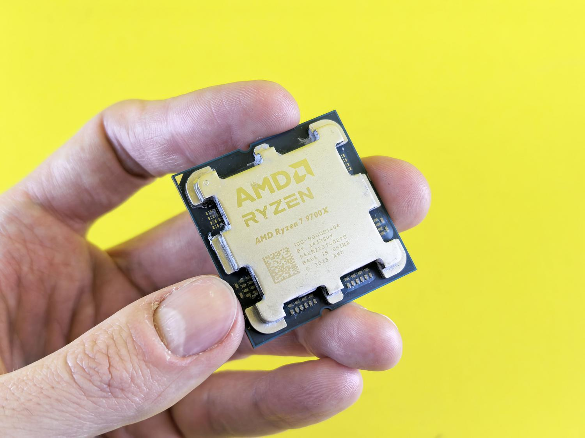

Elegir el procesador es la decisión que más condiciona la vida útil de un PC, porque es la pieza más difícil de cambiar una vez fijado el socket de la placa base. Esta guía es para quien va a montar un equipo, comprar un portátil o actualizar el suyo, y quiere entender qué mirar antes de gastar dinero: núcleos, frecuencia, gama y compatibilidad.

Conviene aclararlo desde el principio: la CPU no va sola. Un procesador potente rinde por debajo de lo esperado si el resto del sistema no está a la altura, así que la meta no es el chip más caro, sino el conjunto equilibrado.

## Requisitos previos

- Tener claro el uso principal del equipo: ofimática, gaming, edición o trabajo profesional.
- Conocer la placa base, sobre todo su socket, si vas a actualizar en lugar de montar desde cero.
- Fijar un presupuesto. La relación calidad-precio suele estar en la gama media.

## Paso 1: Entiende qué hace el procesador y cómo se conecta

La CPU, o Unidad Central de Procesamiento, dirige todas las tareas del equipo: ejecuta las órdenes de los programas y las transforma en información útil. Es el chip que procesa cada clic, cada tecla y cada cálculo.

Se instala en la placa base en un espacio llamado **socket**, el zócalo donde encaja el chip. Que ese socket sea compatible es vital: los procesadores Intel Core suelen usar sockets como el 1151 o el LGA 1700, mientras que los AMD Ryzen utilizan el AM4 o el AM5.

Dentro del chip hay tres piezas fundamentales: la **unidad de control**, que gestiona las señales y organiza la respuesta de los dispositivos; la **ALU (Unidad Aritmética Lógica)**, encargada de los cálculos matemáticos y lógicos; y la **unidad de memoria**, donde se guardan los datos inmediatos.

## Paso 2: Aprende a leer núcleos, hilos y frecuencia

Un **núcleo** es, en esencia, un procesador independiente dentro del chip: cuantos más tenga la CPU, más tareas reales puede procesar a la vez. Los **hilos**, por su parte, son carriles virtuales que optimizan la eficiencia. Gracias a tecnologías como el Hyper-Threading de Intel o el SMT de AMD, un solo núcleo puede gestionar dos hilos, lo que mejora la multitarea aunque no duplique la potencia bruta.

La velocidad se mide en gigahercios (GHz), que indican los ciclos de procesamiento por segundo. Conviene distinguir entre la **frecuencia base**, la velocidad asegurada, y la **frecuencia turbo**, el pico máximo que alcanza el procesador cuando necesita un extra de potencia y la temperatura lo permite.

Aquí entran la refrigeración y el **TDP** (potencia térmica disipada). Si el procesador se calienta en exceso, baja su velocidad para no dañarse: es el fenómeno conocido como thermal throttling.

## Paso 3: Elige la gama según tu uso

La forma más práctica de no perderse entre modelos es dividirlos por gamas:

- **Gama de entrada**: Intel Celeron y Pentium, o AMD Athlon. Chips sencillos para navegar, usar el procesador de textos o ver series; se quedan cortos en tareas exigentes.
- **Gama media**: Intel Core i5 y AMD Ryzen 5. Versátiles, pensados para el día a día, la multitarea y el gaming ocasional. Es el punto donde debería moverse la mayoría.
- **Gama alta**: Intel Core i7 e i9, o Ryzen 7 y 9. Diseñados para diseño gráfico, edición de vídeo en 4K, streaming o gaming profesional.
- **Servidores y estaciones de trabajo**: Intel Xeon o AMD EPYC. No son para un usuario común, sino para empresas que necesitan el equipo encendido 24/7 procesando grandes volúmenes de datos.

## Paso 4: Decide entre Intel y AMD según lo que priorices

Elegir entre las dos marcas depende de lo que busques. Intel ha sido tradicionalmente la opción para quien quiere la **máxima potencia mononúcleo** y un rendimiento sólido en gaming; sus arquitecturas híbridas modernas combinan núcleos de rendimiento (P) y de eficiencia (E) para optimizar el consumo. AMD ha dado el golpe sobre la mesa con la serie Ryzen, que ofrece **más núcleos por un precio más competitivo** y una eficiencia térmica atractiva.

En gaming puro, AMD ha innovado con la tecnología **V-Cache 3D** (como en el Ryzen 7 9800X3D), que añade una cantidad masiva de memoria caché para disparar los FPS. Intel sigue siendo un referente en **rendimiento multinúcleo** para trabajo profesional, aunque AMD ha acortado distancias con sus modelos de gama alta.

No conviene confundir la CPU con la **GPU (Unidad de Procesamiento Gráfico)**, especializada en cálculos masivos para renderizar imágenes. Algunas CPUs incluyen gráficos integrados y permiten usar el PC sin tarjeta dedicada; en AMD esos chips se llaman **APU** y son una buena opción para equipos económicos o Mini-PC donde no cabe una tarjeta gráfica.

En cuanto al diseño interno, predominan dos arquitecturas: la **x86-64**, estándar en Windows y Linux por su potencia, y la **ARM**, reina de la eficiencia energética, usada por los móviles y por los chips de Apple (M1, M2, M3). Esta última es la que permite que un portátil dure mucho más con una sola carga de batería.

## Cómo verificar que has acertado

Antes de pasar por caja, responde a tres preguntas: qué uso le vas a dar, cuál es tu presupuesto y si el chip es compatible con tu placa base y tu memoria RAM.

Una CPU de gama alta puede quedar limitada si el equipo lleva poca memoria RAM o un disco duro mecánico lento. La prueba definitiva no es el precio del procesador, sino el equilibrio: si el chip está a la altura del uso real que le vas a dar y no al revés.

## Advertencias y limitaciones

- La elección de la CPU define la vida útil del ordenador: es el componente más difícil de actualizar una vez fijado el socket, así que no la trates como un gasto menor.
- El salto a la **memoria DDR5** ofrece más ancho de banda, pero la DDR4 sigue siendo una opción viable y barata para presupuestos ajustados. Comprueba qué admite tu plataforma antes de decidir.
- La refrigeración importa: un chip potente con disipación insuficiente acabará bajando su velocidad por thermal throttling.
- Si solo quieres navegar y usar programas ligeros, no pagues de más por una gama alta que no vas a aprovechar.
