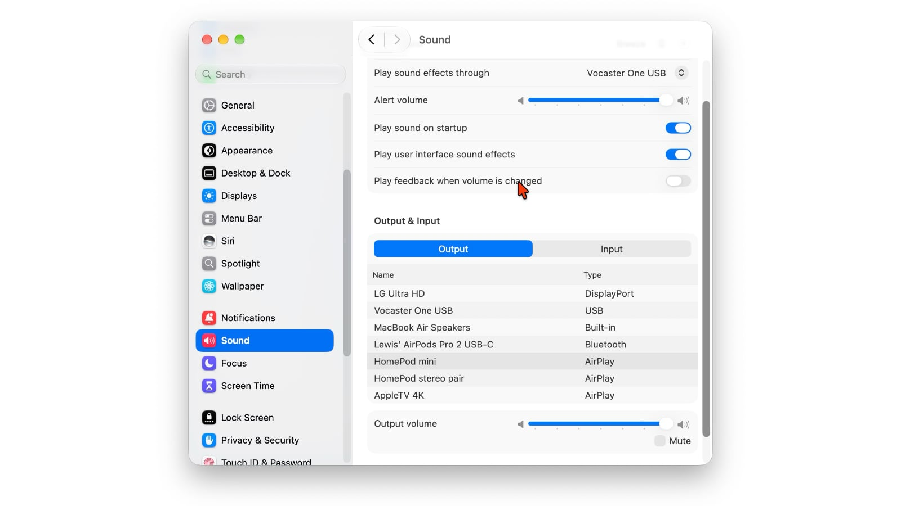

Si utilizas un HomePod para escuchar el Mac y tienes que volver a seleccionarlo por AirPlay, puedes convertirlo en la salida de audio predeterminada con una conexión persistente. Esta guía está pensada para quienes quieren enviar al altavoz el sonido del ordenador, no solo una canción, y disponen de los modelos y versiones compatibles.

El procedimiento sigue la [guía de Ed Hardy en Cult of Mac](https://www.cultofmac.com/how-to/homepod-mac-default-speaker-how-to), publicada el 29 de octubre. Las [notas oficiales de Apple sobre el software del HomePod](https://support.apple.com/en-us/108045), fechadas el 28 de octubre, también describen esta conexión AirPlay persistente. La diferencia respecto al envío temporal de audio es que no hace falta repetir la selección continuamente.

*Fotografía de portada: shyam mishra / Pexels, utilizada por Cult of Mac. Es una imagen ilustrativa; la compatibilidad depende de los modelos indicados a continuación.*

## Requisitos para usar el HomePod con el Mac

Antes de buscar el altavoz en los ajustes, comprueba los requisitos que recoge el tutorial original:

- **HomePod de segunda generación o HomePod mini 2.** No basta con tener cualquier altavoz de la familia HomePod.
- **Software del HomePod 27.2 o posterior** instalado en el altavoz.
- **macOS 27.2** en el ordenador, la versión que indica la guía para esta función.
- **Un Mac compatible con Wi-Fi 6E o posterior.** Poder instalar un macOS reciente no garantiza por sí solo que el equipo cumpla este requisito de hardware.

Si utilizas una pareja estéreo compatible, el procedimiento permite seleccionarla como salida en lugar de elegir un altavoz individual. No necesitas una pareja para seguir los pasos: el original contempla ambas posibilidades. Esta guía parte de dispositivos preparados y no añade instrucciones de actualización ni de creación de parejas estéreo que el artículo no desarrolla.

## 1. Abre los ajustes del sistema

En el Mac, pulsa el **menú Apple**, identificado por el símbolo de la manzana en la esquina superior izquierda de la pantalla. Selecciona **Ajustes del Sistema**; el original lo denomina **System Settings**.

El cambio se realiza desde la configuración del ordenador. No consiste en elegir un destino dentro de una aplicación de música: lo que se busca es definir la salida de audio del Mac.

## 2. Entra en Sonido y localiza Salida

En la barra lateral de los ajustes, selecciona **Sonido** (**Sound** en la guía original). Después, abre la pestaña o sección **Salida** (**Output**).

Ese apartado reúne los dispositivos disponibles para reproducir el audio. Es el punto del recorrido en el que debes localizar el HomePod; no hay un interruptor adicional de persistencia entre los pasos que documenta Cult of Mac.

## 3. Selecciona tu HomePod como salida predeterminada

Pulsa el **nombre de tu HomePod** en la lista de dispositivos de salida. Si ya tienes una pareja estéreo compatible, puedes seleccionar esa pareja en su lugar.

*Captura: Cult of Mac. La interfaz del original está en inglés.*

Esta selección es el paso decisivo. Según el tutorial, con los dispositivos compatibles la conexión pasa a ser persistente, frente al enlace temporal que se obtenía anteriormente al enviar audio por AirPlay.

## Cómo comprobar que funcionó y qué límites tiene

El resultado esperado es escuchar en el HomePod el audio del Mac, incluidos sonidos del sistema, videollamadas y otros contenidos, sin tener que reconectarlo repetidamente. Esa es la comprobación relevante: oír música una vez no permite distinguir por sí solo el envío temporal del comportamiento persistente descrito por la fuente.

Si el resultado no coincide, contrasta primero tu combinación de ordenador, altavoz y software con los requisitos anteriores. El original no ofrece una secuencia de reparación para un HomePod ausente de la lista; por eso no añadimos reinicios, cambios de red ni ajustes alternativos como si estuvieran documentados.

Tampoco conviene confundir esta función con las prestaciones de otros equipos domésticos de Apple: nuestra cobertura del [HomePod mini 2 y el Apple TV 4K](/noticias/audio/apple-homepod-mini-2-homeview-apple-tv-4k/) trata los productos, mientras que aquí el objetivo es configurar la salida del Mac. Las notas de Apple respaldan la persistencia, pero no detallan en esa página los requisitos de hardware: estos proceden de la guía de Cult of Mac, no de una prueba propia.
