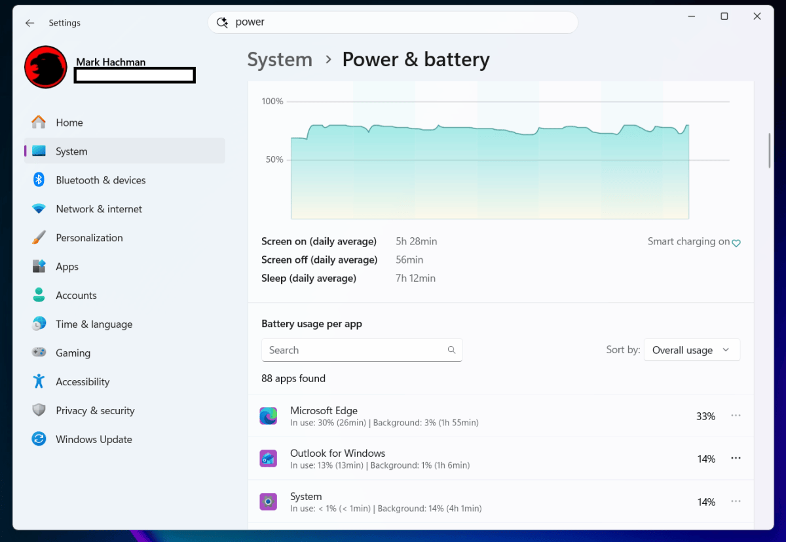
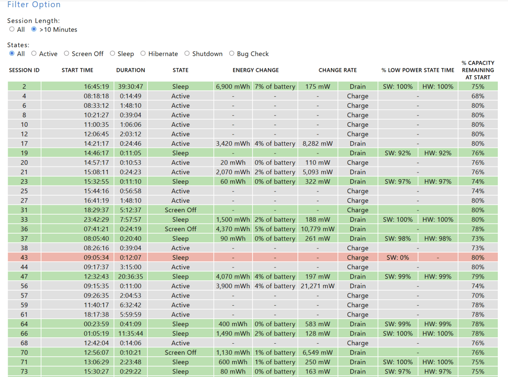
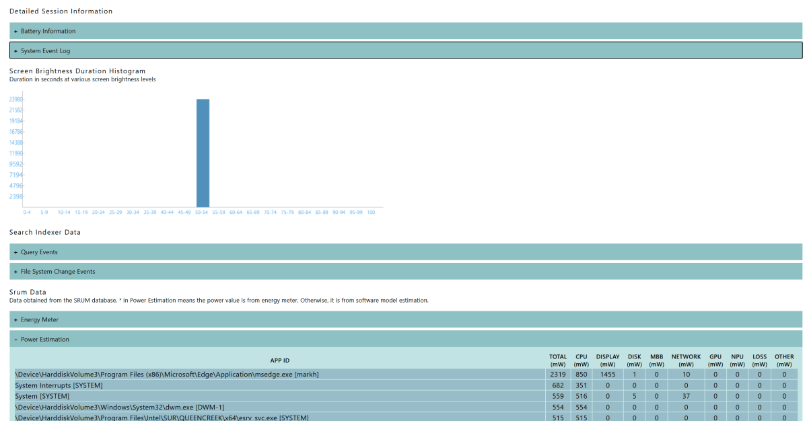

Para detectar qué aplicaciones consumen la batería de un portátil con Windows conviene separar dos situaciones: el gasto mientras trabajas y la actividad cuando el equipo debería estar en reposo. Windows 11 muestra el primero en Configuración; SleepStudy permite investigar la segunda en equipos compatibles. Esta guía adapta el procedimiento publicado por Mark Hachman en PCWorld el 29 de octubre, sin instalar utilidades adicionales ni prometer una mejora concreta de autonomía.

## Requisitos y límites antes de empezar

La ruta de Configuración corresponde a **Windows 11**, como muestra la captura del original. No se debe trasladar literalmente a otras versiones. Para la parte de SleepStudy se necesita abrir el Símbolo del sistema como administrador y disponer de un equipo con **Modern Standby**, el modelo de suspensión al que está destinada la herramienta.

La [documentación de Microsoft sobre SleepStudy](https://learn.microsoft.com/en-us/windows-hardware/design/device-experiences/modern-standby-sleepstudy) sitúa su disponibilidad desde Windows 8.1 en ordenadores que implementan ese modelo. Tener una versión posterior de Windows no garantiza por sí solo esa compatibilidad. Si solo buscas identificar el gasto de las aplicaciones durante el uso, empieza por Configuración: no necesitas generar el informe para consultar esa lista.

## 1. Abre el uso de batería de Windows 11

En **Configuración**, entra en **Sistema → Energía y batería** (*System → Power & battery* en la interfaz inglesa del original). Despliega **Uso de la batería** (*Battery usage*), situado hacia la parte inferior.

El gráfico permite consultar las últimas 24 horas o los últimos siete días y relacionar el historial con el tiempo de pantalla. Antes de buscar culpables, ten presente qué intervalo estás viendo: el consumo de una jornada con muchas tareas no describe necesariamente el comportamiento habitual del portátil.

## 2. Revisa qué aplicaciones consumen la batería

Debajo del gráfico, consulta el apartado de uso de batería por aplicación. Compara las vistas **Overall usage** —uso total— y **Background** —segundo plano— que identifica PCWorld. La primera ayuda a localizar las aplicaciones con mayor gasto; la segunda permite buscar actividad que no coincide con el uso visible de una ventana.



*Captura: Mark Hachman / Foundry, vía PCWorld.*

Una posición alta no demuestra por sí misma un fallo. Un navegador con muchas pestañas puede gastar más porque se ha utilizado más. El interés está en encontrar una aplicación cuyo consumo no encaje con lo que necesitas de ella, especialmente si has instalado alguna utilidad recientemente.

## 3. Cierra una aplicación prescindible cuando necesites autonomía

Si identificas una aplicación con un gasto relevante que no necesitas en ese momento, ciérrala. El ejemplo del original es Outlook durante un desplazamiento: Hachman propone prescindir temporalmente del cliente de correo del portátil y responder desde el teléfono.

No hace falta convertir esa decisión en una desinstalación ni desactivar componentes del sistema. El objetivo de este paso es reducir trabajo prescindible a partir de la información observada, no cerrar indiscriminadamente todo lo que aparezca en la lista.

## 4. Genera un informe SleepStudy para investigar el reposo

Si el problema aparece mientras el portátil debería estar suspendido, abre el **Símbolo del sistema como administrador**. Escribe el comando del original con su opción de salida para guardar el informe en una ubicación explícita:

```cmd
powercfg /sleepstudy /output C:\Users\Public\sleepstudy.html
```

Espera a que termine; puede tardar varios segundos. Después abre el archivo `C:\Users\Public\sleepstudy.html`. Esta variante evita depender de la carpeta de trabajo de la consola: Microsoft explica que, sin una salida especificada, el informe se guarda en el directorio actual.

## 5. Examina los periodos de actividad del informe

El documento aparece como **System Power Report**. Localiza los periodos en los que esperabas reposo y abre sus detalles mediante los enlaces del informe. PCWorld destaca el uso de colores para orientarse: las zonas rojas merecen atención por su actividad elevada, pero no son por sí solas un diagnóstico.



En los detalles puedes encontrar componentes o dispositivos activos, no únicamente aplicaciones convencionales. Por eso un problema de reposo no se resuelve necesariamente cerrando el programa que encabeza la lista de Configuración.



*Capturas de SleepStudy: Mark Hachman / Foundry, vía PCWorld.*

## Cómo verificar el diagnóstico y qué no demuestra

Comprueba que has obtenido dos resultados distintos: una lista de consumo por aplicación para el intervalo elegido y, si el equipo es compatible, un HTML de SleepStudy con sesiones consultables. Si detectas actividad durante un periodo de supuesto reposo, ya tienes una pista concreta que investigar; generar el informe no corrige automáticamente su causa.

Microsoft indica que el informe predeterminado cubre los últimos **tres días**. No debe confundirse con la vista de siete días de Configuración ni suponerse que reproduce el intervalo del ejemplo personal de PCWorld. Además, distingue sesiones con alimentación de red y con batería: observar actividad mientras el equipo está enchufado no equivale a medir descarga de batería.

Esta comprobación tampoco garantiza duplicar la autonomía: esa afirmación de PCWorld remite a otra guía, no a una prueba de estos pasos. Si el gasto viene de la pantalla y no de una aplicación inesperada, puedes consultar nuestra explicación sobre [la frecuencia de actualización y la batería en Windows 11](/noticias/windows-11-pantalla-bateria/), que trata una medida diferente.

*Imagen de portada: Mark Hachman / Foundry, vía PCWorld.*
