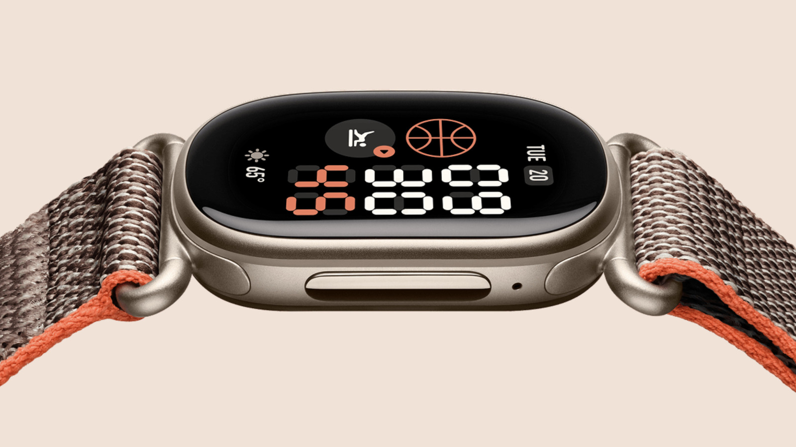
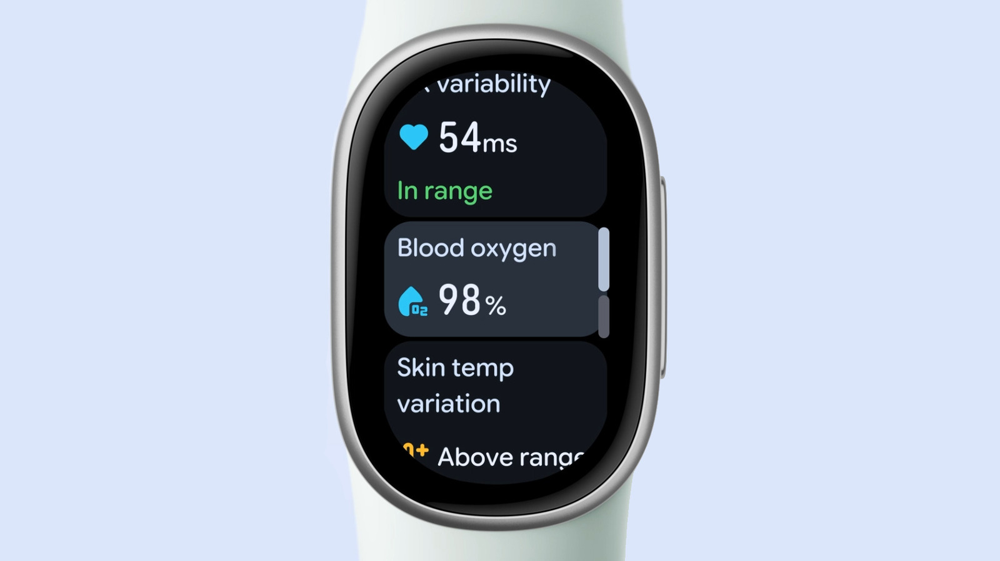

El [Fitbit Edge](/noticias/wearables/fitbit-edge-lanzamiento-oficial/) es el rastreador con el que Google quiere cubrir el hueco entre una pulsera de actividad y un smartwatch completo. El Fitbit Inspire 3 es la alternativa económica que sigue en el catálogo. La distancia de precio es clara: **180 dólares** frente a **99,95 dólares**, un 44 % menos. La duda es si esa diferencia se traduce en algo que el usuario note en el día a día.

## Dos precios y dos planteamientos

El Edge se vende por 180 dólares, con una edición naranja de Stephen Curry que sube a 220 dólares, 40 más que el modelo base. El Inspire 3 se queda en 99,95 dólares. Ambos usan pantalla AMOLED, pero el resto de la ficha técnica marca dos productos con prioridades distintas: el Edge apuesta por sensores e independencia del móvil; el Inspire 3, por precio y duración de batería.

## Pantalla y construcción: aluminio frente a plástico

La pantalla del Edge es 6,9 mm (0,27 pulgadas) más ancha que la del Inspire 3. Las dimensiones son parecidas en el resto: 39,2 x 25,5 x 11,5 mm en el Edge frente a 39,32 x 18,6 x 11,75 mm en el Inspire 3.

La caja del Edge es de aluminio 100 % reciclado y su botón lateral resulta más táctil. Está disponible en verde oliva, negro, blanco y melocotón coral, además de la edición Curry en naranja. El Inspire 3 es más rectangular y recurre al plástico, con tres colores: rosa, naranja y negro.

## GPS, Bluetooth y uso sin el móvil

Aquí está una de las diferencias que más pesan. El Edge lleva GPS integrado y, según Google, mejora un 40 % la precisión al registrar desplazamientos. Eso permite salir a correr sin llevar el teléfono encima. También incorpora Bluetooth 5.4 para conectar auriculares inalámbricos directamente al reloj.

Los dos admiten Find My Device y notificaciones de aplicaciones cuando el móvil está cerca. El Edge suma respuestas rápidas, controles de música y previsión del tiempo, y está previsto que añada Maps próximamente. El Inspire 3 no ofrece esas funciones, aunque sí muestra notificaciones de calendario en pantalla.

## Sensores y datos de salud: dónde está el salto real

El Edge hace seguimiento continuo de la frecuencia cardiaca y añade una aplicación de ECG con detección de fibrilación auricular. También ofrece informes mensuales sobre presión arterial y resistencia a la insulina, y puede analizar los datos de glucosa que el usuario registre por su cuenta.

El Inspire 3 se queda en lo básico: monitor óptico de frecuencia cardiaca, oxígeno en sangre y acelerómetro. El Edge suma a eso el sensor de ECG, la temperatura de la piel, un giroscopio y un altímetro que ayudan a calcular mejor la posición y el desnivel.

En actividad física, el Edge detecta automáticamente 100 tipos de movimiento y admite más de 50 modos de ejercicio; el Inspire 3 se queda en 20. El modelo nuevo incorpora además carga cardiaca, carga cardiaca objetivo, pisos subidos y frecuencia cardiaca durante el uso de máquinas de gimnasio.

## Autonomía y resistencia al agua

El Edge aguanta hasta una semana por carga; el Inspire 3 llega a 10 días. La diferencia existe, pero para quien ya carga el reloj un par de veces por semana no cambia la rutina.

En resistencia al agua empatan con 5 ATM según la norma ISO 22810:2010: aguantan lluvia, ducha y natación en aguas poco profundas, pero no están pensados para bucear. El Edge añade certificación IP68 contra el polvo, algo que el Inspire 3 no declara.

## Cuál comprar: Fitbit Edge o Inspire 3 según tu perfil

**Elige el Fitbit Edge** si sales a correr o a caminar sin el móvil, quieres GPS propio y te interesa el ECG con aviso de fibrilación auricular. También tiene sentido si valoras los materiales, el botón más firme y funciones como respuestas rápidas, música o la futura integración con Maps. Es la opción intermedia para quien no necesita un smartwatch completo y prefiere no pagar el precio de un Pixel Watch.

**Elige el Inspire 3** si el objetivo es contar pasos, dormir y frecuencia cardiaca sin complicaciones. Cuesta unos 80 dólares menos, dura tres días más por carga y sigue ofreciendo pantalla AMOLED, oxígeno en sangre y notificaciones de calendario. Para quien no entrena al aire libre ni necesita ECG, el salto al Edge no aporta nada que vaya a usar.

## Qué pierde cada uno y cuándo no vale la pena el cambio

El Inspire 3 pierde GPS, ECG, sensor de temperatura, altímetro, giroscopio, materiales premium y casi todas las funciones de smartwatch. A cambio, gana 80 dólares de ahorro y tres días de batería. El Edge, por su parte, pierde esos tres días de autonomía y cuesta un 44 % más. Tampoco llega a ser un smartwatch completo: Engadget lo sitúa por debajo de los que permiten llamadas por sí solos, así que quien busque independencia total del teléfono tendrá que mirar otro segmento.

El cambio no compensa si ya tienes un Inspire 3 y solo lo usas para sueño y pasos, ni si cargas el reloj cada pocos días sin que la batería sea un problema. Tampoco si el ECG no va a cambiar ninguna decisión de salud: conviene recordar que estas lecturas son orientativas y no sustituyen una prueba médica. Para el resto, el Edge es la actualización con más sentido dentro de la gama de Google.
