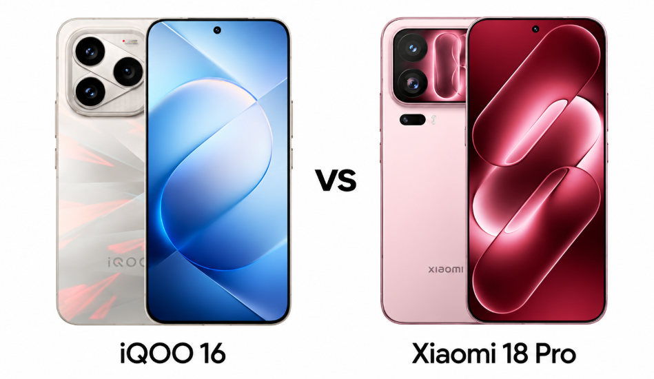

El iQOO 16 y el Xiaomi 18 Pro llegan con la misma base —Android 17, hasta 16 GB de RAM y hasta 1 TB de almacenamiento UFS 4.1— y con prioridades opuestas. El iQOO ronda los 800 dólares (unas 83.000 rupias en India) y el Xiaomi 18 Pro, los 1.000 dólares (unas 120.000 rupias). Esta comparativa separa lo que de verdad cambia la experiencia de uso y termina con un veredicto por perfil: no hay un ganador universal, hay un móvil correcto para cada tipo de comprador.

## Pantalla: 6,85 pulgadas a 165 Hz frente a 6,4 pulgadas LTPO

El iQOO 16 monta un panel AMOLED de 6,85 pulgadas con resolución 1440 × 3168, 165 Hz, Dolby Vision y HDR10+. El Xiaomi 18 Pro opta por un LTPO AMOLED de 6,4 pulgadas, 1120 × 2436 y 120 Hz, también con Dolby Vision y HDR10+.

La diferencia práctica está en dos ejes. El primero es el tamaño: 6,85 pulgadas favorecen el consumo de vídeo y los juegos, mientras que 6,4 pulgadas se manejan mejor con una mano. El segundo es la tasa de refresco: el iQOO declara 165 Hz y el Xiaomi se queda en 120 Hz, aunque su panel LTPO ajusta la frecuencia de forma adaptativa para gastar menos batería.

Los picos de brillo que anuncian ambos fabricantes —10.000 nits en el iQOO y 4.000 en el Xiaomi— son cifras de marketing. Lo que importa es el brillo sostenido en exterior, y eso solo se comprueba con el móvil en la mano.

## Chip: misma generación, distinta posición

El iQOO 16 usa el Snapdragon 8 Elite Extreme Gen 6 con GPU Adreno 850; el Xiaomi 18 Pro, el Snapdragon 8 Elite Gen 6. Sobre el papel, el iQOO ocupa una posición superior dentro de la familia, lo que debería notarse en juegos exigentes y cargas gráficas intensas.

Conviene moderar la expectativa: el rendimiento sostenido depende de la refrigeración y de cómo optimice cada fabricante. El propio análisis de origen advierte de que la ventaja real solo se puede medir con pruebas independientes de rendimiento y temperatura, que no están disponibles en el momento de escribir esta guía. Para aplicaciones exigentes, multitarea y juegos de gama alta, los dos están sobradamente capacitados.

## Cámaras: el argumento que justifica el precio

Aquí la distancia es la más clara. El Xiaomi 18 Pro lleva un sensor principal de 200 MP con estabilización óptica y ópticas Leica, un periscopio también de 200 MP con zoom óptico de 3,2 aumentos, un ultraangular de 50 MP con autofoco, enfoque láser y sensor de espectro de color. Graba en 8K a 30 fps y en 4K a 120 fps, con opciones HDR y LOG.

El iQOO 16 responde con un conjunto más convencional: principal de 50 MP con estabilización, periscopio de 50 MP con zoom óptico de 3 aumentos y ultraangular de 50 MP con autofoco. Graba en 8K a 30 fps. Su cámara frontal es de 32 MP; la del Xiaomi, de 50 MP con autofoco.

La pantalla trasera de 2,7 pulgadas del Xiaomi añade una ventaja concreta para quien se fotografía: permite encuadrar selfis con la cámara principal o con el teleobjetivo en lugar de usar siempre la frontal. Para fotografía y vídeo, el Xiaomi es el más ambicioso; para el uso cotidiano, el iQOO cumple sin problema. Si quieres el detalle del terminal de Xiaomi, la [presentación del Xiaomi 18 Pro](/noticias/xiaomi-18-pro-lanzamiento/) repasa su pantalla trasera y el resto de su ficha.

## Batería y carga

El iQOO 16 equipa una batería de silicio-carbono de 8.400 mAh, con carga por cable de 100 W, inalámbrica de 40 W y carga bypass, que alimenta el teléfono directamente durante las sesiones de juego para no castigar la batería.

El Xiaomi 18 Pro baja a 7.000 mAh, también de silicio-carbono, con 100 W por cable, 50 W inalámbricos y 27 W de carga inalámbrica inversa. Gana en comodidad para accesorios; pierde en capacidad bruta.

Más miliamperios no significan automáticamente más autonomía: el consumo del panel y del software pesa. Aun así, la diferencia de 1.400 mAh es lo bastante grande como para que el iQOO parta con ventaja entre quienes pasan muchas horas fuera de casa.

## Software: empate sobre Android 17

Los dos salen con Android 17: OriginOS 7 en el iQOO y HyperOS 4 en el Xiaomi. La comparativa de origen lo considera un empate, y en la práctica la elección depende de la capa que cada usuario prefiera. Ninguno de los dos documentos detalla el compromiso de actualizaciones, así que conviene confirmarlo con el fabricante o con la tienda antes de pagar, porque es un dato que afecta a la vida útil del móvil.

## Precio: lo que separa al iQOO 16 del Xiaomi 18 Pro

La separación es de unos 200 dólares: 800 frente a 1.000. Por ese dinero, el Xiaomi añade el sistema Leica, los sensores de 200 MP, la grabación a 4K y 120 fps, la pantalla trasera, la carga inalámbrica de 50 W y la inversa de 27 W. El iQOO concentra su presupuesto en pantalla rápida, batería grande, carga bypass y resistencia al agua IP68/IP69.

Ambos precios son aproximados y varían según el país, los impuestos y el momento de compra. Antes de decidir, verifica si la unidad que te ofrecen es la versión china o la global: cambian bandas, accesorios y garantía.

## Veredicto por perfil

- **Jugador o usuario intensivo:** iQOO 16. La pantalla de 165 Hz, los 8.400 mAh y la carga bypass están pensados para sesiones largas.
- **Fotografía y vídeo:** Xiaomi 18 Pro. Los 200 MP con Leica, el 4K a 120 fps y la pantalla trasera marcan la diferencia.
- **Quien busca un móvil compacto:** Xiaomi 18 Pro, con 6,4 pulgadas frente a 6,85.
- **Mejor relación entre precio y rendimiento:** iQOO 16, salvo que la cámara sea una prioridad real.

## Qué pierde cada uno y cuándo no compensa

El iQOO 16 renuncia al sistema Leica, a los sensores de 200 MP, a la carga inalámbrica de 50 W, a la inversa de 27 W, al UWB, a la salida de vídeo por USB-C y a la pantalla trasera. Si haces muchas fotos o grabas vídeo con el móvil, ese recorte se nota.

El Xiaomi 18 Pro pierde capacidad de batería, tasa de refresco y el nivel IP69 del rival, y cuesta unos 200 dólares más. Si no vas a usar la cámara más allá de lo básico ni la pantalla trasera, ese sobreprecio no compra nada que vayas a aprovechar.

## Cómo verificar antes de pagar

1. Confirma en la ficha del vendedor si el modelo es la versión china o la global.
2. Comprueba el precio final con impuestos incluidos, no el anunciado en dólares.
3. Revisa qué cargador incluye la caja y si soporta la carga rápida que anuncia el fabricante.
4. Pregunta por la política de actualizaciones de Android, que ninguna de las dos fichas detalla.
5. Si la cámara es tu motivo principal, pide muestras de foto y vídeo antes de cerrar la compra.

Con esas comprobaciones hechas, la decisión se reduce a una pregunta: ¿pagas 200 dólares más por un sistema fotográfico claramente superior y una pantalla trasera, o te quedas con más batería y una pantalla más rápida por menos dinero?
