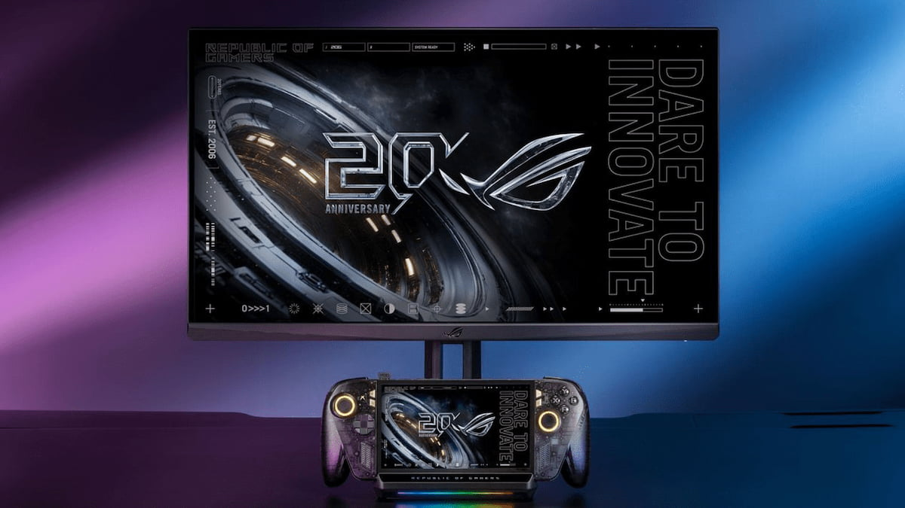
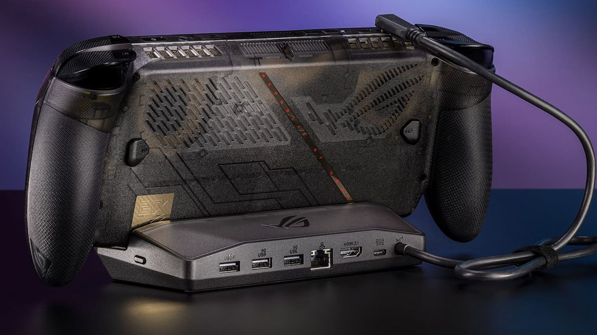

La ROG Ally es un ordenador con formato de consola portátil, así que puede usarse en una pantalla grande aunque no haya un dock de por medio. Basta un cable USB-C que termine en HDMI o DisplayPort. El problema es que ese montaje improvisado no resulta tan cómodo como el de una Switch. Para eso existe el ROG Bulwark DG310, el dock oficial de ASUS: la consola se conecta con un único USB-C y el resto de la instalación queda recogida en un solo accesorio.

Esta guía sirve si ya tienes una ROG Ally y quieres llevarla al salón sin renunciar al modo portátil. Solo recoge lo que documenta el artículo original de AVPasión; si un detalle no aparece allí, aquí tampoco.

## Qué resuelve y para quién

El dock convierte la consola en un equipo de sobremesa permanente, conectado a un televisor, sin desenchufar y reenchufar cables cada vez. Está pensado para quien quiere jugar en pantalla grande en casa y seguir usando la Ally fuera de ella.

No es una transformación mágica: la consola sigue siendo la misma y el dock no añade potencia. Lo que añade son conexiones fijas y un único cable hacia la consola.

## Requisitos

- **Una consola ROG Ally.** El original menciona la familia ROG Ally y, de forma expresa, la versión especial en colaboración con Xbox. No enumera otros modelos, así que conviene comprobar el tuyo antes de comprar.
- **El dock ASUS ROG Bulwark DG310**, la versión presentada en octubre de 2026. Es la actualización del Bulwark de 2025.
- **Un televisor con entrada HDMI.** El dock está diseñado para conectarse a una TV y su salida de vídeo es HDMI 2.1.
- **Un cable USB-C** para unir el dock con el puerto de la consola.

El artículo no menciona ninguna versión de software, ningún menú del sistema ni un mando incluido en el paquete. Por eso no hay pasos de configuración en esta guía: no se pueden verificar.

## Pasos

### 1. Comprueba que tu ROG Ally es compatible

El dock se ha desarrollado pensando en las consolas portátiles ROG Ally, incluida la edición en colaboración con Xbox. Verifica el modelo antes de seguir: el original no promete compatibilidad con otras marcas.

### 2. Conecta el dock a la consola por USB-C

El ROG Bulwark DG310 funciona como cualquier otro dock: se conecta con un único puerto USB-C que va directamente al puerto de la propia consola. Es la única unión entre ambos equipos.

### 3. Lleva la imagen al televisor por HDMI

Conecta el televisor al puerto HDMI 2.1 del dock. El accesorio está diseñado precisamente para ese uso: sacar la consola del modo portátil y jugar en una pantalla grande.

### 4. Añade red por cable y periféricos (opcional)

El dock suma seis salidas en total. Además del USB-C de la consola y el HDMI 2.1, incluye un puerto Ethernet de 1 GB y tres puertos USB-A 3.2. Puedes usar el Ethernet para una conexión por cable y los USB-A para teclado, ratón o almacenamiento.

### 5. Alternativa sin dock

Si no quieres comprar el accesorio, el original recuerda que cualquier consola de este tipo, al ser un ordenador, puede jugar en modo sobremesa con un cable USB-C que conecte con un HDMI o un DisplayPort. Es menos cómodo, pero funciona. Y si lo que buscas es exprimir la Ally sin cambiar de equipo, también hay margen por la vía del reescalado: [HelixSR lleva el DLSS de NVIDIA a portátiles AMD como esta](/noticias/tarjetas-graficas/helixsr-dlss-steam-deck-rog-ally/).

## Cómo verificar que funcionó

El original no describe un menú de comprobación, así que la verificación es física: si el televisor muestra la imagen de la consola a través del HDMI del dock, la conexión está resuelta. Después puedes confirmar que los periféricos conectados a los USB-A responden y que la red por Ethernet enlaza, si decidiste usarla.

## Limitaciones y lo que no hace

- **No añade rendimiento.** El dock es un concentrador de conexiones, no una GPU externa. La consola mantiene su hardware y su enfoque portátil, pensado para resoluciones más bajas.
- **No incluye mando.** El original no menciona ninguno en el paquete; si quieres jugar cómodamente en el salón, tendrás que aportar el tuyo.
- **No es la opción más barata para jugar solo en el salón.** El propio autor de la pieza recomienda usar la Ally principalmente en modo portátil y dejar el dock como segunda opción. Si la mayor parte del tiempo vas a jugar en sobremesa, un PC ofrece mejor relación calidad-precio.
- **Precio.** El ROG Bulwark DG310 sale por 99 dólares; en Europa se espera que ronde los 120 euros, la misma cifra que la versión anterior.

En resumen: el dock cumple bien su función si tu uso es mixto y quieres una instalación ordenada en el salón. Si tu intención es jugar casi siempre en el televisor, el desembolso tiene menos sentido.
