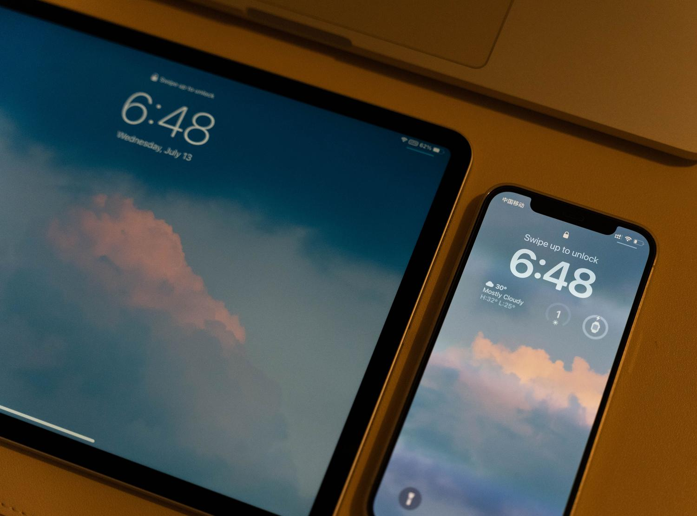

Cambiar de ordenador o estrenar un móvil no debería obligar a volver a guardar páginas web útiles ni a reescribir una y otra vez las mismas claves. Vincular tu cuenta personal de Google en Chrome resuelve exactamente eso: al activar la sincronización, el navegador deja de ser una herramienta que guarda datos solo en el disco local y la información se replica cifrada en la nube, de modo que tus preferencias y accesos te acompañen dondequiera que inicies sesión. Esta guía es para cualquier usuario de Windows, macOS o Linux que quiera dejar de arrastrar datos a mano entre dispositivos. De paso, si te interesa el ecosistema Chrome a otro nivel, también puedes [convertir un PC antiguo con Windows en un Chromebook con ChromeOS Flex](/noticias/windows-pc-to-chromebook/).

## Requisitos previos

- Una **cuenta de Google activa**.
- **Chrome actualizado** a la versión más reciente. Si el navegador está desfasado, es probable que algunas opciones de sincronización no aparezcan o den errores: fuerza la actualización desde el menú de ayuda antes de continuar.
- El **teléfono móvil a mano**. Por seguridad, Google puede pedirte una verificación en dos pasos al detectar que entras desde un equipo desconocido; se confirma desde el móvil en unos segundos.

La estructura de los menús es prácticamente idéntica en los tres sistemas, así que los pasos valen igual en Windows, macOS y Linux.

## Cómo activar la sincronización paso a paso

1. **Abre el menú de perfil.** Haz clic en el icono de **Perfil**, en la esquina superior derecha de Chrome.

2. **Inicia sesión con tu cuenta de Google.** Selecciona la opción **Activar sincronización** e introduce tu correo electrónico y contraseña.

3. **Completa la verificación de seguridad.** Si el sistema te lo solicita, confirma el acceso desde tu teléfono móvil.

4. **Acepta los términos y elige el alcance.** Puedes sincronizar todos los datos o personalizar la selección: por ejemplo, sincronizar marcadores pero no el historial.

5. **Comprueba el estado de la cuenta.** En el menú de configuración, el estado debe aparecer correctamente como **sincronizado**.

## Cómo personalizar qué datos se guardan en la nube

Si en algún momento decides cambiar qué datos se sincroniza, no hace falta cerrar la sesión: entra en **Sincronización y servicios de Google** y ajusta las categorías a tu gusto.

## Cómo verificar que funcionó

Después de aceptar los términos, vuelve al menú de configuración de Chrome y confirma que el estado de la cuenta figure como **sincronizado**. Con eso confirmado, marcadores, contraseñas e historial quedan replicados cifrados en la nube: un formateo inesperado o la pérdida de un dispositivo ya no borran tu rastro de navegación.

## Ventajas de tener la cuenta vinculada

- El **gestor de contraseñas integrado** rellena los formularios y solo autocompleta los datos en el dominio correcto, lo que te protege de webs fraudulentas.
- Puedes **consultar las pestañas abiertas** en el móvil desde el ordenador y viceversa, útil para no perder el hilo de una lectura o una compra.
- Si pierdes el portátil o el móvil, puedes **cerrar la sesión de forma remota** desde la configuración de tu cuenta de Google para que nadie acceda a tu información privada.

## Perfiles de Chrome para separar uso personal y profesional

Cuando el equipo se comparte —pareja, hijos o compañeros de trabajo—, los perfiles independientes de Chrome evitan que las sesiones de trabajo interfieran con las de ocio: cada perfil funciona como un navegador separado, con sus propios marcadores, extensiones y cookies.

1. Ve al icono de perfil.
2. Selecciona **Añadir perfil**.
3. Personalízalo con un nombre, una foto y un color distintivos para identificarlo a golpe de vista.

Si alguien necesita usar tu equipo solo un momento, el **Modo Invitado** es la opción recomendada: crea una ventana temporal que se borra por completo al cerrarla, sin dejar rastro de la navegación.

## Solución de problemas comunes

Si ves un aviso de que la sincronización se ha detenido, no te alarmes: suele ser algo sencillo de arreglar.

- **Cambiaste la contraseña de la cuenta de Google.** Haz clic en la alerta e introduce la clave nueva.
- **Te has quedado sin espacio de almacenamiento en la cuenta.** Libera datos o desactiva categorías secundarias.
- **Un antivirus o software de seguridad bloquea la conexión** con los servidores de Google. Añade Chrome como excepción en tu programa de seguridad.
- **Nada de lo anterior funciona.** Cierra la sesión por completo y vuelve a entrar para refrescar la conexión con los servidores.

## Cómo desactivar la sincronización

Si decides que ya no quieres sincronizar tus datos, desactiva la función desde el menú de perfil. Ten en cuenta que, aunque **desactives la sincronización**, seguirás viendo tus marcadores y contraseñas en ese equipo, pero los cambios que hagas ya no se replicarán en los demás dispositivos ni se guardarán en la nube.

Para quienes quieran borrar todo rastro de su información sincronizada de los servidores de Google, existe una opción específica en `chrome.google.com/sync`, desde la que se puede ejecutar el borrado de datos.

## Advertencias y limitaciones

- Activa la sincronización únicamente en **dispositivos de tu propiedad** y evítalo en ordenadores públicos para proteger tu privacidad.
- Desactivar la sincronización **no borra los datos locales**: el equipo conserva marcadores y contraseñas, pero deja de replicarlos y de guardarlos en la nube. El borrado en los servidores es una acción aparte, en `chrome.google.com/sync`.
- Todo el proceso depende de una cuenta de Google activa y de un navegador actualizado; sin esas dos condiciones, las opciones de sincronización pueden no aparecer o fallar.
