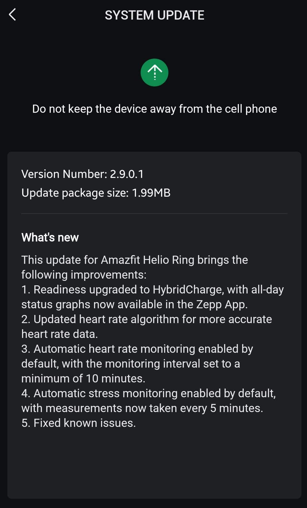

El **Amazfit Helio Ring recibe HybridCharge**, una nueva forma de consultar el estado de recuperación y la carga diaria en Zepp, junto con cambios en el seguimiento automático del pulso y el estrés. La actualización es la **2.9.0.1**, según [Gadgets & Wearables](https://gadgetsandwearables.com/2026/10/31/amazfit-helio-ring-2-9-0-1-update/), que publicó el 31 de octubre una captura de sus notas. El despliegue es gradual: no todos los propietarios tienen por qué verla disponible al mismo tiempo.

La novedad afecta a cómo se presentan e interpretan los datos del anillo, no a una función que prometa acelerar la recuperación física. Para quien ya consulta Zepp al levantarse o antes de entrenar, lo relevante es el paso de Readiness a un sistema con gráficos del estado a lo largo del día.

*Imagen de portada: Zepp Health, distribuida por Gadgets & Wearables.*

## Qué cambia HybridCharge en el Amazfit Helio Ring

Las notas de la versión indican que **Readiness se sustituye por HybridCharge** y que los gráficos diarios pasan a estar disponibles en la aplicación Zepp. Es el cambio más visible de esta entrega: la consulta deja de depender del esquema anterior de disposición para la actividad.

Gadgets & Wearables explica que HybridCharge combina BioCharge con Training Load y LifeLoad. La idea es incorporar recuperación, carga del ejercicio y contexto de la vida cotidiana a la valoración del estado del usuario. Su [cobertura previa del sistema](https://gadgetsandwearables.com/2026/06/05/amazfit-hybridcharge-schedule/) describe también aportaciones manuales de contexto y esfuerzo percibido; eso no permite asumir que todas las opciones de los relojes estén reproducidas exactamente en el anillo.

Para el propietario, conviene distinguir la nueva presentación de una mejora demostrada de las estimaciones. La captura confirma la incorporación de HybridCharge, pero no aporta una validación clínica ni una comparación que cuantifique cuánto mejora sus recomendaciones. Aquí recogemos las novedades documentadas, no una prueba propia del dispositivo.

*Captura de las notas de actualización de Zepp publicada por Gadgets & Wearables.*

## Pulso cada diez minutos y estrés cada cinco

El registro de cambios activa por defecto el seguimiento automático de frecuencia cardiaca y fija un **intervalo mínimo de diez minutos**. También habilita de forma predeterminada el seguimiento del estrés, con mediciones cada cinco minutos. Son registros periódicos: no deben confundirse con una lectura continua del pulso segundo a segundo.

Además, las notas anuncian una revisión del algoritmo cardiaco orientada a obtener datos más precisos y correcciones de problemas conocidos. No detallan cuáles son esos fallos ni incluyen cifras de error antes y después. Por eso, la mayor precisión debe entenderse como el objetivo anunciado por el fabricante, no como un resultado verificado por TechSpain24.

El seguimiento discreto es precisamente uno de los argumentos de estos formatos, como ocurre con la [combinación de pulsera y anillo de Qalo](/noticias/wearables/qalo-pulsera-anillo/). En el Helio Ring, esta actualización cambia la configuración automática y la consulta de datos; las estimaciones de estrés no equivalen a un diagnóstico médico.

## Cómo comprobar su llegada y qué queda por medir

El medio recomienda revisar el apartado **System Update** de la aplicación Zepp durante los próximos días. Al tratarse de un despliegue escalonado, que la versión no aparezca todavía no demuestra que exista un problema con el anillo. La información publicada no fija una fecha de disponibilidad universal ni una fecha específica para España.

La otra incógnita es la autonomía real. Registrar datos con más frecuencia plantea una pregunta razonable sobre el consumo, pero la fuente no presenta mediciones de batería con este firmware. No hay base para prometer más duración ni para afirmar una pérdida concreta tras instalarlo.

Si ya utilizas el Helio Ring para revisar tendencias de descanso y actividad, esta entrega merece atención por HybridCharge y los ajustes automáticos. Si lo que esperas es una mejora demostrada de precisión o autonomía, conviene esperar a pruebas comparables: las notas de una actualización no sustituyen esas mediciones.
