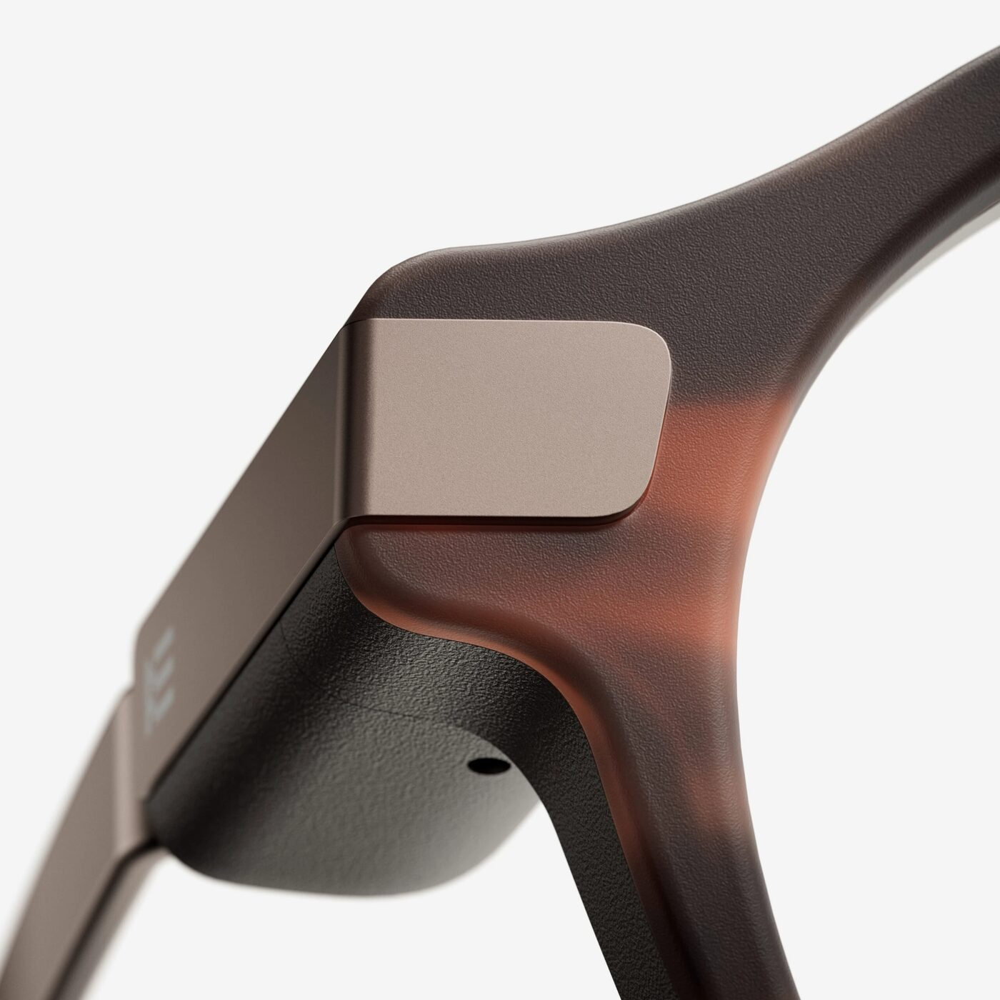

Según Android Headlines, Even Realities ha presentado una actualización de software para sus gafas Even G2 que es la mayor desde abril. Lo que de verdad cambia para quien ya las lleva puestas no es el color de la montura, sino la memoria: la versión V2.4.0 introduce una Knowledge Base donde se guardan documentos y conversaciones para que las gafas mantengan el contexto y puedan echar una mano durante una reunión.

Conviene fijar el estado de la información antes de seguir. Even Realities no ha publicado todavía un changelog oficial de la V2.4.0 en su web ni en su centro de ayuda, y el anuncio llega a través del medio citado. El color Brown 2, los clips polarizados y la cadena sí están confirmados en la página oficial del producto. El detalle del software se cuenta aquí como reportado.

## Qué guarda la Knowledge Base y quién decide qué se queda

El punto de partida es una base de conocimiento personal. Se pueden importar sesiones anteriores de Conversate —la función que transcribe y resume conversaciones— o subir archivos propios. Las gafas organizan ese material en un árbol visual de temas conectados, y el usuario decide qué añade, qué actualiza y qué elimina.

Sobre esa base trabaja Even AI 2.0. El asistente mantiene el hilo entre preguntas de seguimiento y permite retomar una conversación anterior sin empezar de cero. La diferencia práctica es la de siempre: un asistente que responde desde el aire frente a uno que sabe de qué proyecto se está hablando. Para un comercial que retoma una cuenta después de dos semanas, o para quien prepara una clase con el material del trimestre anterior, ese contexto es justo lo que faltaba.

Quedan preguntas sin respuesta oficial: qué formatos de archivo acepta la importación, cuánto material cabe y si la base viaja con la cuenta o con el móvil. Ni Android Headlines ni la web del fabricante lo detallan, así que no hay que darlo por hecho.

## Asistencia durante la reunión: lo que está en beta

La segunda pieza es AI Cue Expert Mode, que se presenta como un experto de conversación dentro del campo de visión. Durante una llamada de ventas, una entrevista o una clase puede mostrar información relevante, señalar preguntas que quedaron sin responder y sugerir próximos pasos. Todo sin levantar la vista del interlocutor, que es la única razón por la que unas gafas con pantalla tienen sentido en ese escenario.

A eso se suman Conversate Pro Mode e Insights, las dos funciones que la compañía sitúa en beta. Van más allá del resumen de reunión: destacan prioridades, riesgos potenciales y siguientes pasos recomendados, y cada conclusión queda enlazada al momento concreto de la conversación del que sale. Ese enlace es lo que separa un resumen decorativo de algo verificable; sin él, no hay forma de comprobar si el sistema entendió o inventó.

De momento no hay datos de disponibilidad por país ni de idiomas soportados para estas dos funciones, y la beta puede cambiar antes de llegar a todos. También aparece una interfaz oscura, un detalle menor pero esperado en quienes usan las gafas de noche o en interiores con poca luz.

## Conversaciones y documentos salen del dispositivo

Aquí está la parte que el anuncio trata de pasada. Una Knowledge Base que importa conversaciones y documentos implica procesar ese material en un servicio externo, y eso incluye voces de terceros que no han dado permiso. El centro de privacidad de Even Realities describe el tratamiento actual: Conversate y Even AI procesan en la nube, el audio se trabaja por segmentos y cada segmento se borra en cuanto se transcribe, la memoria de la IA se puede activar o desactivar en los ajustes, los datos no se usan para entrenar modelos generativos y el tráfico va cifrado en tránsito y en reposo. Los registros se pueden revisar y eliminar.

Esa política describe las funciones existentes, no específicamente la Knowledge Base, y la compañía no ha explicado qué cambia cuando se suben documentos. Dos cautelas se deducen sin necesidad de inventar nada. La primera: subir un acta, un contrato o una grabación de cliente convierte a las gafas en depositarias de datos que quizá no deberían salir del portátil. La segunda: que las gafas no lleven cámara elimina el problema de grabar imágenes, no el de escuchar. El micrófono sigue ahí, y en España grabar una conversación exige informar a los participantes; en el trabajo, en clase o en una consulta médica hay además normas propias del lugar.

La recomendación práctica es la de siempre con esta categoría: avisar de que se está transcribiendo, no usarlas en conversaciones confidenciales sin marco claro, y revisar y borrar los registros con la misma costumbre con la que se limpia la bandeja de entrada.

## Lo demás del anuncio: Brown 2, clips polarizados y cadena

El resto es acabado. Brown 2 es una nueva montura de acetato con efecto carey cálido, un patrón distinto en cada unidad y 20 horas de pulido según el fabricante, que la presenta como la versión más ligera del G2 manteniendo ajuste y nitidez de pantalla. Los Even G2 Polarized Sun Clips añaden lentes grises espejadas con protección UVA y UVB del 100 %, en versiones para la montura A y la B, y la Even G2 Chain es una cadena de acero inoxidable para llevarlas al cuello entre usos, pensada para quien no lleva graduación y se las quita y se las pone varias veces al día.

Con todo esto sobre la mesa, la decisión depende de para qué se compraron. Si ya tienes las gafas y tu día pasa por reuniones, entrevistas o clases, la Knowledge Base y el contexto persistente son la actualización que justifica el desembolso, siempre que la beta cumpla y que el tratamiento de datos te encaje. Si lo que esperabas era una cámara o visión artificial, este anuncio no lo trae y conviene esperar: el enfoque sin cámara de Even Realities es una decisión de producto, no un paso intermedio. Puedes seguir el resto de novedades del sector en la sección de [wearables](/noticias/wearables/).
