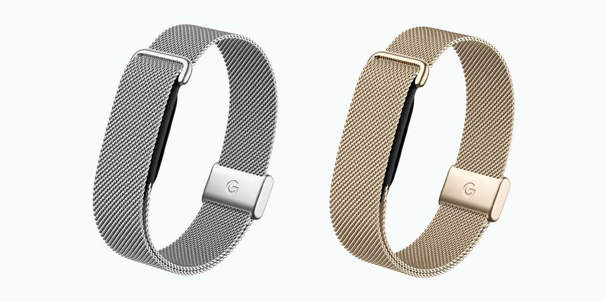

Quien se compra un Fitbit Air tiene hoy dos correas donde elegir, la Elevated Modern y la Performance Loop, y ninguna de las dos cambia demasiado el aspecto del dispositivo. Google acaba de abrir una tercera vía: una correa Metal Mesh en plata pulida y oro champán, pensada para que el rastreador combine con las joyas que ya llevas puestas. Es una novedad de acabado, no de hardware: la correa no añade sensores ni mide nada nuevo.

## Una correa para el Fitbit Air que apunta a un look más arreglado

La Metal Mesh llega con la intención declarada de «elevar» el conjunto, y ahí está su sentido práctico. Las bandas anteriores cumplen para el día a día, pero la malla metálica es la primera opción que apunta a un plan más formal: la idea es que el rastreador pase desapercibido junto a un anillo o una pulsera, en lugar de parecer un accesorio deportivo. Los dos acabados, plata y oro, siguen esa misma lógica de imitar la joyería que la acompaña.

Según el anuncio recogido por 9to5Google, la correa cuesta 69,99 dólares y ya se puede reservar en la tienda de Google y en Target. Los envíos deberían producirse a lo largo de este mes. Hay además un pack que junta el Fitbit Air con la Metal Mesh y la Performance Loop por 149,99 dólares, aunque solo está disponible en oro: son 20 dólares más que las ediciones especiales de la marca, como las dedicadas a Steph Curry o al sueño de Pokémon, con la diferencia de que aquí vienen dos correas en lugar de una.

## La mejora que de verdad se nota: el registro automático

El cambio con más recorrido no está en la correa, sino en cómo el Fitbit Air interpreta lo que haces sin que se lo pidas. Google asegura que el seguimiento automático de actividad pasa a ser «más inteligente, preciso y fiable», y lo concreta en cuatro frentes:

- **Detecta más deportes.** El número de actividades que el rastreador o un Pixel Watch reconocen sube de 10 a más de 100, e incluye entrenamiento de fuerza, natación y deportes de raqueta y de equipo, terrenos donde el registro automático solía fallar.
- **Usa más contexto.** Con razonamiento contextual, Google Health tiene en cuenta tus rutinas de entrenamiento, el historial, las ediciones manuales y, con permiso, la ubicación. La compañía afirma que esto se traduce en casi el doble de detecciones correctas y en menos de la mitad de entrenamientos sin registrar.
- **Registra sesiones solo.** Un entrenamiento que supere el umbral mínimo de duración —15 minutos por defecto— con el pulso elevado sostenido se anota de forma automática, y el resumen llega a la aplicación del móvil, normalmente en menos de 30 minutos.
- **Aprende de tus correcciones.** Cada vez que confirmas o editas una actividad, alimentas un sistema que aprende tus patrones y ajusta sus predicciones con ellos.

El detalle que importa para la muñeca es que estas mejoras son de software y no dependen de la correa que lleves: están planificadas para «finales de este mes» en el propio rastreador, sea cual sea la banda elegida. Es decir, quien ya tenga un Fitbit Air recibirá el cambio sin comprar nada nuevo, y quien dude por la correa puede separar ambas decisiones.

## Health Guardian y el resto del anuncio

La correa no viaja sola. En el mismo anuncio, Google detalla novedades de Health Guardian para los usuarios de Google Health Premium que tengan configuradas las tendencias de presión arterial y de resistencia a la insulina en la aplicación: a partir de ahora recibirán un informe mensual para orientar ajustes de estilo de vida. Todo esto se suma a un ecosistema que Google sigue empujando, y llega apenas un día después de presentar el Fitbit Edge, un rastreador de 179 dólares con pantalla que se separa del enfoque sin display del Fitbit Air.

## Qué cambia para ti

Si te gusta el Fitbit Air por su diseño discreto y querías una correa para las ocasiones en que no pega una banda deportiva, la Metal Mesh tiene sentido: por 69,99 dólares, o por 149,99 dólares si prefieres llevarte también la Performance Loop. Si el motivo para mirarlo era la precisión de las métricas, la recomendación es otra: espera unos días y comprueba en la aplicación cómo se comporta el nuevo registro automático, porque es ahí donde está el salto real. Y conviene recordar que la parte de salud que depende de Health Guardian sigue atada a la suscripción Premium, así que no es gratis por mucho que la correa sea bonita.
