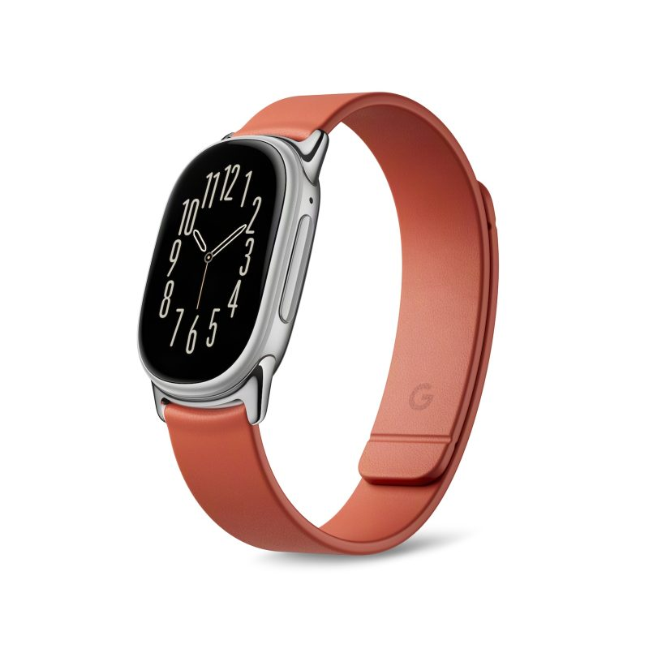
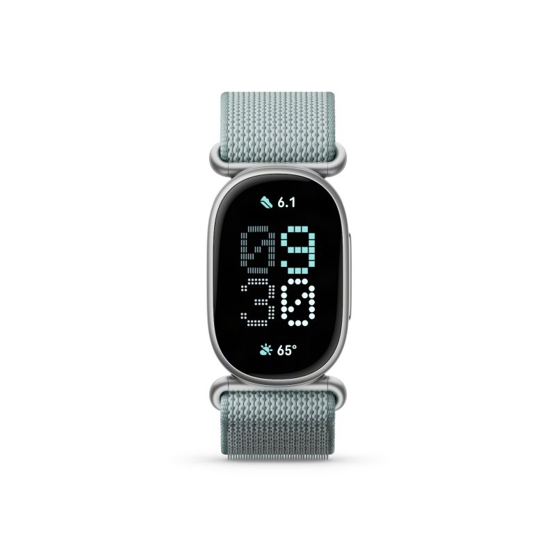
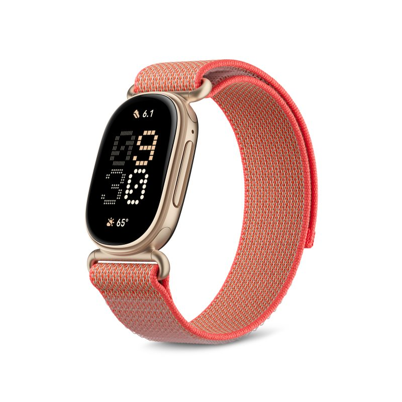
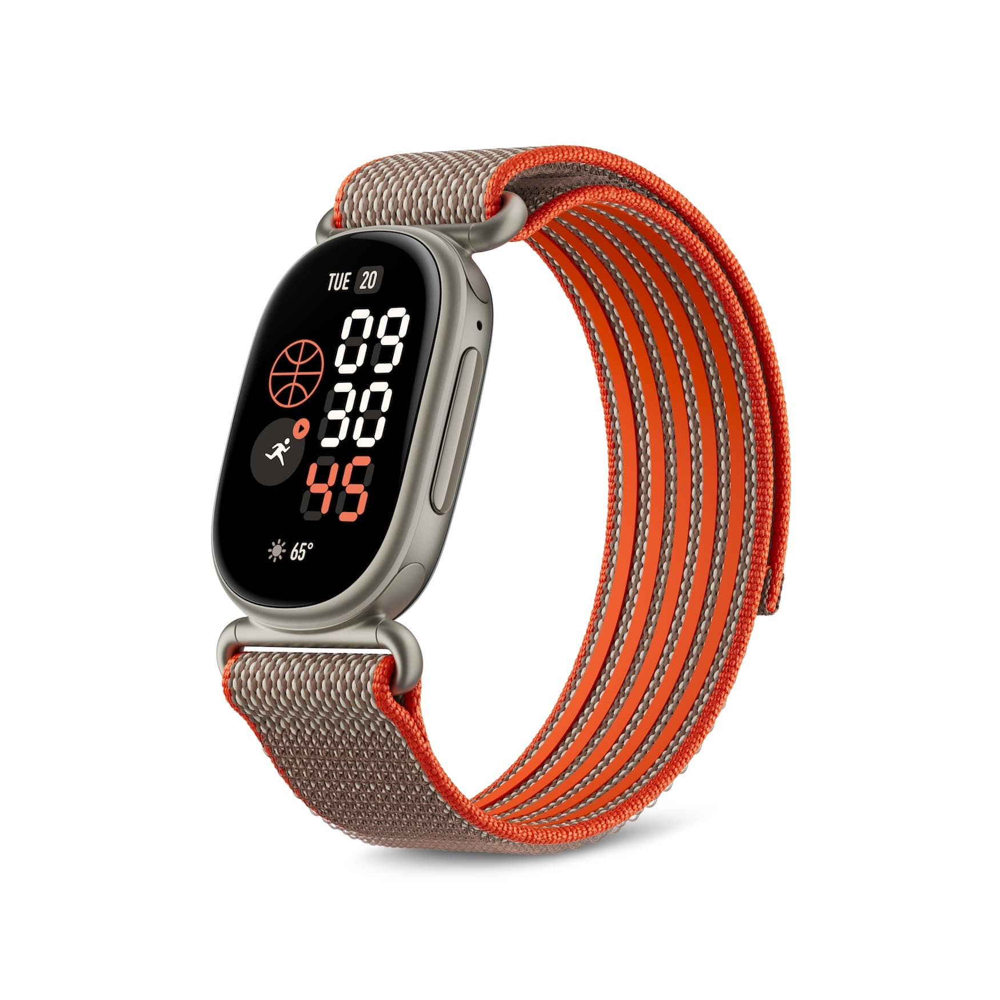

Google ha hecho oficial el **Fitbit Edge**, su segundo pulsómetro con pantalla del año
después del Fitbit Air que llegó en mayo. La propuesta es la misma que la de esa familia
—una pulsera de seguimiento de actividad, no un reloj completo— pero con una pantalla
mucho más generosa y un cuerpo pensado para el deporte al aire libre.

El cambio que más se nota en la muñeca es precisamente ese: una pantalla AMOLED alargada,
con forma de pastilla, protegida por Gorilla Glass 3, que ofrece un **46 % más de superficie
visible** que la del Charge 6 de 2023. Es la clase de diferencia que separa «mirar la hora»
de «leer una notificación sin sacar el móvil».

## Qué hay dentro (y por qué importa)

El cuerpo mide 11,5 mm de grosor y está fabricado en aluminio, con una técnica de
nano-moldeado que, según Google, hace que el **GPS sea un 40 % más preciso** que el del
Charge 6. También incorpora un **altímetro dedicado** para medir el desnivel, algo que se
agradece al hacer senderismo o trail y que antes se resolvía con estimaciones. En el lado
derecho hay un botón grande para controlar el dispositivo de forma táctil, útil cuando
tienes las manos mojadas —por ejemplo, al nadar—. El conjunto tiene protección **IP68 y
5ATM** frente al polvo y el agua.

En la cara inferior están los sensores: acelerómetro, altímetro, sensor de luz ambiental,
sensor de temperatura cutánea de campo lejano, giroscopio, sensor de frecuencia cardíaca,
sensores eléctricos multiuso (**ECG**) y sensores rojo e infrarrojo (**SpO2**). Conviene
recordarlo: son métricas de bienestar, no diagnósticos médicos, y ninguna de ellas
sustituye a una consulta profesional.

La batería es uno de los apartados donde el Edge se juega su utilidad real. Google la cifra
en **una semana con la pantalla siempre activa desactivada**, y esa cifra se queda en torno
a **dos días** en cuanto enciendes el AOD. Es la misma letra pequeña de siempre: la
autonomía anunciada no es la que vas a ver con la pantalla encendida todo el día. La carga
se hace con el cargador magnético USB-C del Fitbit Air, **cinco minutos dan para un día de
uso** y una carga completa ronda los 90 minutos. Además, como en el Pixel Watch 5, se puede
abrir el dispositivo para **reemplazar la batería**.

## Lo que puedes hacer con él (y lo que no)

El Edge funciona con Android e iOS y corre un sistema Fitbit similar al del Air, pero la
pantalla más grande habilita una interfaz más rica, con inspiración en el Pixel Watch 5.
Google mostró una docena larga de esferas, analógicas y digitales, con complicaciones que
se personalizan desde la app Google Health.

Deslizando a los lados desde la esfera se accede a los mosaicos —inicio rápido de
ejercicios, métricas de enfoque, sueño, corazón, salud del ciclo, clima, temporizadores,
alarmas y controles de música—, y su orden es configurable. Aquí hay una mejora clara
respecto al Charge 6: los **controles de música funcionan con cualquier app** del teléfono
emparejado, y también llegan las notificaciones. La app de ejercicio registra **más de 50
tipos de actividad** con guía en tiempo real, y el dispositivo puede emitir la frecuencia
cardíaca a equipos compatibles.

Ahora, las limitaciones, que son las que deciden la compra. Las **respuestas rápidas a
mensajes se quedan en Android** por restricciones de iOS. Hay navegación con Google Maps,
pero **no hay Google Wallet** porque el Edge tampoco tiene NFC: si pagas con el reloj, este
no es tu dispositivo. La detección automática de actividad, eso sí, mejora con el mismo
razonamiento contextual «con IA» que el Air, aprende tus hábitos y promete cubrir más de
100 actividades. Fitbit Air, Edge y Pixel Watch 5 pueden convivir en la misma cuenta con
cambio fluido entre ellos.

## Precio, correas y disponibilidad

El Fitbit Edge cuesta **179,99 dólares**, con reservas abiertas desde hoy y **disponibilidad
el 27 de octubre**. Llega en cuatro combinaciones: aluminio negro mate con correa Obsidian,
aluminio plata pulida con correa Fog, aluminio pirita satinada con correa Olive y oro
champán con correa Canyon. Hay una **Stephen Curry Special Edition por 219,99 dólares** con
correa personalizada.

Las correas se cambian con un nuevo mecanismo de intercambio y hay cuatro diseños
adicionales: Active Sport (silicona extra suave con grandes perforaciones) por 39,99
dólares, Magnet Band (sin cierre, con imanes integrados) por 59,99, Metal Links por 149,99
y Performance Loop (elástica y microajustable) por 49,99.

Algunos de esos acabados, en imágenes:

La Stephen Curry Special Edition añade su propia correa personalizada:

La decisión, como siempre, depende de una sola pregunta: **¿vas a usarlo de verdad?** Si
quieres seguir entrenamientos con GPS fiable, controlar el sueño y llevar una pantalla que
se lee al sol sin renunciar a una semana de batería —y no te importa no poder pagar con la
muñeca—, el Edge es una opción sensata dentro de su gama. Si lo que buscas es un reloj
completo, con NFC, apps de terceros y pagos, este Fitbit no es ese producto: ahí toca mirar
hacia otro segmento.
