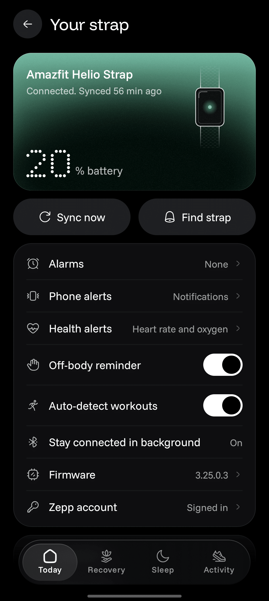

El **Amazfit Helio Strap** siempre ha llevado dentro un motor de vibración, pero la app **Zepp** apenas lo aprovecha: avisa del emparejamiento y de la batería baja, y poco más. La banda no vibra cuando entra una llamada ni cuando llega un mensaje, algo que se da por hecho en casi cualquier ponible conectado. Un proyecto independiente ha demostrado que no es una limitación del hardware: **OpenStrap**, una aplicación no oficial para Android, hace vibrar la banda con las llamadas entrantes y con las notificaciones del teléfono.

La novedad llega con la versión **2.0.0** de OpenStrap, publicada el 24 de octubre, cuyas notas de publicación incluyen la vibración para llamadas y avisos «con elección de patrón». El medio especializado [Gadgets & Wearables](https://gadgetsandwearables.com/2026/10/26/helio-strap-phone-alerts-third-party-app/) lo recogió el 26 de octubre en un artículo firmado por Ivan Jovin, en el que también plantea por qué Zepp Health ha dejado esa función fuera.

## Qué añade OpenStrap al Amazfit Helio Strap

OpenStrap no pasa por los servidores de Zepp: se comunica directamente con la banda por Bluetooth. El proyecto nació de ingeniería inversa sobre el protocolo que usa el Helio Strap, y ese trabajo es lo que ha permitido llegar a funciones que la aplicación oficial no expone. Según las notas de la versión 2.0.0, la vibración admite varios patrones, de modo que el aviso de una llamada no tiene por qué vibrar igual que el de un mensaje.

La misma actualización añade entrenamientos controlados desde el teléfono: elegir deporte, ver la frecuencia cardiaca en directo sobre un arco de zonas, recibir un aviso háptico al salir de la zona objetivo, registrar la ruta con GPS y cerrar con un resumen del esfuerzo. Es decir, la vibración no se queda en los avisos del móvil, también sirve como señal durante el ejercicio.

Antes de instalarla conviene tener claras tres condiciones. Es una **app no oficial**, sin respaldo de Zepp Health. Requiere **Android 9 o superior**. Y el **primer emparejamiento sigue pasando por la app Zepp**, que se encarga de la autenticación inicial de la banda; sin ese paso previo, OpenStrap no tiene con qué trabajar.

## Por qué Zepp lo dejó fuera

El Helio Strap lleva una batería de **232 mAh**, suficiente para hasta **10 días de uso típico**, una de sus mejores cartas frente a relojes con pantalla. Ese dato es también la explicación más repetida: hacer vibrar el motor unas pocas veces al día por avisos del sistema no se parece a hacerlo por cada llamada, mensaje, correo y notificación de aplicación, sobre todo en un teléfono que genera decenas de avisos diarios.

Conviene subrayarlo: **Zepp Health no ha explicado públicamente por qué no ofrece la función**, así que la autonomía es una hipótesis razonable, no una razón confirmada. Hay una segunda explicación igual de plausible y menos técnica: la compañía ha colocado el Helio Strap como banda de salud, recuperación y entrenamiento, no como reloj inteligente. Añadir avisos del teléfono difumina esa frontera y acerca el producto a una categoría que no quiere ocupar.

## Lo que no cambia

La vibración con avisos es una comodidad, no una ampliación de lo que la banda mide. Los indicadores de salud y recuperación siguen siendo los que calcula Zepp con los datos del dispositivo: OpenStrap los lee y los presenta en su interfaz, pero no hay validación independiente de esas métricas ni equivalencia garantizada con lo que muestra la aplicación oficial. Tampoco hay que leerlo como consejo médico.

Falta además el dato que más pesa en el día a día: **nadie ha medido la autonomía real con las notificaciones activadas**. Los 10 días anunciados corresponden al uso típico con la vibración casi en reposo, así que el lector debe esperar menos y comprobarlo por su cuenta. A eso se suma lo habitual en un proyecto independiente: sin soporte, sin garantía de que una actualización de firmware deje de romper la conexión y con la gestión de datos en manos de sus autores. En ese terreno la app oficial también se mueve: prepara [controles para decidir qué datos de salud suben a la nube](/noticias/amazfit-zepp-cloud-data-controls/).

Por último, no hay que confundir versiones. La **2.1.0**, publicada el 25 de octubre, es otra novedad: añade widgets de pantalla de inicio en tres tamaños. Los avisos de llamadas y notificaciones llegaron con la 2.0.0 del día anterior.

Si el Helio Strap te sirve como banda de salud y lo que te faltaba era enterarte de una llamada sin sacar el móvil del bolsillo, esta es la vía disponible hoy, con las cautelas de una app no oficial. Si necesitas soporte del fabricante o una cifra de autonomía contrastada, espera: Zepp no ha dicho nada y nadie ha medido cuánto dura la batería vibrando todo el día.
