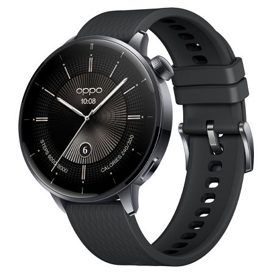
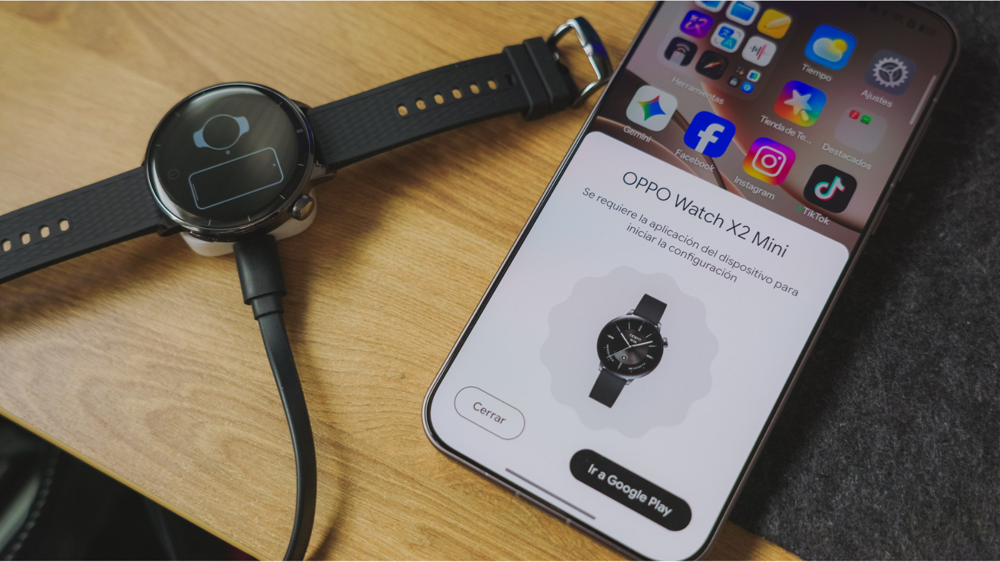

El problema de buena parte de los relojes con Wear OS no está en la pantalla ni en las aplicaciones: está en que, sobre una muñeca pequeña, acaban pareciendo un ladrillo con correa. El OPPO Watch X2 Mini se diseñó justo para lo contrario, y ahora es más fácil justificar la compra: PcComponentes lo vende por 229,99 euros, frente a los 299,99 euros que costaba antes. Son 70 euros de descuento, alrededor de un 23 %.

## El OPPO Watch X2 Mini: una caja contenida que cambia el uso diario

El dato que de verdad altera la experiencia no es el procesador, sino el tamaño. La pantalla AMOLED mide 1,32 pulgadas y la ficha del minorista sitúa la caja en 43 mm, una medida discreta frente a los relojes de 46 y 47 mm que dominan el catálogo actual. En la muñeca, eso se traduce en una correa que se ajusta sin que la caja sobresalga por los lados y en una manga que no se engancha cada vez que levantas el brazo.

Lo interesante es que ese formato no obliga a renunciar a lo importante. No estamos ante un reloj básico que solo cuenta pasos.

## Precio, condiciones y disponibilidad

La oferta corresponde a una variante concreta, no a toda la gama del modelo:

- **Precio actual:** 229,99 euros.
- **Precio anterior:** 299,99 euros.
- **Descuento:** 70 euros.
- **Tienda:** PcComponentes.
- **Unidad:** caja de 43 mm en acabado Nebula Black, con Wi-Fi, Bluetooth, GPS y NFC.

Conviene revisar en la ficha que el color y la conectividad son los que buscas antes de confirmar el pedido: el descuento se aplica a esa unidad y no hay que dar por hecho que se extienda a otras configuraciones.

## Wear OS y NFC: lo que se usa de verdad

Wear OS da acceso a las aplicaciones de Google y permite consultar indicaciones en Maps mientras caminas, vas en bicicleta o usas el transporte público. También sirve para gestionar llamadas, leer mensajes y controlar la música sin sacar el teléfono del bolsillo. Son funciones que se agradecen más de lo que parece cuando se convierten en rutina.

El NFC es el otro detalle que justifica el desembolso para muchos usuarios: pagar acercando la muñeca al terminal resulta cómodo siempre que haya un servicio de pago compatible configurado, algo que se resuelve desde Google Wallet.

En el apartado deportivo incluye más de 100 modos de entrenamiento y un modo Pro Running que registra oscilación vertical, tiempo de contacto con el suelo y equilibrio de la zancada. Son métricas útiles para quien sale a correr con regularidad; para quien solo camina y quiere ver su actividad diaria, probablemente no serán determinantes. El reloj mide frecuencia cardíaca, permite consultar el oxígeno en sangre y registra parámetros de sueño y estrés, además de avisar de posibles problemas respiratorios durante el descanso. Completa la ficha con resistencia al agua de 5 ATM y certificación IP68.

## Para quién sí y para quién no

Tiene sentido si llevas tiempo buscando un reloj con Wear OS que no te quede grande, si quieres pagar con la muñeca y si no te apetece gastar por encima de los 300 euros. Es un perfil muy concreto: muñeca pequeña, uso mixto de notificaciones y deporte ligero, y predilección por el ecosistema de Google.

No es la compra adecuada si necesitas conectividad móvil propia, porque esta unidad se queda en Wi-Fi y Bluetooth, ni si vienes de un Garmin con dos semanas reales de batería. Tampoco si buscas el reloj más potente de OPPO: la marca tiene modelos con más ambición en acabados y, si el presupuesto no es el problema, conviene comparar antes con otras alternativas al smartwatch convencional.

## La autonomía, el punto flojo

OPPO anuncia hasta siete días en determinadas condiciones, pero el propio medio que publica la oferta advierte de que la cifra real es inferior. Con Wear OS, el consumo depende del uso de la pantalla, de las aplicaciones y de las funciones de seguimiento que dejes activas. La parte buena es que, al ser un reloj más pequeño, tiende a aguantar más encendido que otros modelos con el sistema de Google.

## Veredicto

Si buscas un Wear OS compacto, con NFC y a un precio contenido, esta es una de las pocas opciones que no te obliga a elegir entre funciones y tamaño: a 229,99 euros, el OPPO Watch X2 Mini tiene sentido. Si lo que necesitas es autonomía de dos semanas, conectividad propia o métricas de entrenamiento avanzadas, espera y mira otras opciones: este reloj no está pensado para eso. Para quien ya tenga un reloj de OPPO y quiera saber por dónde va el software de la marca, la [experiencia del OPPO Watch S2 con ColorOS Watch 17](/noticias/oppo-watch-s2-coloros-watch-17/) da contexto sobre el ecosistema.
