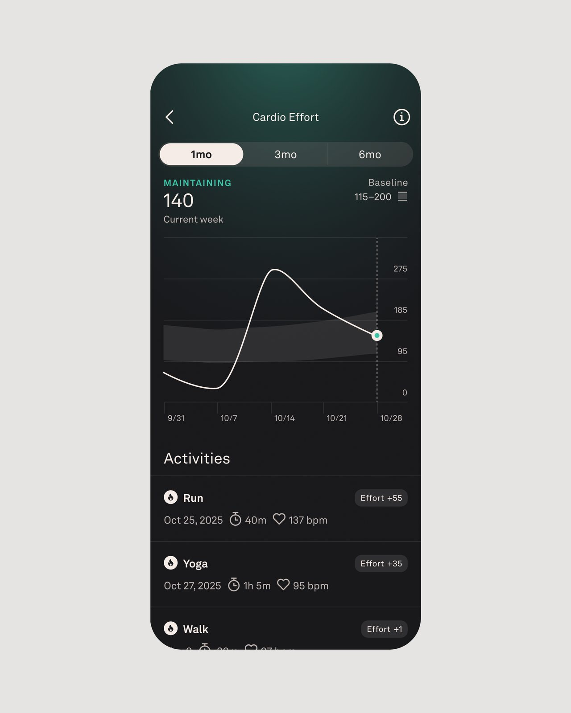

**Oura incorpora Cardio Effort para contextualizar la carga cardiovascular de la semana y prueba una estimación automática del VO2 max.** Son dos lecturas distintas: una resume el esfuerzo de las actividades registradas; la otra estima la capacidad aeróbica a partir de sesiones con GPS. La marca presentó ambas novedades el 20 de octubre, pero la segunda sigue siendo experimental dentro de Oura Labs.

## Cardio Effort compara la semana con el historial personal

Según Oura, Cardio Effort combina duración e intensidad y utiliza la respuesta de la frecuencia cardiaca cuando hay datos suficientes. No equivale a contar pasos ni a medir la dificultad muscular de una sesión: un entrenamiento de fuerza exigente puede generar menos carga cardiovascular que otra actividad con el pulso elevado durante más tiempo.

La carga se acumula desde el comienzo de la semana y se compara con un rango personal basado en la actividad reciente. La aplicación la sitúa en cinco bandas, desde Light hasta Reaching, pasando por Fair, Maintaining y Building. **No es una nota sobre cien ni un número que haya que maximizar.** Maintaining representa una carga próxima al nivel habitual, no un objetivo fallido.

Las actividades añadidas manualmente también pueden recibir una estimación, identificada como tal. Esa distinción importa cuando faltan lecturas del pulso: el registro sigue aportando contexto, pero no debe confundirse con una sesión documentada con todos sus datos.

## El VO2 max automático necesita cinco actividades válidas

La función automática de VO2 max está disponible en Oura Labs para **Oura Ring Gen3 y posteriores**. Tras activarla, requiere cinco actividades válidas con GPS, entre ellas caminar, correr o hacer senderismo, para proporcionar la primera estimación. Son cinco sesiones que cumplen los requisitos, no cinco modalidades deportivas diferentes.

Oura presenta esta opción como alternativa al test específico de caminata de seis minutos. En el espacio de salud cardiaca de la aplicación se muestran la estimación, su categoría y la evolución temporal. Más actividades válidas pueden actualizarla, aunque la marca advierte de que no tiene por qué cambiar después de cada entrenamiento.

## Una ayuda para interpretar tendencias, no un diagnóstico

El cambio práctico es poder observar por separado qué esfuerzo se ha acumulado y cómo evoluciona la capacidad aeróbica estimada. Como explicamos al abordar [el VO2 max y los datos de los wearables](/noticias/vo2-max-estrategias-datos-wearables/), el contexto de la medición importa tanto como el número.

Oura Labs reúne funciones en desarrollo que pueden cambiar con los comentarios de sus usuarios. **La estimación del anillo no es una prueba clínica de consumo de oxígeno ni un diagnóstico médico.** La aplicación permite guardar resultados externos de laboratorio u otros dispositivos, pero esos registros permanecen separados y no sustituyen su estimación automática.

*Imágenes: Oura. La vista de Cardio Effort procede de una animación oficial y se reproduce como fotograma estático.*
