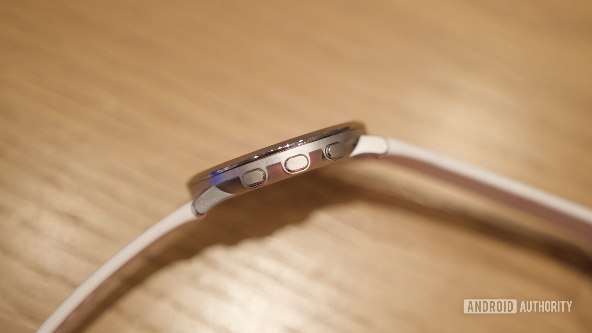

El Pebble Round 2 todavía no ha llegado a sus compradores, pero quien lo ha llevado durante meses ya tiene una opinión formada. Un beta tester ha publicado un vídeo en YouTube con sus impresiones de uso diario, y el balance es muy positivo: un reloj redondo, delgado y cómodo que, puesto junto a rivales más gruesos, los deja en evidencia. Conviene precisar de qué producto hablamos: este es el reloj de muñeca Pebble Round 2, no el [anillo Pebble Index 01](/noticias/wearables/anillo-pebble-sin-carga/), la otra propuesta de la marca, que no tiene nada que ver con él.

## Diseño fino y cómodo: el punto fuerte del Pebble Round 2

El vídeo lo firma Nick Lum, un probador que asegura tener una unidad idéntica a las que se enviarán a los clientes, y lo compara cara a cara con el Pebble Time 2 y con el Garmin Forerunner 165. Según recoge Notebookcheck, la conclusión es clara a favor del Round 2 por grosor: mide 8,1 mm, bastante menos que buena parte de sus competidores. En la muñeca, esa diferencia se traduce en algo concreto: el reloj se cuela bajo la manga de una camisa sin engancharse.

A ello contribuye que no incorpora sensor de ritmo cardíaco, lo que permite que el cuerpo quede completamente plano sobre la piel. Lum añade que, después de meses de uso diario, la unidad sigue como nueva, y que desde que tiene el Round 2 apenas se ha puesto el Time 2.

## Botones que a veces no responden

El punto negativo del vídeo tiene que ver con los botones físicos: a veces dan la sensación de haberse pulsado sin que el reloj registre la orden. Lum comenta que lo habló con el fundador de Pebble, Eric Migicovsky, y que el problema también apareció en una unidad de reemplazo. Parece depender en parte de cómo se pulsa, pero es un fallo que puede resultar molesto en el uso diario.

## Autonomía irregular: entre 5 y 14 días

La batería ha sido otro apartado inconsistente durante las pruebas. El probador ha registrado cifras que van de los 5 a los 14 días según la configuración, y posiblemente según las actualizaciones de software que se fueron instalando en ese periodo. Su último dato es de unos 10 días, en el extremo bajo de los 10 a 14 días que anuncia Pebble.

Para estirar la autonomía, recomienda evitar las esferas que muestran los segundos y desactivar el monitor de progreso en la aplicación de música. Son dos ajustes sencillos que, según su experiencia, marcan la diferencia.

## Precio, retraso y disponibilidad

El Pebble Round 2 cuesta 199 dólares. Su envío estaba previsto para mayo, pero los problemas de producción obligaron a retrasarlo. Ahora, según Notebookcheck, la fabricación ya ha arrancado, aunque la mayoría de los clientes podría no recibir su reloj hasta diciembre.

Para quien siga esperando, estas impresiones son en su mayoría tranquilizadoras: el diseño y la comodidad cumplen lo prometido. La duda es si esos botones esquivos bastan para empañar el resto.

La recomendación es la de siempre en este segmento: si buscas un reloj fino, ligero y con recargas poco frecuentes, el Round 2 apunta a cumplir; si dependes del seguimiento de pulso continuo o de métricas de salud deportivas, este no es tu reloj, porque renuncia al sensor de ritmo cardíaco. Y si los botones forman parte de tu uso diario, conviene esperar a las primeras unidades de serie para confirmar que el fallo se corrigió.
