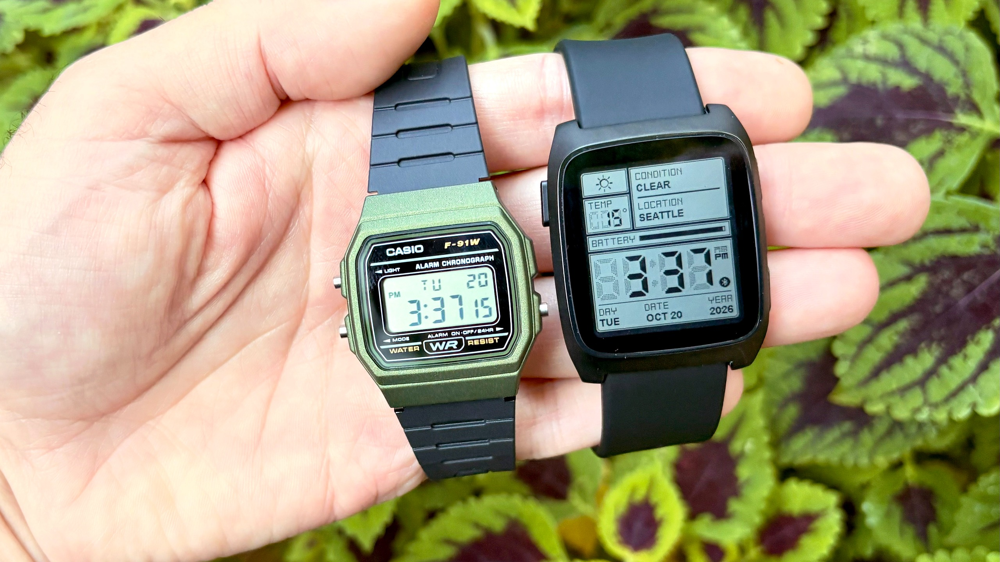
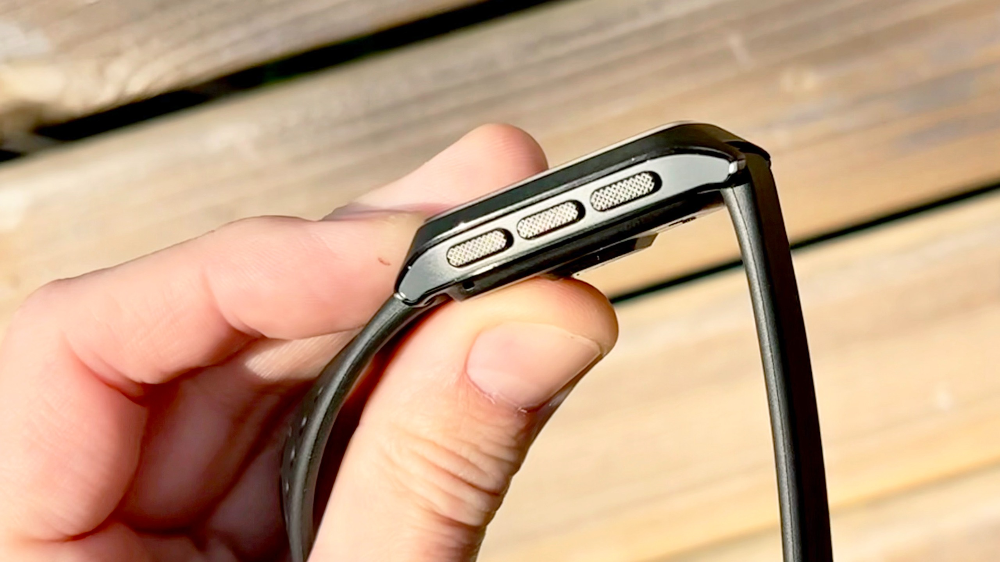
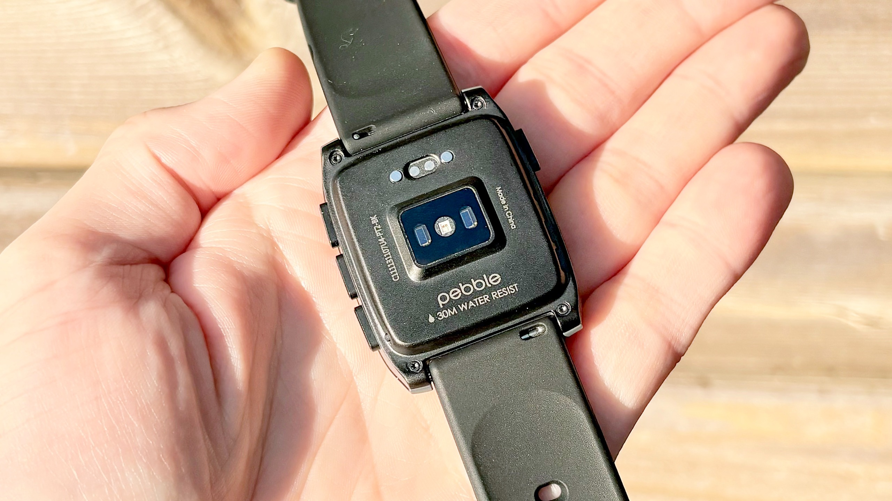

El Pebble Time 2 no compite por la ficha técnica. Es un reloj pensado para consultar la hora, leer notificaciones y entretenerse un rato, y que a cambio promete algo que casi ningún rival puede igualar: semanas sin pasar por el cargador. Tom's Guide ha publicado sus primeras impresiones tras un uso breve, y el balance apunta a que su atractivo está menos en lo que mide y más en cómo se siente en la muñeca.

## Pebble Time 2: un reloj que no se parece a los demás

La caja es rectangular y combina acero inoxidable con plástico. El resultado recuerda a los relojes digitales de finales de los ochenta y principios de los noventa, una referencia que el medio estadounidense ilustra con el mítico Casio F-91W. No hay intento de imitar el lenguaje visual de un Apple Watch ni de un Galaxy Watch: el Pebble Time 2 asume su aire retro y lo convierte en parte de la propuesta.

La pantalla es la pieza que explica casi todo. Se trata de un panel de tinta electrónica de 1,5 pulgadas, con 64 colores y función táctil, que permanece siempre encendido. En luz solar directa se lee con una comodidad que un AMOLED no siempre consigue, aunque en determinadas condiciones de iluminación puede verse algo apagado o deslucido. Es el precio de una tecnología que prioriza el consumo sobre el brillo.

## Precio y disponibilidad

El precio que maneja Tom's Guide es de 225 dólares. El artículo no detalla la fecha exacta de lanzamiento ni los mercados en los que se venderá, de modo que la disponibilidad internacional sigue sin confirmarse. Tampoco se especifican las condiciones de envío ni si habrá versiones con distintos acabados.

En la muñeca, el reloj se apoya en cuatro botones físicos: tres en el lado derecho y uno de retroceso en el izquierdo. Todos tienen una textura estriada generosa y el conjunto transmite una sensación de construcción sólida. La pantalla está protegida por cristal Gorilla Glass, aunque sobresale por encima del bisel, algo que invita a pensar en posibles arañazos con el uso prolongado.

## Lo que funciona en el uso diario

La configuración inicial es rápida y funciona tanto con Android como con iOS. A partir de ahí, el gran argumento es PebbleOS, un sistema abierto y muy personalizable. Casi cualquier acción se puede asignar a una pulsación larga de un botón, y aunque la interfaz carece de las animaciones vistosas de watchOS o Wear OS, moverse por los menús resulta sencillo.

El ecosistema es otra de sus bazas: la tienda de Pebble reúne más de 10.000 esferas, aplicaciones y juegos, muchos de ellos gratuitos, y la instalación apenas requiere tiempo. Entre los juegos disponibles, el medio destaca Turbo Drift, un título de conducción con aire a Out Run, y menciona Pixel Miner, Strike Force y Rock Crusher como próximas pruebas.

La autonomía es la promesa más llamativa. Según Pebble, el reloj alcanza hasta 30 días por carga. Esa cifra se explica por lo que no lleva dentro: no hay pantalla AMOLED, ni GPS, ni antena celular. Son componentes que encarecen el producto y consumen batería, y su ausencia marca el tipo de reloj que es.

## Lo que no convence

El capítulo de salud es deliberadamente básico. El reloj incorpora un sensor de ritmo cardíaco continuo, un acelerómetro para contar pasos y registrar entrenamientos, y ofrece datos sobre la duración del sueño y las fases ligera y profunda. Es un nivel de seguimiento propio de una pulsera de entrada, no el de un reloj deportivo: sin GPS no hay trazado de rutas ni métricas avanzadas de entrenamiento.

La pantalla también tiene su contrapartida. Quien venga de un panel brillante notará que la tinta electrónica pierde viveza en interiores con poca luz, y el cristal elevado sobre el bisel es un punto débil para quien sea descuidado con los golpes. PebbleOS, por su parte, no aspira a la fluidez de las plataformas cerradas: quien busque animaciones y transiciones cuidadas no las va a encontrar aquí.

## Para quién tiene sentido y para quién no

Tiene sentido si buscas un reloj ligero de funciones, con una autonomía que te permita olvidarte del cargador durante semanas, y si te apetece trastear con esferas, aplicaciones y juegos sin depender de un ecosistema cerrado. También si el diseño retro te resulta atractivo en lugar de un defecto.

No tiene sentido si tu prioridad es el deporte con GPS, las métricas de salud avanzadas o una pantalla brillante y fluida. En ese caso, un reloj deportivo o un smartwatch completo encajan mejor. Quien prefiera un formato redondo y delgado tiene además el [Pebble Round 2](/noticias/wearables/pebble-round-2-reloj/), otro producto de la marca con un enfoque distinto.

## Qué queda por confirmar

Tom's Guide anuncia una review completa, así que varias preguntas siguen abiertas: cuánto dura realmente la batería con uso intensivo y pantalla siempre activa, qué precisión tienen el pulso y el seguimiento del sueño, cómo se comporta el cristal con el roce diario y hasta qué punto el catálogo de aplicaciones se mantiene actualizado. Tampoco hay confirmación sobre precios en euros ni sobre una fecha de venta en España. Hasta entonces, la propuesta se sostiene sobre una idea sencilla y poco habitual: menos funciones, mucha más autonomía.
