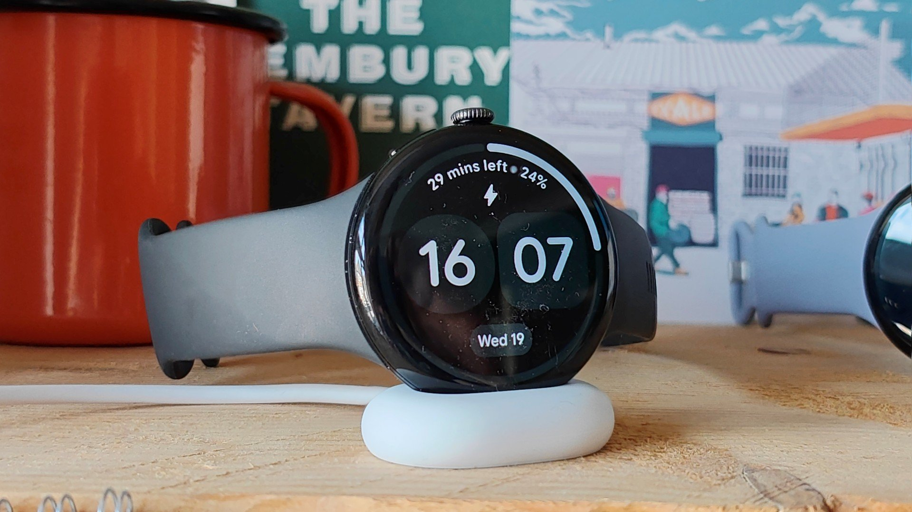

El Pixel Watch dejó de llegar a la noche. Durante la última semana, usuarios de varias generaciones del reloj vieron cómo la autonomía se hundía hasta unas 12 horas con el aparato prácticamente sin usar, y Google ya ha empezado a desplegar la solución. El detalle que importa en la muñeca es cómo llega: no hay que esperar una actualización de Wear OS, basta con actualizar las aplicaciones del reloj desde la Play Store. Google lo confirmó a *Android Authority* con este comunicado:

> «El arreglo del problema de consumo de batería, que afecta a un número reducido de usuarios del Pixel Watch, ha empezado a desplegarse y estará completo en los próximos dos días. Para aplicarlo, actualiza las aplicaciones del Pixel Watch pulsando la corona, abriendo la aplicación Play Store y tocando **Manage apps > Update all**.»

La cita está traducida del inglés; los nombres de menú son los que emplea Google en sus instrucciones.

## Un parche que llega por la puerta de las aplicaciones

Google no publica una actualización del sistema, sino una tanda de actualizaciones de aplicaciones que se instalan desde la tienda del propio reloj. *Android Police* lo señala de forma explícita, y esa vía explica dos cosas. La primera, que no haya un número de compilación de Wear OS que consultar para saber si ya lo tienes: la única pista es que la Play Store deje de ofrecer actualizaciones pendientes. La segunda, que el fallo encaje con un servicio en segundo plano o una aplicación de Wear OS que se comportaba mal, y no con un defecto de hardware repentino, que era la hipótesis que se manejaba cuando los avisos empezaron a acumularse.

Google no ha detallado qué aplicación provocaba el consumo. Tampoco ha publicado una nota de versión con el contenido del arreglo, así que la comprobación real es la de siempre: usar el reloj un día entero y mirar si vuelve a aguantar lo que aguantaba antes.

El episodio encaja con un reloj cuyo software lleva tiempo moviéndose por entregas: las funciones de salud también han llegado por actualizaciones de aplicación, como ocurrió con [Health Guardian en el Pixel Watch](/noticias/pixel-watch-health-guardian-gratis/).

## Qué modelos están afectados y cuánta autonomía se pierde

Las cifras que manejan los medios que han seguido el caso coinciden en lo esencial y discrepan en el alcance. *Android Authority* habla de «varias generaciones» y sitúa la autonomía en torno a 12 horas en equipos que apenas se usaban. *Android Police* acota los reportes a los modelos actualmente compatibles, del Pixel Watch 2 al Pixel Watch 5, y habla de 12 a 16 horas donde antes había casi dos días. *Tech Advisor* también limita el rango del Pixel Watch 2 al Pixel Watch 5 y describe caídas desde 24 o incluso 48 horas hasta 12.

La discrepancia está en el modelo más antiguo: la ficha del artículo de *Android Authority* incluye etiquetas del primer Pixel Watch, pero su texto no confirma que ese modelo esté afectado, y las otras dos coberturas arrancan en el Pixel Watch 2. Google, por su parte, se limita a hablar de «un número reducido de usuarios» sin dar una lista de modelos, así que la referencia más segura es la del Pixel Watch 2 en adelante.

*El Pixel Watch 5, sobre su cargador. Imagen: Chris Martin / Foundry, vía Tech Advisor.*

## Cómo comprobar si tu Pixel Watch ya tiene el arreglo

Estos son los pasos que indica Google, en el orden exacto de sus instrucciones:

1. Pulsa la corona para abrir la lista de aplicaciones del reloj.
2. Abre la aplicación **Play Store** en el Pixel Watch.
3. Toca **Manage apps** y después **Update all**. Si la interfaz del reloj está en español, los dos rótulos aparecen traducidos.
4. Deja el reloj en el cargador mientras se instalan las actualizaciones si la batería está baja; son varias descargas y conviene no quedarse a medias.
5. Reinicia el reloj al terminar. *Android Police* lo recomienda como cierre del proceso, aunque Google no lo menciona en su comunicado.

Para verificar el resultado no sirve buscar un parche del sistema: no lo hay. Lo práctico es dejar el día completo de uso, con la pantalla siempre activa en el mismo ajuste que llevabas y el seguimiento que uses habitualmente, y comparar el porcentaje restante al acostarte con el de los últimos días. Si sigue en torno a 12 horas tras una carga completa y un reinicio, o el despliegue todavía no ha llegado a tu unidad, o el consumo tiene otro origen.

## Qué queda pendiente

El despliegue es escalonado y Google calcula que estará completo en un par de días, así que es normal que la Play Store del reloj no muestre nada todavía: si no aparece ninguna actualización pendiente, toca volver a mirar más tarde. Tampoco hay fecha para un parche a nivel de sistema, porque el arreglo no va por esa vía, ni explicación oficial sobre la aplicación responsable.

Si tu Pixel Watch se ha quedado en 12 horas, actualiza las aplicaciones hoy y dale una carga completa antes de dar el reloj por gastado: el problema es de software y la solución ya está en circulación. Si tu unidad sigue aguantando lo de siempre, no hay nada que hacer, porque el fallo nunca te tocó. Y si después de actualizar y reiniciar la autonomía no vuelve a su nivel anterior, el siguiente paso pasa por revisar qué aplicaciones siguen activas en segundo plano antes de asumir que la batería está degradada.
